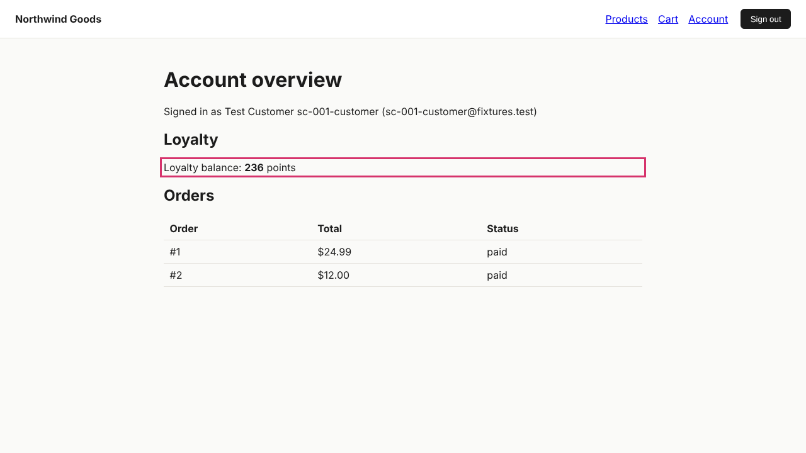

# SC-001 Welcome points are granted on the first order only

**Verdict: FAILED** — A2: expected 136, got 236

- Steps chosen by: Claude subagent (Opus) via HTTP bridge
- Environment: http://localhost:3001, commit seeded-bug
- Started 2026-11-17T23:44:21.416Z, took 75.8 s, 27 tool calls
- Basis: requirement; requirements REQ-1, REQ-2, REQ-6

## Objective

Verify that a customer who has never ordered is credited the welcome bonus when their first order is paid, and is not credited it again when their second order is paid. Note each order's total when it is shown before payment.

## Assertions

Expected values were fixed in the plan; actual values were read and compared in code.

| Id | What | Expected (plan) | Expected (evaluated) | Actual | Result | Evidence |
|---|---|---|---|---|---|---|
| A1 | Loyalty balance on the account overview after the first paid order | `100 + floor(firstOrderTotal)` | 124 | 124 | match | [check-A1.png](check-A1.png) |
| A2 | Loyalty balance on the account overview after the second paid order | `100 + floor(firstOrderTotal) + floor(secondOrderTotal)` | 136 | 236 | **MISMATCH** | [check-A2.png](check-A2.png) |

## Observations

- `firstOrderTotal` = 24.99
- `secondOrderTotal` = 12

## Steps

| # | Tool | Input | Outcome | Stated reason |
|---|---|---|---|---|
| 1 | navigate | {"path":"/"} | URL: / | Discover the app entry page. |
| 2 | navigate | {"path":"/login"} | URL: /login | Sign in as the fixture customer. |
| 3 | fill | {"element":{"by":"label","value":"Email"},"text":"sc-001-customer@fixtures.test"} | URL: /login | Enter fixture email. |
| 4 | fill | {"element":{"by":"label","value":"Password"},"text":"pw-sc-001-customer"} | URL: /login | Enter fixture password. |
| 5 | click | {"element":{"by":"role","role":"button","value":"Sign in"}} | URL: /login | Submit login. |
| 6 | navigate | {"path":"/account"} | URL: /login | See starting account overview. |
| 7 | click | {"element":{"by":"role","role":"link","value":"Account"}} | URL: /login | Open account overview to see starting state. |
| 8 | navigate | {"path":"/"} | URL: / | Go to products to build first order. |
| 9 | click | {"element":{"by":"role","role":"button","value":"Add Canvas Tote Bag to cart"}} | URL: / | Add an item for the first order. |
| 10 | navigate | {"path":"/cart"} | URL: /cart | Proceed to cart for checkout. |
| 11 | click | {"element":{"by":"role","role":"link","value":"Proceed to checkout"}} | URL: /cart | Go to checkout where the order total is shown before payment. |
| 12 | navigate | {"path":"/checkout"} | URL: /checkout | Open checkout page to see order total before payment. |
| 13 | observe | {"name":"firstOrderTotal","target":{"source":"page","by":"text","value":"Order total:","pattern":"Order total:\\s*\\$?([0-9.]+)"}} | Recorded firstOrderTotal = 24.99 | Record the first order total shown before payment. |
| 14 | fill | {"element":{"by":"label","value":"Card number"},"text":"4242 4242 4242 4242"} | URL: /checkout | Enter the accepted simulated card. |
| 15 | click | {"element":{"by":"role","role":"button","value":"Pay now"}} | URL: /checkout | Pay the first order. |
| 16 | navigate | {"path":"/account"} | URL: /account | Check loyalty balance after first paid order. |
| 17 | check | {"assertionId":"A1","target":{"source":"page","by":"text","value":"Loyalty balance:","pattern":"Loyalty balance:\\s*([0-9]+)"}} | Recorded A1: expected 124, actual 124 -> match. This result is final. | First order is paid; account overview shows loyalty balance. |
| 18 | navigate | {"path":"/"} | URL: / | Build second order. |
| 19 | click | {"element":{"by":"role","role":"button","value":"Add Notebook, Dotted A5 to cart"}} | URL: / | Add an item for the second order. |
| 20 | navigate | {"path":"/cart"} | URL: /cart | Verify cart contents for second order. |
| 21 | navigate | {"path":"/checkout"} | URL: /checkout | See second order total before payment. |
| 22 | observe | {"name":"secondOrderTotal","target":{"source":"page","by":"text","value":"Order total:","pattern":"Order total:\\s*\\$?([0-9.]+)"}} | Recorded secondOrderTotal = 12 | Record the second order total shown before payment. |
| 23 | fill | {"element":{"by":"label","value":"Card number"},"text":"4242 4242 4242 4242"} | URL: /checkout | Enter the accepted simulated card. |
| 24 | click | {"element":{"by":"role","role":"button","value":"Pay now"}} | URL: /checkout | Pay the second order. |
| 25 | navigate | {"path":"/account"} | URL: /account | Check loyalty balance after second paid order. |
| 26 | check | {"assertionId":"A2","target":{"source":"page","by":"text","value":"Loyalty balance:","pattern":"Loyalty balance:\\s*([0-9]+)"}} | Recorded A2: expected 136, actual 236 -> MISMATCH. This result is final. | Second order is paid; account overview shows loyalty balance. |
| 27 | finish | {"outcome":"completed","reason":"Both orders paid with card 4242; A1 and A2 checked against the account overview loyalty balance."} | Scenario ended. | All assertions have been checked. |

## Evidence

- Playwright trace: `trace.zip` (open with `npx playwright show-trace`)
- A1: 
- A2: 
