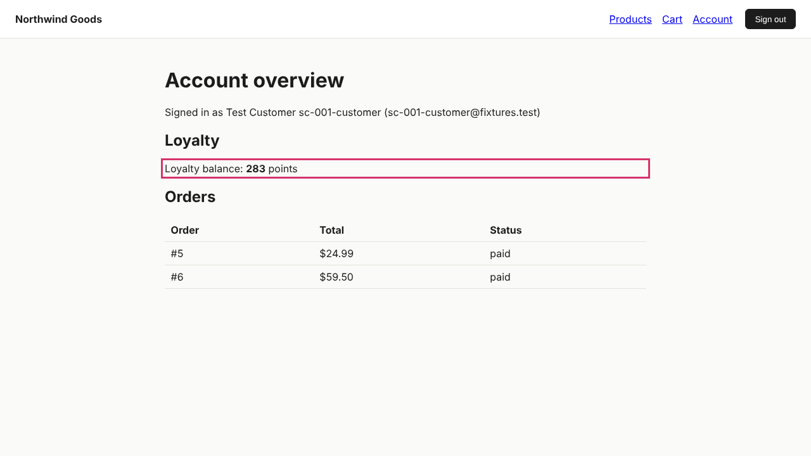

# SC-001 Welcome points are granted on the first order only

**Verdict: FAILED** — A2: expected 183, got 283

- Steps chosen by: Claude subagent (Opus) via HTTP bridge
- Environment: http://localhost:3001, commit seeded-bug
- Started 2026-11-17T23:46:27.247Z, took 69.9 s, 24 tool calls
- Basis: requirement; requirements REQ-1, REQ-2, REQ-6

## Objective

Verify that a customer who has never ordered is credited the welcome bonus when their first order is paid, and is not credited it again when their second order is paid. Note each order's total when it is shown before payment.

## Assertions

Expected values were fixed in the plan; actual values were read and compared in code.

| Id | What | Expected (plan) | Expected (evaluated) | Actual | Result | Evidence |
|---|---|---|---|---|---|---|
| A1 | Loyalty balance on the account overview after the first paid order | `100 + floor(firstOrderTotal)` | 124 | 124 | match | [check-A1.png](check-A1.png) |
| A2 | Loyalty balance on the account overview after the second paid order | `100 + floor(firstOrderTotal) + floor(secondOrderTotal)` | 183 | 283 | **MISMATCH** | [check-A2.png](check-A2.png) |

## Observations

- `firstOrderTotal` = 24.99
- `secondOrderTotal` = 59.5

## Steps

| # | Tool | Input | Outcome | Stated reason |
|---|---|---|---|---|
| 1 | navigate | {"path":"/"} | URL: / | Discover the app entry page. |
| 2 | navigate | {"path":"/login"} | URL: /login | Sign in as the test customer. |
| 3 | fill | {"element":{"by":"role","role":"textbox","value":"Email"},"text":"sc-001-customer@fixtures.test"} | URL: /login | Enter customer email. |
| 4 | fill | {"element":{"by":"role","role":"textbox","value":"Password"},"text":"pw-sc-001-customer"} | URL: /login | Enter customer password. |
| 5 | click | {"element":{"by":"role","role":"button","value":"Sign in"}} | URL: /account | Submit login. |
| 6 | navigate | {"path":"/"} | URL: / | Go to products to add an item. |
| 7 | click | {"element":{"by":"role","role":"button","value":"Add Canvas Tote Bag to cart"}} | URL: /cart | Add first order item. |
| 8 | navigate | {"path":"/cart"} | URL: /cart | Open cart to check out. |
| 9 | click | {"element":{"by":"role","role":"link","value":"Proceed to checkout"}} | URL: /checkout | Go to checkout for first order. |
| 10 | observe | {"name":"firstOrderTotal","target":{"source":"page","by":"role","role":"strong","value":"$24.99"}} | error: Error: Expected exactly one element for {"source":"page","by":"role","role":"strong","value":"$24.99"}, found 0. | Record first order total shown before payment. |
| 11 | observe | {"name":"firstOrderTotal","target":{"source":"page","by":"text","value":"Order total:","pattern":"\\$([0-9.]+)"}} | Recorded firstOrderTotal = 24.99 | Record first order total shown before payment. |
| 12 | fill | {"element":{"by":"role","role":"textbox","value":"Card number"},"text":"4242 4242 4242 4242"} | URL: /checkout | Enter accepted test card. |
| 13 | click | {"element":{"by":"role","role":"button","value":"Pay now"}} | URL: /account?order=5 | Pay the first order. |
| 14 | navigate | {"path":"/account"} | URL: /account | Reload account overview to confirm balance after first order. |
| 15 | check | {"assertionId":"A1","target":{"source":"page","by":"text","value":"Loyalty balance:","pattern":"([0-9]+)"}} | Recorded A1: expected 124, actual 124 -> match. This result is final. | Check loyalty balance after first paid order. |
| 16 | navigate | {"path":"/"} | URL: / | Go to products for second order. |
| 17 | click | {"element":{"by":"role","role":"button","value":"Add Ceramic Pour-Over Set to cart"}} | URL: /cart | Add second order item. |
| 18 | navigate | {"path":"/checkout"} | URL: /checkout | Open checkout for second order. |
| 19 | observe | {"name":"secondOrderTotal","target":{"source":"page","by":"text","value":"Order total:","pattern":"\\$([0-9.]+)"}} | Recorded secondOrderTotal = 59.5 | Record second order total shown before payment. |
| 20 | fill | {"element":{"by":"role","role":"textbox","value":"Card number"},"text":"4242 4242 4242 4242"} | URL: /checkout | Enter accepted test card. |
| 21 | click | {"element":{"by":"role","role":"button","value":"Pay now"}} | URL: /account?order=6 | Pay the second order. |
| 22 | navigate | {"path":"/account"} | URL: /account | Reload account overview to confirm balance after second order. |
| 23 | check | {"assertionId":"A2","target":{"source":"page","by":"text","value":"Loyalty balance:","pattern":"([0-9]+)"}} | Recorded A2: expected 183, actual 283 -> MISMATCH. This result is final. | Check loyalty balance after second paid order. |
| 24 | finish | {"outcome":"completed","reason":"Both assertions checked: A1 matched (124), A2 mismatched (expected 183, actual 283)."} | Scenario ended. | All planned assertions have been checked. |

## Evidence

- Playwright trace: `trace.zip` (open with `npx playwright show-trace`)
- A1: 
- A2: 
