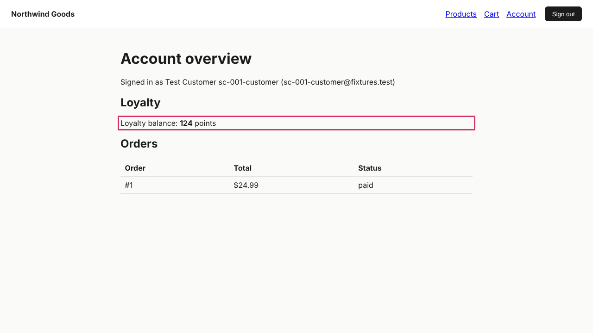
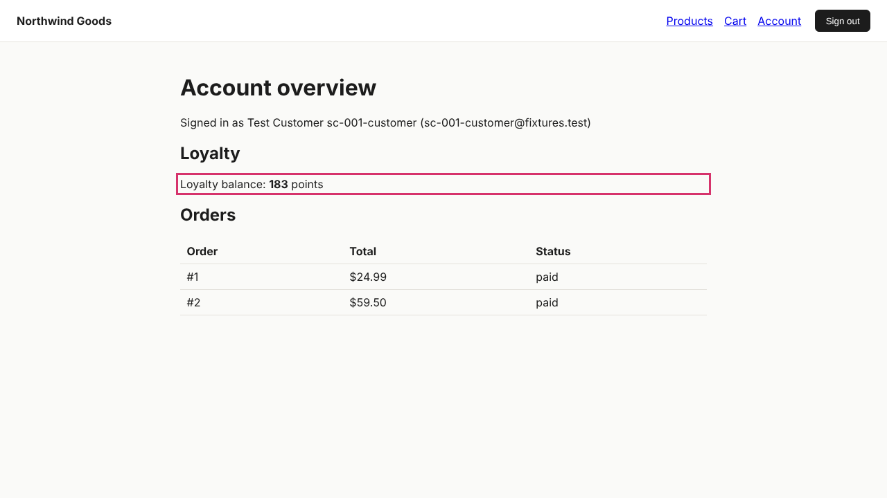

# SC-001 Welcome points are granted on the first order only

**Verdict: PASSED** — All 2 assertions matched.

- Steps chosen by: Claude subagent (Opus) via HTTP bridge
- Environment: http://localhost:3000, commit clean
- Started 2026-11-17T23:44:19.985Z, took 72.6 s, 27 tool calls
- Basis: requirement; requirements REQ-1, REQ-2, REQ-6

## Objective

Verify that a customer who has never ordered is credited the welcome bonus when their first order is paid, and is not credited it again when their second order is paid. Note each order's total when it is shown before payment.

## Assertions

Expected values were fixed in the plan; actual values were read and compared in code.

| Id | What | Expected (plan) | Expected (evaluated) | Actual | Result | Evidence |
|---|---|---|---|---|---|---|
| A1 | Loyalty balance on the account overview after the first paid order | `100 + floor(firstOrderTotal)` | 124 | 124 | match | [check-A1.png](check-A1.png) |
| A2 | Loyalty balance on the account overview after the second paid order | `100 + floor(firstOrderTotal) + floor(secondOrderTotal)` | 183 | 183 | match | [check-A2.png](check-A2.png) |

## Observations

- `firstOrderTotal` = 24.99
- `secondOrderTotal` = 59.5

## Steps

| # | Tool | Input | Outcome | Stated reason |
|---|---|---|---|---|
| 1 | navigate | {"path":"/"} | URL: / | Discover the application landing page. |
| 2 | navigate | {"path":"/login"} | URL: /login | Sign in as the test customer. |
| 3 | fill | {"element":{"by":"label","value":"Email"},"text":"sc-001-customer@fixtures.test"} | URL: /login | Enter customer email. |
| 4 | fill | {"element":{"by":"label","value":"Password"},"text":"pw-sc-001-customer"} | URL: /login | Enter customer password. |
| 5 | click | {"element":{"by":"role","role":"button","value":"Sign in"}} | URL: /login | Submit login. |
| 6 | navigate | {"path":"/account"} | URL: /login | See baseline account overview before ordering. |
| 7 | navigate | {"path":"/account"} | URL: /account | View account overview baseline now that sign-in completed. |
| 8 | navigate | {"path":"/"} | URL: / | Go to products to build the first order. |
| 9 | click | {"element":{"by":"role","role":"button","value":"Add Canvas Tote Bag to cart"}} | URL: / | Add an item for the first order. |
| 10 | navigate | {"path":"/cart"} | URL: /cart | Proceed to cart to see order total. |
| 11 | click | {"element":{"by":"role","role":"link","value":"Proceed to checkout"}} | URL: /cart | Go to checkout to see order total before payment. |
| 12 | observe | {"name":"firstOrderTotal","target":{"source":"page","by":"role","role":"paragraph","value":"Order total:","pattern":"Order total:\\s*\\$([0-9.,]+)"}} | error: Error: Expected exactly one element for {"source":"page","by":"role","role":"paragraph","value":"Order total:","pattern":"Order total:\\s*\\$([0-9.,]+)"}, found 0. | Record first order total shown before payment. |
| 13 | observe | {"name":"firstOrderTotal","target":{"source":"page","by":"text","value":"Order total:","pattern":"\\$([0-9.,]+)"}} | Recorded firstOrderTotal = 24.99 | Record first order total shown before payment. |
| 14 | fill | {"element":{"by":"label","value":"Card number"},"text":"4242 4242 4242 4242"} | URL: /checkout | Enter accepted test card. |
| 15 | click | {"element":{"by":"role","role":"button","value":"Pay now"}} | URL: /checkout | Pay the first order. |
| 16 | navigate | {"path":"/account"} | URL: /account | Check loyalty balance after first paid order. |
| 17 | check | {"assertionId":"A1","target":{"source":"page","by":"text","value":"Loyalty balance:","pattern":"Loyalty balance:\\s*([0-9]+)"}} | Recorded A1: expected 124, actual 124 -> match. This result is final. | Account overview shows loyalty balance after first paid order. |
| 18 | navigate | {"path":"/"} | URL: / | Go to products for the second order. |
| 19 | click | {"element":{"by":"role","role":"button","value":"Add Ceramic Pour-Over Set to cart"}} | URL: / | Add an item for the second order. |
| 20 | navigate | {"path":"/cart"} | URL: /cart | Confirm cart contents for second order. |
| 21 | navigate | {"path":"/checkout"} | URL: /checkout | Open checkout to see second order total before payment. |
| 22 | observe | {"name":"secondOrderTotal","target":{"source":"page","by":"text","value":"Order total:","pattern":"\\$([0-9.,]+)"}} | Recorded secondOrderTotal = 59.5 | Record second order total shown before payment. |
| 23 | fill | {"element":{"by":"label","value":"Card number"},"text":"4242 4242 4242 4242"} | URL: /checkout | Enter accepted test card. |
| 24 | click | {"element":{"by":"role","role":"button","value":"Pay now"}} | URL: /checkout | Pay the second order. |
| 25 | navigate | {"path":"/account"} | URL: /account | Check loyalty balance after second paid order. |
| 26 | check | {"assertionId":"A2","target":{"source":"page","by":"text","value":"Loyalty balance:","pattern":"Loyalty balance:\\s*([0-9]+)"}} | Recorded A2: expected 183, actual 183 -> match. This result is final. | Account overview shows loyalty balance after second paid order. |
| 27 | finish | {"outcome":"completed","reason":"Both orders paid with the accepted card; A1 and A2 checked against the account overview loyalty balance."} | Scenario ended. | All assertions have been checked. |

## Evidence

- Playwright trace: `trace.zip` (open with `npx playwright show-trace`)
- A1: 
- A2: 
