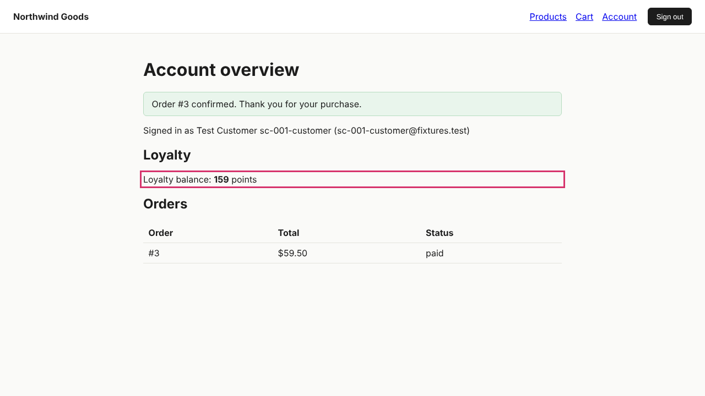
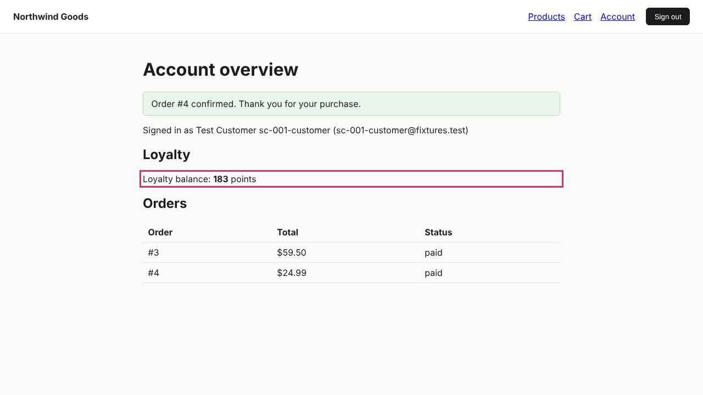

# SC-001 Welcome points are granted on the first order only

**Verdict: PASSED** — All 2 assertions matched.

- Steps chosen by: Claude subagent (Opus) via HTTP bridge
- Environment: http://localhost:3000, commit clean
- Started 2026-11-17T23:46:25.677Z, took 61.3 s, 21 tool calls
- Basis: requirement; requirements REQ-1, REQ-2, REQ-6

## Objective

Verify that a customer who has never ordered is credited the welcome bonus when their first order is paid, and is not credited it again when their second order is paid. Note each order's total when it is shown before payment.

## Assertions

Expected values were fixed in the plan; actual values were read and compared in code.

| Id | What | Expected (plan) | Expected (evaluated) | Actual | Result | Evidence |
|---|---|---|---|---|---|---|
| A1 | Loyalty balance on the account overview after the first paid order | `100 + floor(firstOrderTotal)` | 159 | 159 | match | [check-A1.png](check-A1.png) |
| A2 | Loyalty balance on the account overview after the second paid order | `100 + floor(firstOrderTotal) + floor(secondOrderTotal)` | 183 | 183 | match | [check-A2.png](check-A2.png) |

## Observations

- `firstOrderTotal` = 59.5
- `secondOrderTotal` = 24.99

## Steps

| # | Tool | Input | Outcome | Stated reason |
|---|---|---|---|---|
| 1 | navigate | {"path":"/"} | URL: / | Discover the application entry page. |
| 2 | navigate | {"path":"/login"} | URL: /login | Sign in as the prepared customer. |
| 3 | fill | {"element":{"by":"label","value":"Email"},"text":"sc-001-customer@fixtures.test"} | URL: /login | Enter customer email. |
| 4 | fill | {"element":{"by":"label","value":"Password"},"text":"pw-sc-001-customer"} | URL: /login | Enter customer password. |
| 5 | click | {"element":{"by":"role","role":"button","value":"Sign in"}} | URL: /account | Submit login. |
| 6 | navigate | {"path":"/"} | URL: / | Go to product list for first order. |
| 7 | click | {"element":{"by":"role","role":"button","value":"Add Ceramic Pour-Over Set to cart"}} | URL: /cart | Add an item for the first order. |
| 8 | navigate | {"path":"/cart"} | URL: /cart | Proceed to cart. |
| 9 | click | {"element":{"by":"role","role":"link","value":"Proceed to checkout"}} | URL: /checkout | Go to checkout for the first order. |
| 10 | observe | {"name":"firstOrderTotal","target":{"source":"page","by":"text","value":"Order total:","pattern":"\\$([0-9.]+)"}} | Recorded firstOrderTotal = 59.5 | Record first order total shown before payment. |
| 11 | fill | {"element":{"by":"label","value":"Card number"},"text":"4242 4242 4242 4242"} | URL: /checkout | Enter accepted test card. |
| 12 | click | {"element":{"by":"role","role":"button","value":"Pay now"}} | URL: /account?order=3 | Pay the first order. |
| 13 | check | {"assertionId":"A1","target":{"source":"page","by":"text","value":"Loyalty balance:","pattern":"([0-9]+)"}} | Recorded A1: expected 159, actual 159 -> match. This result is final. | Account overview shows balance after first paid order. |
| 14 | navigate | {"path":"/"} | URL: / | Start second order. |
| 15 | click | {"element":{"by":"role","role":"button","value":"Add Canvas Tote Bag to cart"}} | URL: /cart | Add an item for the second order. |
| 16 | click | {"element":{"by":"role","role":"link","value":"Proceed to checkout"}} | URL: /checkout | Go to checkout for the second order. |
| 17 | observe | {"name":"secondOrderTotal","target":{"source":"page","by":"text","value":"Order total:","pattern":"\\$([0-9.]+)"}} | Recorded secondOrderTotal = 24.99 | Record second order total shown before payment. |
| 18 | fill | {"element":{"by":"label","value":"Card number"},"text":"4242 4242 4242 4242"} | URL: /checkout | Enter accepted test card. |
| 19 | click | {"element":{"by":"role","role":"button","value":"Pay now"}} | URL: /account?order=4 | Pay the second order. |
| 20 | check | {"assertionId":"A2","target":{"source":"page","by":"text","value":"Loyalty balance:","pattern":"([0-9]+)"}} | Recorded A2: expected 183, actual 183 -> match. This result is final. | Account overview shows balance after second paid order. |
| 21 | finish | {"outcome":"completed","reason":"Both orders placed and paid with card 4242; totals observed at checkout (59.5, 24.99); A1 and A2 checked on the account overview."} | Scenario ended. | All assertions have been checked. |

## Evidence

- Playwright trace: `trace.zip` (open with `npx playwright show-trace`)
- A1: 
- A2: 
