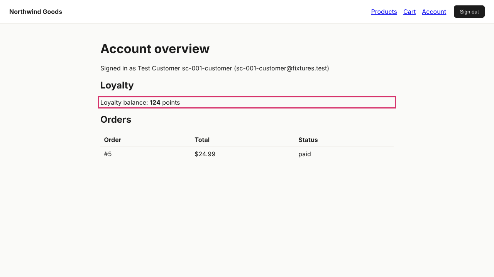
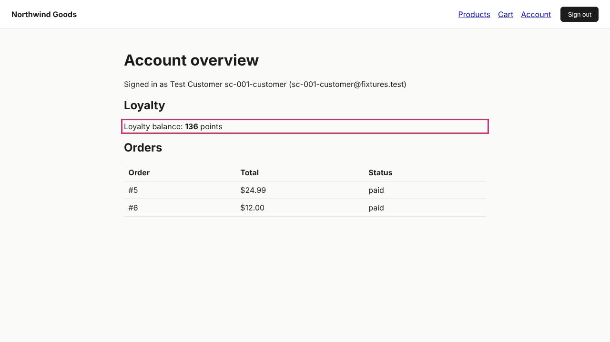

# SC-001 Welcome points are granted on the first order only

**Verdict: PASSED** — All 2 assertions matched.

- Steps chosen by: Claude subagent (Opus) via HTTP bridge
- Environment: http://localhost:3000, commit clean
- Started 2026-11-17T23:49:21.049Z, took 70.9 s, 23 tool calls
- Basis: requirement; requirements REQ-1, REQ-2, REQ-6

## Objective

Verify that a customer who has never ordered is credited the welcome bonus when their first order is paid, and is not credited it again when their second order is paid. Note each order's total when it is shown before payment.

## Assertions

Expected values were fixed in the plan; actual values were read and compared in code.

| Id | What | Expected (plan) | Expected (evaluated) | Actual | Result | Evidence |
|---|---|---|---|---|---|---|
| A1 | Loyalty balance on the account overview after the first paid order | `100 + floor(firstOrderTotal)` | 124 | 124 | match | [check-A1.png](check-A1.png) |
| A2 | Loyalty balance on the account overview after the second paid order | `100 + floor(firstOrderTotal) + floor(secondOrderTotal)` | 136 | 136 | match | [check-A2.png](check-A2.png) |

## Observations

- `firstOrderTotal` = 24.99
- `secondOrderTotal` = 12

## Steps

| # | Tool | Input | Outcome | Stated reason |
|---|---|---|---|---|
| 1 | navigate | {"path":"/"} | URL: / | Discover the application landing page. |
| 2 | navigate | {"path":"/login"} | URL: /login | Sign in as the prepared customer. |
| 3 | fill | {"element":{"by":"label","value":"Email"},"text":"sc-001-customer@fixtures.test"} | URL: /login | Enter customer email. |
| 4 | fill | {"element":{"by":"label","value":"Password"},"text":"pw-sc-001-customer"} | URL: /login | Enter customer password. |
| 5 | click | {"element":{"by":"role","role":"button","value":"Sign in"}} | URL: /account | Submit login. |
| 6 | navigate | {"path":"/"} | URL: / | Go to products for first order. |
| 7 | click | {"element":{"by":"role","role":"button","value":"Add Canvas Tote Bag to cart"}} | URL: /cart | Add an item for the first order. |
| 8 | navigate | {"path":"/cart"} | URL: /cart | Review cart and proceed to checkout. |
| 9 | click | {"element":{"by":"role","role":"link","value":"Proceed to checkout"}} | URL: /checkout | Go to checkout to see the order total. |
| 10 | observe | {"name":"firstOrderTotal","target":{"source":"page","by":"text","value":"Order total:","pattern":"\\$([0-9.]+)"}} | Recorded firstOrderTotal = 24.99 | Record first order total shown before payment. |
| 11 | fill | {"element":{"by":"label","value":"Card number"},"text":"4242 4242 4242 4242"} | URL: /checkout | Enter accepted test card. |
| 12 | click | {"element":{"by":"role","role":"button","value":"Pay now"}} | URL: /account?order=5 | Pay for the first order. |
| 13 | navigate | {"path":"/account"} | URL: /account | Reload account overview to read the persisted balance. |
| 14 | check | {"assertionId":"A1","target":{"source":"page","by":"text","value":"Loyalty balance:","pattern":"([0-9]+)"}} | Recorded A1: expected 124, actual 124 -> match. This result is final. | Check balance after first paid order. |
| 15 | navigate | {"path":"/"} | URL: / | Go to products for the second order. |
| 16 | click | {"element":{"by":"role","role":"button","value":"Add Notebook, Dotted A5 to cart"}} | URL: /cart | Add an item for the second order. |
| 17 | navigate | {"path":"/checkout"} | URL: /checkout | Go to checkout to see second order total. |
| 18 | observe | {"name":"secondOrderTotal","target":{"source":"page","by":"text","value":"Order total:","pattern":"\\$([0-9.]+)"}} | Recorded secondOrderTotal = 12 | Record second order total shown before payment. |
| 19 | fill | {"element":{"by":"label","value":"Card number"},"text":"4242 4242 4242 4242"} | URL: /checkout | Enter accepted test card. |
| 20 | click | {"element":{"by":"role","role":"button","value":"Pay now"}} | URL: /account?order=6 | Pay for the second order. |
| 21 | navigate | {"path":"/account"} | URL: /account | Reload account overview to read the persisted balance. |
| 22 | check | {"assertionId":"A2","target":{"source":"page","by":"text","value":"Loyalty balance:","pattern":"([0-9]+)"}} | Recorded A2: expected 136, actual 136 -> match. This result is final. | Check balance after second paid order. |
| 23 | finish | {"outcome":"completed","reason":"Both assertions checked after two paid orders."} | Scenario ended. | All assertions have been checked. |

## Evidence

- Playwright trace: `trace.zip` (open with `npx playwright show-trace`)
- A1: 
- A2: 
