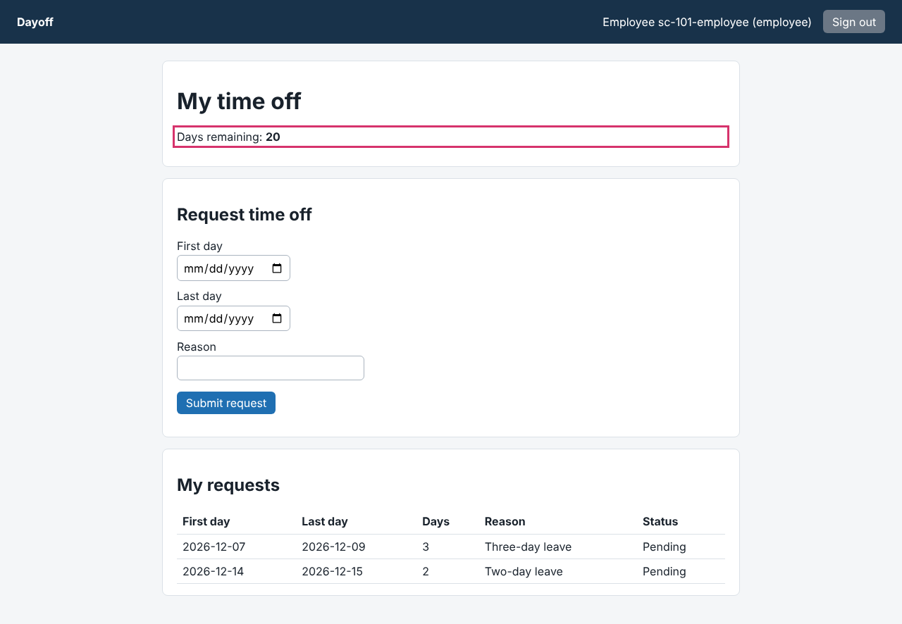
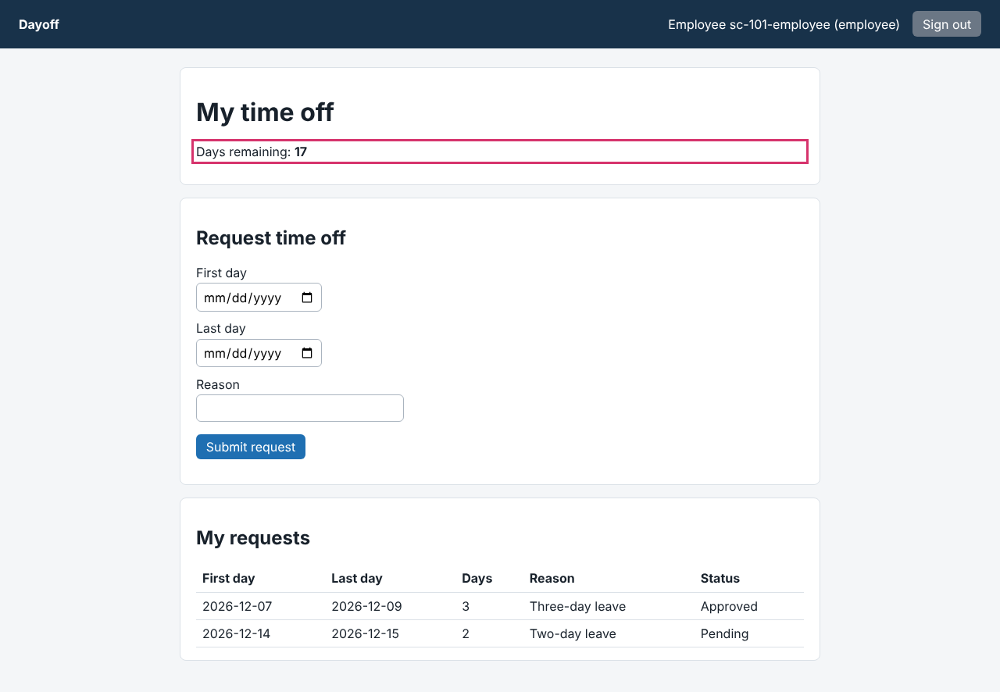

# SC-101 Approved leave is deducted from the balance; pending and rejected leave is not

**Verdict: FAILED** — A3: expected 17, got 15

- Steps chosen by: Claude subagent (Opus) via HTTP bridge
- Environment: http://localhost:3101, commit seeded-bug
- Started 2026-11-17T23:51:15.386Z, took 51.4 s, 35 tool calls
- Basis: requirement; requirements REQ-2, REQ-3, REQ-4

## Objective

As the employee, note the remaining leave days, then submit one request covering three consecutive days and a second request covering two consecutive days in a different week. As the manager, approve the three-day request and reject the two-day request. Check the employee's remaining days at each stage the assertions describe.

## Assertions

Expected values were fixed in the plan; actual values were read and compared in code.

| Id | What | Expected (plan) | Expected (evaluated) | Actual | Result | Evidence |
|---|---|---|---|---|---|---|
| A1 | Employee's remaining days while both requests are still pending | `startingDays` | 20 | 20 | match | [check-A1.png](check-A1.png) |
| A2 | Employee's remaining days after the three-day request is approved and before the other request is decided | `startingDays - 3` | 17 | 17 | match | [check-A2.png](check-A2.png) |
| A3 | Employee's remaining days after the two-day request is rejected | `startingDays - 3` | 17 | 15 | **MISMATCH** | [check-A3.png](check-A3.png) |

## Observations

- `startingDays` = 20

## Steps

| # | Tool | Input | Outcome | Stated reason |
|---|---|---|---|---|
| 1 | navigate | {"path":"/"} | URL: / | Discover the application entry page. |
| 2 | fill | {"element":{"by":"role","role":"textbox","value":"Username"},"text":"sc-101-employee"} | URL: / | Enter employee username. |
| 3 | fill | {"element":{"by":"role","role":"textbox","value":"Password"},"text":"pw-sc-101-employee"} | URL: / | Enter employee password. |
| 4 | click | {"element":{"by":"role","role":"button","value":"Sign in"}} | URL: / | Sign in as employee. |
| 5 | observe | {"name":"startingDays","target":{"source":"page","by":"text","value":"Days remaining:","pattern":"(\\d+)"}} | Recorded startingDays = 20 | Record starting balance before any requests. |
| 6 | fill | {"element":{"by":"role","role":"textbox","value":"First day"},"text":"2026-12-07"} | URL: / | Three-day request start (Monday). |
| 7 | fill | {"element":{"by":"role","role":"textbox","value":"Last day"},"text":"2026-12-09"} | URL: / | Three-day request end (Wednesday). |
| 8 | fill | {"element":{"by":"role","role":"textbox","value":"Reason"},"text":"Three-day leave"} | URL: / | Reason for request. |
| 9 | click | {"element":{"by":"role","role":"button","value":"Submit request"}} | URL: / | Submit three-day request. |
| 10 | fill | {"element":{"by":"role","role":"textbox","value":"First day"},"text":"2026-12-14"} | URL: / | Two-day request start (Monday, different week). |
| 11 | fill | {"element":{"by":"role","role":"textbox","value":"Last day"},"text":"2026-12-15"} | URL: / | Two-day request end (Tuesday). |
| 12 | fill | {"element":{"by":"role","role":"textbox","value":"Reason"},"text":"Two-day leave"} | URL: / | Reason for request. |
| 13 | click | {"element":{"by":"role","role":"button","value":"Submit request"}} | URL: / | Submit two-day request. |
| 14 | check | {"assertionId":"A1","target":{"source":"page","by":"text","value":"Days remaining:","pattern":"(\\d+)"}} | Recorded A1: expected 20, actual 20 -> match. This result is final. | Both requests pending; check remaining days. |
| 15 | click | {"element":{"by":"role","role":"button","value":"Sign out"}} | URL: / | Switch to manager. |
| 16 | fill | {"element":{"by":"role","role":"textbox","value":"Username"},"text":"sc-101-manager"} | URL: / | Manager username. |
| 17 | fill | {"element":{"by":"role","role":"textbox","value":"Password"},"text":"pw-sc-101-manager"} | URL: / | Manager password. |
| 18 | click | {"element":{"by":"role","role":"button","value":"Sign in"}} | URL: / | Sign in as manager. |
| 19 | click | {"element":{"by":"role","role":"button","value":"Approve request 3 from Employee sc-101-employee"}} | URL: / | Approve the three-day request. |
| 20 | click | {"element":{"by":"role","role":"button","value":"Sign out"}} | URL: / | Switch back to employee. |
| 21 | fill | {"element":{"by":"role","role":"textbox","value":"Username"},"text":"sc-101-employee"} | URL: / | Employee username. |
| 22 | fill | {"element":{"by":"role","role":"textbox","value":"Password"},"text":"pw-sc-101-employee"} | URL: / | Employee password. |
| 23 | click | {"element":{"by":"role","role":"button","value":"Sign in"}} | URL: / | Sign in as employee to view balance. |
| 24 | check | {"assertionId":"A2","target":{"source":"page","by":"text","value":"Days remaining:","pattern":"(\\d+)"}} | Recorded A2: expected 17, actual 17 -> match. This result is final. | Three-day approved, two-day still pending. |
| 25 | click | {"element":{"by":"role","role":"button","value":"Sign out"}} | URL: / | Switch to manager. |
| 26 | fill | {"element":{"by":"role","role":"textbox","value":"Username"},"text":"sc-101-manager"} | URL: / | Manager username. |
| 27 | fill | {"element":{"by":"role","role":"textbox","value":"Password"},"text":"pw-sc-101-manager"} | URL: / | Manager password. |
| 28 | click | {"element":{"by":"role","role":"button","value":"Sign in"}} | URL: / | Sign in as manager. |
| 29 | click | {"element":{"by":"role","role":"button","value":"Reject request 4 from Employee sc-101-employee"}} | URL: / | Reject the two-day request. |
| 30 | click | {"element":{"by":"role","role":"button","value":"Sign out"}} | URL: / | Switch back to employee. |
| 31 | fill | {"element":{"by":"role","role":"textbox","value":"Username"},"text":"sc-101-employee"} | URL: / | Employee username. |
| 32 | fill | {"element":{"by":"role","role":"textbox","value":"Password"},"text":"pw-sc-101-employee"} | URL: / | Employee password. |
| 33 | click | {"element":{"by":"role","role":"button","value":"Sign in"}} | URL: / | Sign in as employee. |
| 34 | check | {"assertionId":"A3","target":{"source":"page","by":"text","value":"Days remaining:","pattern":"(\\d+)"}} | Recorded A3: expected 17, actual 15 -> MISMATCH. This result is final. | Two-day request rejected; check remaining days. |
| 35 | finish | {"outcome":"completed","reason":"All three assertions (A1, A2, A3) were checked at the states the scenario describes."} | Scenario ended. | Every planned assertion has been checked. |

## Evidence

- Playwright trace: `trace.zip` (open with `npx playwright show-trace`)
- A1: 
- A2: 
- A3: 
