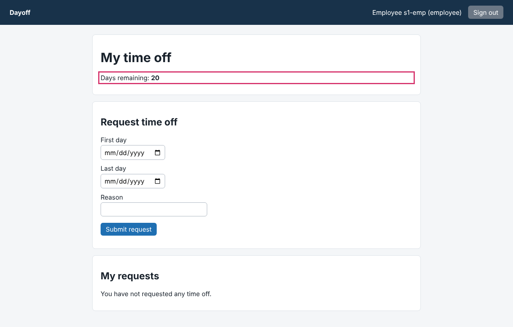
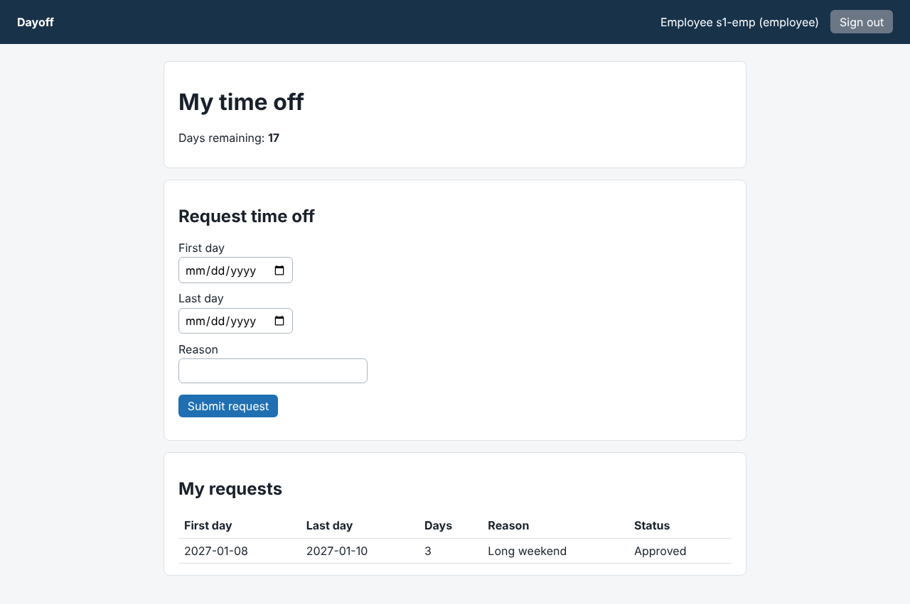

# S1 Submitting leaves the balance unchanged; approving a 3-day range that includes a weekend deducts 3 days

**Verdict: PASSED** — All 4 assertions matched.

- Steps chosen by: external model via HTTP bridge
- Environment: http://localhost:3100, commit dev-timeoff
- Started 2026-11-18T18:48:36.647Z, took 73.9 s, 30 tool calls
- Basis: requirement; requirements R1, R2, R3, R5, R6, R7, R9

## Objective

Sign in as the employee 'emp'. On the "My time off" screen, record the displayed days remaining as observation screenBalanceBefore. Call GET /api/me and record its balance field as apiBalanceBefore. Submit a time-off request with first day 2027-01-08, last day 2027-01-10 (Friday to Sunday) and any reason. Then call GET /api/me again and record balance as apiBalanceAfterSubmit. Call GET /api/requests and find the new request; keep its id and check its status field. Sign out, sign in as the manager 'mgr', and approve that request (in the UI or via POST /api/requests/:id/decision with decision approve). Sign out, sign in again as 'emp', call GET /api/me and record balance as apiBalanceAfterApprove.

## Assertions

Expected values were fixed in the plan; actual values were read and compared in code.

| Id | What | Expected (plan) | Expected (evaluated) | Actual | Result | Evidence |
|---|---|---|---|---|---|---|
| A1 | Before any request: the days-remaining number shown on the employee's "My time off" screen (screenBalanceBefore) equals the balance returned by GET /api/me at the same moment (apiBalanceBefore). | `apiBalanceBefore` | 20 | 20 | match | [check-A1.png](check-A1.png) |
| A2 | Right after submitting the 2027-01-08..2027-01-10 request (still pending): GET /api/me balance (apiBalanceAfterSubmit) equals apiBalanceBefore. | `apiBalanceBefore` | 20 | 20 | match | [check-A2.png](check-A2.png) |
| A3 | Right after submitting, before any manager action: the status field of the new request in GET /api/requests (employee session) contains the text Pending. | `Pending` | Pending | Pending | match | [check-A3.png](check-A3.png) |
| A4 | After the manager approved the request: GET /api/me balance in a fresh employee session (apiBalanceAfterApprove) equals apiBalanceBefore minus 3 (2027-01-08 to 2027-01-10 inclusive is 3 calendar days, weekend counted). | `apiBalanceBefore - 3` | 17 | 17 | match | [check-A4.png](check-A4.png) |

## Observations

- `screenBalanceBefore` = 20
- `apiBalanceBefore` = 20
- `apiBalanceAfterSubmit` = 20
- `apiBalanceAfterApprove` = 17

## Steps

| # | Tool | Input | Outcome | Stated reason |
|---|---|---|---|---|
| 1 | navigate | {"path":"/"} | URL: / | Open the application to find the sign-in page. |
| 2 | fill | {"element":{"by":"role","role":"textbox","value":"Username"},"text":"s1-emp"} | URL: / | Enter employee handle. |
| 3 | fill | {"element":{"by":"role","role":"textbox","value":"Password"},"text":"{{secret:emp.password}}"} | URL: / | Enter employee password. |
| 4 | click | {"element":{"by":"role","role":"button","value":"Sign in"}} | URL: / | Sign in as employee. |
| 5 | observe | {"name":"screenBalanceBefore","target":{"source":"page","by":"text","value":"Days remaining:","count":false,"pattern":"Days remaining:\\s*(\\d+(?:\\.\\d+)?)"}} | Recorded screenBalanceBefore = 20 | Record displayed days remaining before any request. |
| 6 | api_request | {"method":"GET","path":"/api/me"} | {"responseId":"R1","status":200,"body":{"handle":"s1-emp","name":"Employee s1-emp","role":"employee","balance":20}} | Read API balance at the same moment. |
| 7 | observe | {"name":"apiBalanceBefore","target":{"source":"api","responseId":"R1","field":"body","jsonPath":"balance","count":false}} | Recorded apiBalanceBefore = 20 | Record API balance before any request. |
| 8 | check | {"assertionId":"A1","target":{"source":"page","by":"text","value":"Days remaining:","count":false,"pattern":"Days remaining:\\s*(\\d+(?:\\.\\d+)?)"}} | Recorded A1: expected 20, actual 20 -> match. This result is final. | Screen days remaining should equal API balance before any request. |
| 9 | fill | {"element":{"by":"role","role":"textbox","value":"First day"},"text":"2027-01-08"} | URL: / | Set first day. |
| 10 | fill | {"element":{"by":"role","role":"textbox","value":"Last day"},"text":"2027-01-10"} | URL: / | Set last day. |
| 11 | fill | {"element":{"by":"role","role":"textbox","value":"Reason"},"text":"Long weekend"} | URL: / | Set a reason. |
| 12 | click | {"element":{"by":"role","role":"button","value":"Submit request"}} | URL: / | Submit the time-off request. |
| 13 | api_request | {"method":"GET","path":"/api/me"} | {"responseId":"R2","status":200,"body":{"handle":"s1-emp","name":"Employee s1-emp","role":"employee","balance":20}} | Read balance right after submitting. |
| 14 | api_request | {"method":"GET","path":"/api/requests"} | {"responseId":"R3","status":200,"body":[{"id":2,"employee":"s1-emp","employeeName":"Employee s1-emp","start":"2027-01-08","end":"2027-01-10","days":3,"reason":"Long weekend","status":"Pending"}]} | Find the new request and its status. |
| 15 | observe | {"name":"apiBalanceAfterSubmit","target":{"source":"api","responseId":"R2","field":"body","jsonPath":"balance","count":false}} | Recorded apiBalanceAfterSubmit = 20 | Record balance after submitting. |
| 16 | check | {"assertionId":"A2","target":{"source":"api","responseId":"R2","field":"body","jsonPath":"balance","count":false}} | Recorded A2: expected 20, actual 20 -> match. This result is final. | Balance after submit should equal balance before. |
| 17 | check | {"assertionId":"A3","target":{"source":"api","responseId":"R3","field":"body","jsonPath":"0.status","count":false}} | Recorded A3: expected Pending, actual Pending -> match. This result is final. | New request status should be Pending. |
| 18 | click | {"element":{"by":"role","role":"button","value":"Sign out"}} | URL: / | Sign out the employee. |
| 19 | fill | {"element":{"by":"role","role":"textbox","value":"Username"},"text":"s1-mgr"} | URL: / | Enter manager handle. |
| 20 | fill | {"element":{"by":"role","role":"textbox","value":"Password"},"text":"{{secret:mgr.password}}"} | URL: / | Enter manager password. |
| 21 | click | {"element":{"by":"role","role":"button","value":"Sign in"}} | URL: / | Sign in as manager. |
| 22 | click | {"element":{"by":"role","role":"button","value":"Approve request 2 from Employee s1-emp"}} | URL: / | Approve the scenario request #2. |
| 23 | click | {"element":{"by":"role","role":"button","value":"Sign out"}} | URL: / | Sign out the manager. |
| 24 | fill | {"element":{"by":"role","role":"textbox","value":"Username"},"text":"s1-emp"} | URL: / | Enter employee handle. |
| 25 | fill | {"element":{"by":"role","role":"textbox","value":"Password"},"text":"{{secret:emp.password}}"} | URL: / | Enter employee password. |
| 26 | click | {"element":{"by":"role","role":"button","value":"Sign in"}} | URL: / | Fresh employee session. |
| 27 | api_request | {"method":"GET","path":"/api/me"} | {"responseId":"R4","status":200,"body":{"handle":"s1-emp","name":"Employee s1-emp","role":"employee","balance":17}} | Read balance after approval in fresh employee session. |
| 28 | observe | {"name":"apiBalanceAfterApprove","target":{"source":"api","responseId":"R4","field":"body","jsonPath":"balance","count":false}} | Recorded apiBalanceAfterApprove = 17 | Record balance after approval. |
| 29 | check | {"assertionId":"A4","target":{"source":"api","responseId":"R4","field":"body","jsonPath":"balance","count":false}} | Recorded A4: expected 17, actual 17 -> match. This result is final. | Balance after approval should be before minus 3. |
| 30 | finish | {"outcome":"completed","reason":"All four assertions (A1-A4) were checked."} | Scenario ended. | Every assertion has been checked. |

## Evidence

- Playwright trace: `trace.zip` (open with `npx playwright show-trace`)
- A1: 
- A2: 
- A3: 
- A4: 
