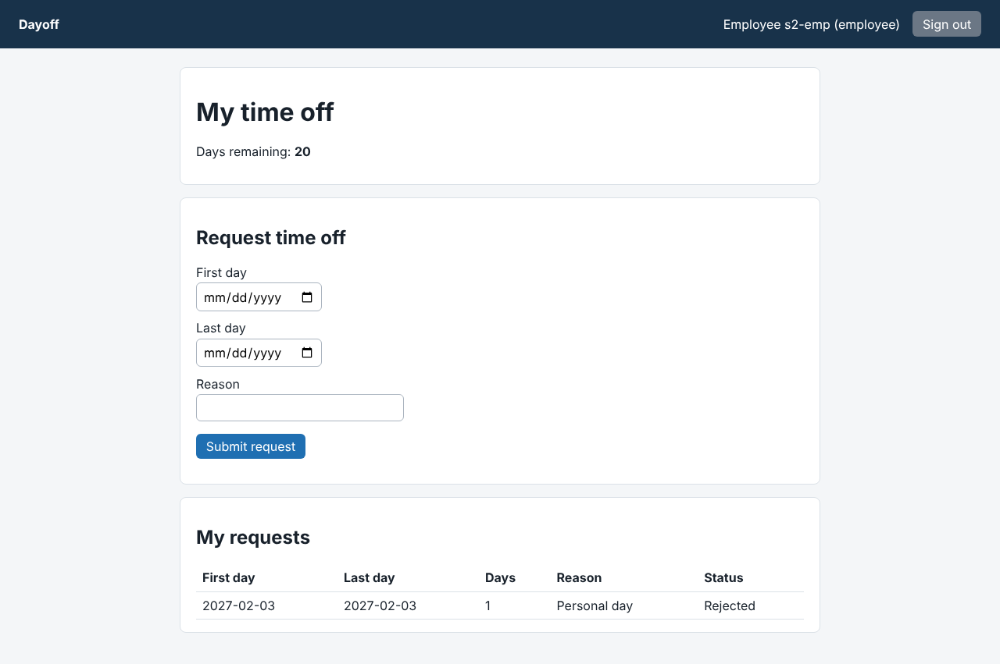

# S2 Rejecting leaves the balance unchanged, and a rejected request cannot later be approved

**Verdict: PASSED** — All 2 assertions matched.

- Steps chosen by: external model via HTTP bridge
- Environment: http://localhost:3100, commit dev-timeoff
- Started 2026-11-18T18:48:36.647Z, took 93.0 s, 36 tool calls
- Basis: risk; requirements R4, R7, R8, R9

## Objective

Sign in as the employee 'emp', call GET /api/me and record balance as apiBalanceBefore. Submit a single-day request with first and last day 2027-02-03 and any reason. Call GET /api/requests and keep the new request's id. Sign out, sign in as the manager 'mgr' and reject that request (in the UI or via POST /api/requests/:id/decision with decision reject). Sign out, sign in as 'emp', call GET /api/me and record balance as apiBalanceAfterReject. Sign out, sign in as 'mgr' again and send POST /api/requests/:id/decision with decision approve for the same request (a second decision; its response is not itself asserted). Sign out, sign in as 'emp', call GET /api/me and record balance as apiBalanceAfterSecondDecision.

## Assertions

Expected values were fixed in the plan; actual values were read and compared in code.

| Id | What | Expected (plan) | Expected (evaluated) | Actual | Result | Evidence |
|---|---|---|---|---|---|---|
| A1 | After the manager rejected the request (before the second decision attempt): GET /api/me balance in a fresh employee session (apiBalanceAfterReject) equals apiBalanceBefore. | `apiBalanceBefore` | 20 | 20 | match | [check-A1.png](check-A1.png) |
| A2 | After the manager's later approve attempt on the already-rejected request: GET /api/me balance in a fresh employee session (apiBalanceAfterSecondDecision) equals apiBalanceAfterReject (a decided request cannot be decided again, so no deduction happens). | `apiBalanceAfterReject` | 20 | 20 | match | [check-A2.png](check-A2.png) |

## Observations

- `apiBalanceBefore` = 20
- `apiBalanceAfterReject` = 20
- `apiBalanceAfterSecondDecision` = 20

## Steps

| # | Tool | Input | Outcome | Stated reason |
|---|---|---|---|---|
| 1 | navigate | {"path":"/"} | URL: / | Find the sign-in page. |
| 2 | fill | {"element":{"by":"label","value":"Username"},"text":"s2-emp"} | URL: / | Sign in as employee. |
| 3 | fill | {"element":{"by":"label","value":"Password"},"text":"{{secret:emp.password}}"} | URL: / | Sign in as employee. |
| 4 | click | {"element":{"by":"role","role":"button","value":"Sign in"}} | URL: / | Submit sign-in. |
| 5 | api_request | {"method":"GET","path":"/api/me"} | {"responseId":"R1","status":200,"body":{"handle":"s2-emp","name":"Employee s2-emp","role":"employee","balance":20}} | Read balance before. |
| 6 | observe | {"name":"apiBalanceBefore","target":{"source":"api","responseId":"R1","field":"body","jsonPath":"balance","count":false}} | Recorded apiBalanceBefore = 20 | Record initial balance. |
| 7 | fill | {"element":{"by":"label","value":"First day"},"text":"2027-02-03"} | URL: / | Fill request. |
| 8 | fill | {"element":{"by":"label","value":"Last day"},"text":"2027-02-03"} | URL: / | Fill request. |
| 9 | fill | {"element":{"by":"label","value":"Reason"},"text":"Personal day"} | URL: / | Fill request. |
| 10 | click | {"element":{"by":"role","role":"button","value":"Submit request"}} | URL: / | Submit the request. |
| 11 | api_request | {"method":"GET","path":"/api/requests"} | {"responseId":"R2","status":200,"body":[{"id":3,"employee":"s2-emp","employeeName":"Employee s2-emp","start":"2027-02-03","end":"2027-02-03","days":1,"reason":"Personal day","status":"Pending"}]} | Get the new request id. |
| 12 | click | {"element":{"by":"role","role":"button","value":"Sign out"}} | URL: / | Switch to manager. |
| 13 | fill | {"element":{"by":"label","value":"Username"},"text":"s2-mgr"} | URL: / | Sign in as manager. |
| 14 | fill | {"element":{"by":"label","value":"Password"},"text":"{{secret:mgr.password}}"} | URL: / | Sign in as manager. |
| 15 | click | {"element":{"by":"role","role":"button","value":"Sign in"}} | URL: / | Submit sign-in. |
| 16 | api_request | {"method":"POST","path":"/api/requests/3/decision","body":{"decision":"reject"}} | {"responseId":"R3","status":200,"body":{"id":3,"employee":"s2-emp","employeeName":"Employee s2-emp","start":"2027-02-03","end":"2027-02-03","days":1,"reason":"Personal day","status":"Rejected"}} | Reject the request. |
| 17 | click | {"element":{"by":"role","role":"button","value":"Sign out"}} | URL: / | Switch to employee. |
| 18 | fill | {"element":{"by":"label","value":"Username"},"text":"s2-emp"} | URL: / | Sign in as employee. |
| 19 | fill | {"element":{"by":"label","value":"Password"},"text":"{{secret:emp.password}}"} | URL: / | Sign in as employee. |
| 20 | click | {"element":{"by":"role","role":"button","value":"Sign in"}} | URL: / | Submit sign-in. |
| 21 | api_request | {"method":"GET","path":"/api/me"} | {"responseId":"R4","status":200,"body":{"handle":"s2-emp","name":"Employee s2-emp","role":"employee","balance":20}} | Read balance after reject. |
| 22 | observe | {"name":"apiBalanceAfterReject","target":{"source":"api","responseId":"R4","field":"body","jsonPath":"balance","count":false}} | Recorded apiBalanceAfterReject = 20 | Record balance after reject. |
| 23 | check | {"assertionId":"A1","target":{"source":"api","responseId":"R4","field":"body","jsonPath":"balance","count":false}} | Recorded A1: expected 20, actual 20 -> match. This result is final. | Balance after reject should equal before. |
| 24 | click | {"element":{"by":"role","role":"button","value":"Sign out"}} | URL: / | Switch to manager. |
| 25 | fill | {"element":{"by":"label","value":"Username"},"text":"s2-mgr"} | URL: / | Sign in as manager. |
| 26 | fill | {"element":{"by":"label","value":"Password"},"text":"{{secret:mgr.password}}"} | URL: / | Sign in as manager. |
| 27 | click | {"element":{"by":"role","role":"button","value":"Sign in"}} | URL: / | Submit sign-in. |
| 28 | api_request | {"method":"POST","path":"/api/requests/3/decision","body":{"decision":"approve"}} | {"responseId":"R5","status":409,"body":{"error":"This request was already decided."}} | Second decision attempt on rejected request. |
| 29 | click | {"element":{"by":"role","role":"button","value":"Sign out"}} | URL: / | Switch to employee. |
| 30 | fill | {"element":{"by":"label","value":"Username"},"text":"s2-emp"} | URL: / | Sign in as employee. |
| 31 | fill | {"element":{"by":"label","value":"Password"},"text":"{{secret:emp.password}}"} | URL: / | Sign in as employee. |
| 32 | click | {"element":{"by":"role","role":"button","value":"Sign in"}} | URL: / | Submit sign-in. |
| 33 | api_request | {"method":"GET","path":"/api/me"} | {"responseId":"R6","status":200,"body":{"handle":"s2-emp","name":"Employee s2-emp","role":"employee","balance":20}} | Read balance after second decision. |
| 34 | observe | {"name":"apiBalanceAfterSecondDecision","target":{"source":"api","responseId":"R6","field":"body","jsonPath":"balance","count":false}} | Recorded apiBalanceAfterSecondDecision = 20 | Record final balance. |
| 35 | check | {"assertionId":"A2","target":{"source":"api","responseId":"R6","field":"body","jsonPath":"balance","count":false}} | Recorded A2: expected 20, actual 20 -> match. This result is final. | Final balance should equal balance after reject. |
| 36 | finish | {"outcome":"completed","reason":"Both assertions A1 and A2 checked."} | Scenario ended. | All assertions have been checked. |

## Evidence

- Playwright trace: `trace.zip` (open with `npx playwright show-trace`)
- A1: 
- A2: 
