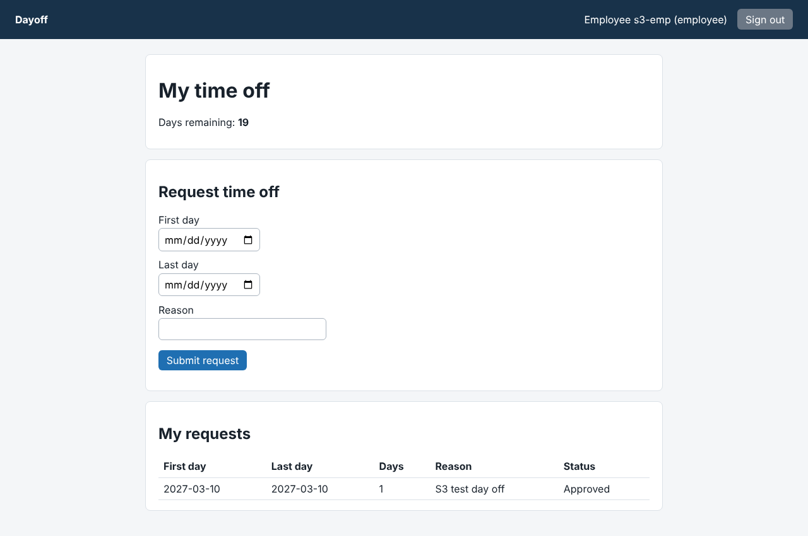

# S3 Employee cannot decide own request; approval deducts once even if approved twice

**Verdict: PASSED** — All 3 assertions matched.

- Steps chosen by: external model via HTTP bridge
- Environment: http://localhost:3100, commit dev-timeoff
- Started 2026-11-18T18:48:36.647Z, took 74.8 s, 31 tool calls
- Basis: risk; requirements R3, R5, R8, R10, R9

## Objective

Sign in as the employee 'emp', call GET /api/me and record balance as apiBalanceBefore. Submit a single-day request with first and last day 2027-03-10 and any reason, then read GET /api/requests and keep the new request's id. Still as the employee, send POST /api/requests/:id/decision with decision approve for that request. Then call GET /api/me and record balance as apiBalanceAfterEmployeeDecide, and read the request's status in GET /api/requests. Sign out, sign in as the manager 'mgr' and approve the request. Then, still as manager, send POST /api/requests/:id/decision with decision approve again for the same request. Sign out, sign in as 'emp', call GET /api/me and record balance as apiBalanceFinal.

## Assertions

Expected values were fixed in the plan; actual values were read and compared in code.

| Id | What | Expected (plan) | Expected (evaluated) | Actual | Result | Evidence |
|---|---|---|---|---|---|---|
| A1 | After the employee tried to approve their own request via the API: GET /api/me balance (apiBalanceAfterEmployeeDecide) equals apiBalanceBefore. | `apiBalanceBefore` | 20 | 20 | match | [check-A1.png](check-A1.png) |
| A2 | After the employee's own decision attempt: the request's status field in GET /api/requests (employee session) still contains the text Pending. | `Pending` | Pending | Pending | match | [check-A2.png](check-A2.png) |
| A3 | After the manager approved the single-day request and then sent a second approve: GET /api/me balance in a fresh employee session (apiBalanceFinal) equals apiBalanceBefore minus 1 (one calendar day deducted exactly once). | `apiBalanceBefore - 1` | 19 | 19 | match | [check-A3.png](check-A3.png) |

## Observations

- `apiBalanceBefore` = 20
- `apiBalanceAfterEmployeeDecide` = 20
- `apiBalanceFinal` = 19

## Steps

| # | Tool | Input | Outcome | Stated reason |
|---|---|---|---|---|
| 1 | navigate | {"path":"/"} | URL: / | Find the sign-in page. |
| 2 | fill | {"element":{"by":"label","value":"Username"},"text":"s3-emp"} | URL: / | Sign in as employee. |
| 3 | fill | {"element":{"by":"label","value":"Password"},"text":"{{secret:emp.password}}"} | URL: / | Employee password. |
| 4 | click | {"element":{"by":"role","role":"button","value":"Sign in"}} | URL: / | Submit sign-in. |
| 5 | api_request | {"method":"GET","path":"/api/me"} | {"responseId":"R1","status":200,"body":{"handle":"s3-emp","name":"Employee s3-emp","role":"employee","balance":20}} | Read starting balance. |
| 6 | observe | {"name":"apiBalanceBefore","target":{"source":"api","responseId":"R1","field":"body","jsonPath":"balance","count":false}} | Recorded apiBalanceBefore = 20 | Record starting balance. |
| 7 | fill | {"element":{"by":"label","value":"First day"},"text":"2027-03-10"} | URL: / | Single-day request. |
| 8 | fill | {"element":{"by":"label","value":"Last day"},"text":"2027-03-10"} | URL: / | Single-day request. |
| 9 | fill | {"element":{"by":"label","value":"Reason"},"text":"S3 test day off"} | URL: / | Any reason. |
| 10 | click | {"element":{"by":"role","role":"button","value":"Submit request"}} | URL: / | Submit the request. |
| 11 | api_request | {"method":"GET","path":"/api/requests"} | {"responseId":"R2","status":200,"body":[{"id":1,"employee":"s3-emp","employeeName":"Employee s3-emp","start":"2027-03-10","end":"2027-03-10","days":1,"reason":"S3 test day off","status":"Pending"}]} | Get the new request id. |
| 12 | api_request | {"method":"POST","path":"/api/requests/1/decision","body":{"decision":"approve"}} | {"responseId":"R3","status":403,"body":{"error":"Only managers can decide requests."}} | Employee attempts to approve own request. |
| 13 | api_request | {"method":"GET","path":"/api/me"} | {"responseId":"R4","status":200,"body":{"handle":"s3-emp","name":"Employee s3-emp","role":"employee","balance":20}} | Balance after employee decision attempt. |
| 14 | api_request | {"method":"GET","path":"/api/requests"} | {"responseId":"R5","status":200,"body":[{"id":1,"employee":"s3-emp","employeeName":"Employee s3-emp","start":"2027-03-10","end":"2027-03-10","days":1,"reason":"S3 test day off","status":"Pending"}]} | Request status after employee decision attempt. |
| 15 | observe | {"name":"apiBalanceAfterEmployeeDecide","target":{"source":"api","responseId":"R4","field":"body","jsonPath":"balance","count":false}} | Recorded apiBalanceAfterEmployeeDecide = 20 | Record balance after employee decide. |
| 16 | check | {"assertionId":"A1","target":{"source":"api","responseId":"R4","field":"body","jsonPath":"balance","count":false}} | Recorded A1: expected 20, actual 20 -> match. This result is final. | Balance after employee attempt should equal before. |
| 17 | check | {"assertionId":"A2","target":{"source":"api","responseId":"R5","field":"body","jsonPath":"0.status","count":false}} | Recorded A2: expected Pending, actual Pending -> match. This result is final. | Status should still be Pending. |
| 18 | click | {"element":{"by":"role","role":"button","value":"Sign out"}} | URL: / | Switch to manager. |
| 19 | fill | {"element":{"by":"label","value":"Username"},"text":"s3-mgr"} | URL: / | Manager sign in. |
| 20 | fill | {"element":{"by":"label","value":"Password"},"text":"{{secret:mgr.password}}"} | URL: / | Manager password. |
| 21 | click | {"element":{"by":"role","role":"button","value":"Sign in"}} | URL: / | Submit sign-in. |
| 22 | click | {"element":{"by":"role","role":"button","value":"Approve request 1 from Employee s3-emp"}} | URL: / | Manager approves the request. |
| 23 | api_request | {"method":"POST","path":"/api/requests/1/decision","body":{"decision":"approve"}} | {"responseId":"R6","status":409,"body":{"error":"This request was already decided."}} | Second approve for the same request. |
| 24 | click | {"element":{"by":"role","role":"button","value":"Sign out"}} | URL: / | Switch back to employee. |
| 25 | fill | {"element":{"by":"label","value":"Username"},"text":"s3-emp"} | URL: / | Employee sign in. |
| 26 | fill | {"element":{"by":"label","value":"Password"},"text":"{{secret:emp.password}}"} | URL: / | Employee password. |
| 27 | click | {"element":{"by":"role","role":"button","value":"Sign in"}} | URL: / | Submit sign-in. |
| 28 | api_request | {"method":"GET","path":"/api/me"} | {"responseId":"R7","status":200,"body":{"handle":"s3-emp","name":"Employee s3-emp","role":"employee","balance":19}} | Final balance in fresh employee session. |
| 29 | observe | {"name":"apiBalanceFinal","target":{"source":"api","responseId":"R7","field":"body","jsonPath":"balance","count":false}} | Recorded apiBalanceFinal = 19 | Record final balance. |
| 30 | check | {"assertionId":"A3","target":{"source":"api","responseId":"R7","field":"body","jsonPath":"balance","count":false}} | Recorded A3: expected 19, actual 19 -> match. This result is final. | Final balance should be before minus 1. |
| 31 | finish | {"outcome":"completed","reason":"All three assertions checked."} | Scenario ended. | Scenario complete. |

## Evidence

- Playwright trace: `trace.zip` (open with `npx playwright show-trace`)
- A1: 
- A2: 
- A3: 
