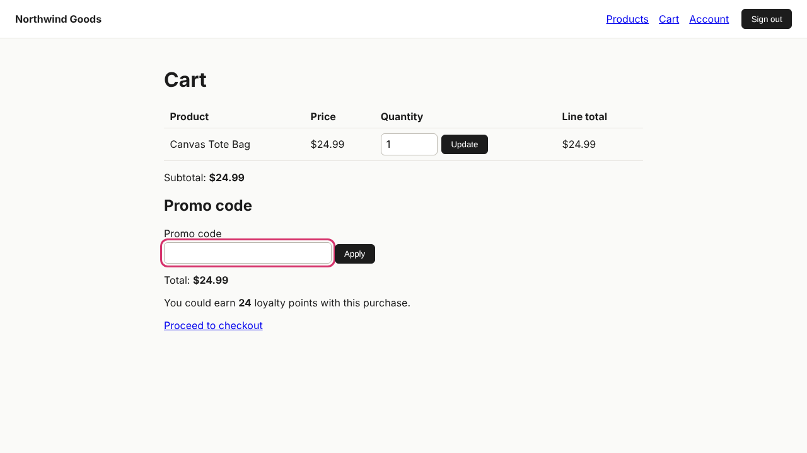
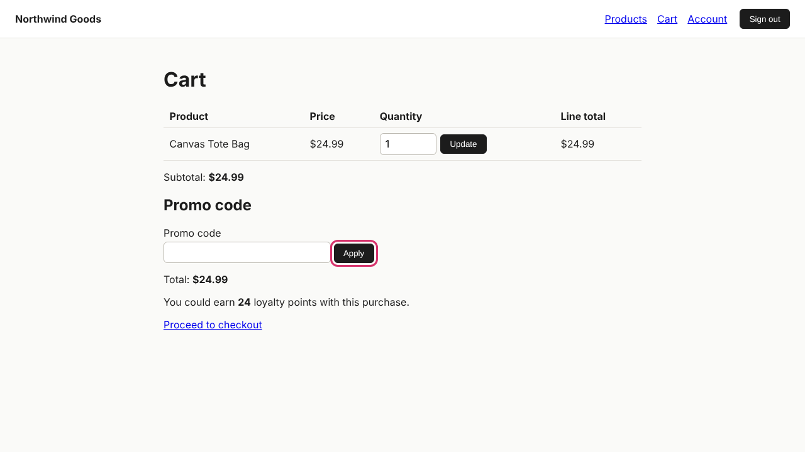
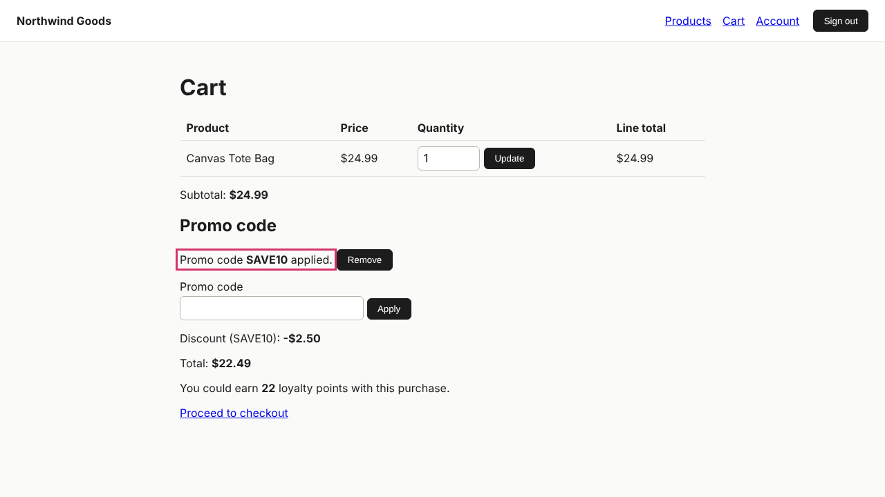
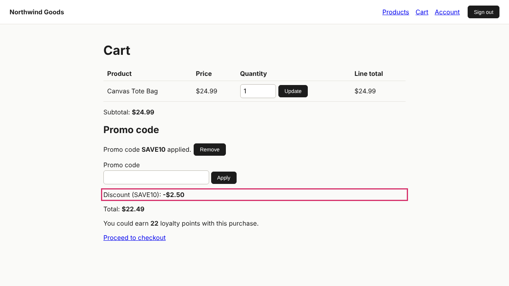
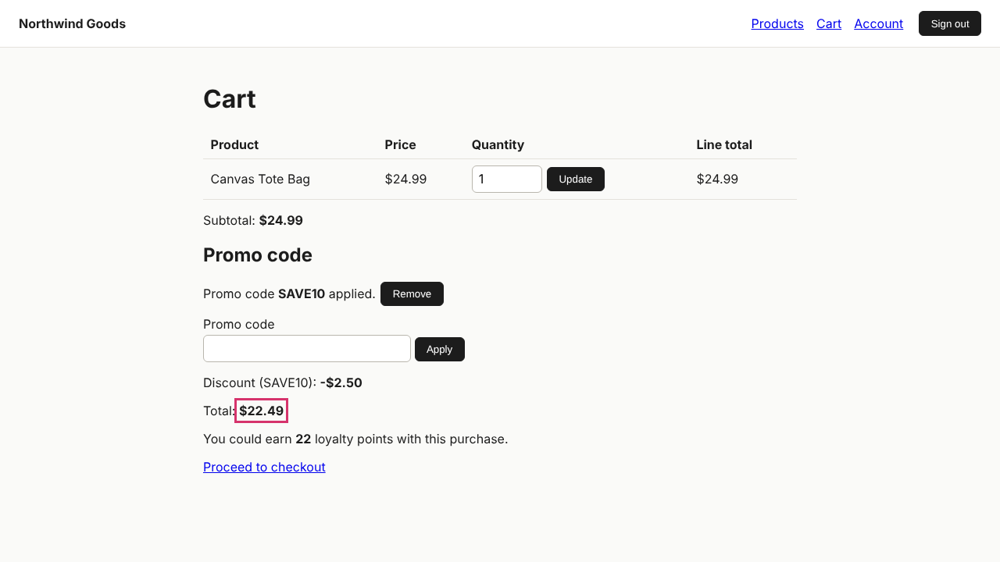
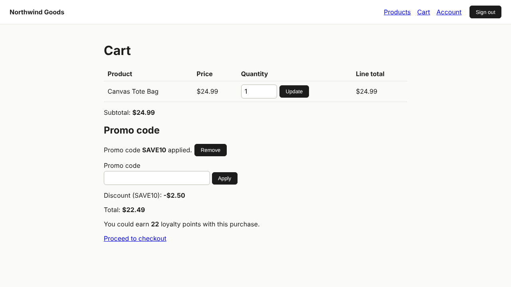

# S1 SAVE10 on a $24.99 cart: field, Apply, rounding down, cart display and GET /api/cart

**Verdict: FAILED** — A6: expected 2.49, got 2.5; A4: expected 249, got 250; A5: expected 249, got 250

- Steps chosen by: external model via HTTP bridge
- Environment: http://localhost:3000, commit 5ca65f012d822e0a2fe3dc56b1dd3a6a0066570b
- Started 2026-11-18T18:58:14.120Z, took 126.0 s, 29 tool calls
- Basis: requirement; requirements R1, R2, R3, R10, R26

## Objective

Sign in as the customer. Add one Canvas Tote Bag ($24.99) to the cart and open the cart page. Check that the cart page has a Promo code input and an Apply button. Enter SAVE10 exactly (upper case, no spaces) and apply it. On the cart page after applying, check that the applied code is shown and record three numbers in dollars as displayed: the Subtotal (uiSubtotal), the Discount line (uiDiscount) and the Total (uiTotal). Then call GET /api/cart and record subtotalCents (apiSubtotal), discountCents (apiDiscount) and totalCents (apiTotal), and check the promoCode field.

## Assertions

Expected values were fixed in the plan; actual values were read and compared in code.

| Id | What | Expected (plan) | Expected (evaluated) | Actual | Result | Evidence |
|---|---|---|---|---|---|---|
| A1 | Before applying any code, the cart page (with the Canvas Tote Bag in it) contains a text input for the promo code. | `present` | present | present | match | [check-A1.png](check-A1.png) |
| A2 | Before applying any code, the cart page contains a button labelled Apply. | `present` | present | present | match | [check-A2.png](check-A2.png) |
| A3 | After applying SAVE10, the cart page's applied-code display contains the text SAVE10. | `SAVE10` | SAVE10 | Promo code SAVE10 applied. | match | [check-A3.png](check-A3.png) |
| A4 | After applying SAVE10, discountCents from GET /api/cart (apiDiscount) equals 249: 10% of 2499 cents rounded down to the whole cent (the ticket's own example: 10% of $24.99 = $2.49). | `249` | 249 | 250 | **MISMATCH** | [check-A4.png](check-A4.png) |
| A5 | After applying SAVE10, apiDiscount equals 10% of apiSubtotal rounded down: floor(apiSubtotal / 10). | `floor(apiSubtotal / 10)` | 249 | 250 | **MISMATCH** | [check-A5.png](check-A5.png) |
| A6 | After applying SAVE10, the Discount line on the cart page (uiDiscount, dollars) equals 2.49. | `2.49` | 2.49 | 2.5 | **MISMATCH** | [check-A6.png](check-A6.png) |
| A7 | After applying SAVE10, the Total shown on the cart page (uiTotal, dollars) equals the displayed Subtotal minus the displayed Discount. | `round((uiSubtotal - uiDiscount) * 100) / 100` | 22.49 | 22.49 | match | [check-A7.png](check-A7.png) |
| A8 | After applying SAVE10, totalCents from GET /api/cart (apiTotal) equals apiSubtotal minus apiDiscount. | `apiSubtotal - apiDiscount` | 2249 | 2249 | match | [check-A8.png](check-A8.png) |
| A9 | After applying SAVE10, the promoCode field of GET /api/cart equals SAVE10. | `SAVE10` | SAVE10 | SAVE10 | match | [check-A9.png](check-A9.png) |

## Observations

- `uiSubtotal` = 24.99
- `uiDiscount` = 2.5
- `uiTotal` = 22.49
- `apiSubtotal` = 2499
- `apiDiscount` = 250
- `apiTotal` = 2249

## Steps

| # | Tool | Input | Outcome | Stated reason |
|---|---|---|---|---|
| 1 | navigate | {"path":"/"} | URL: / | Find the sign-in entry point. |
| 2 | navigate | {"path":"/login"} | URL: /login | Sign in as the customer first. |
| 3 | fill | {"element":{"by":"role","role":"textbox","value":"Email"},"text":"s1-shopper@fixtures.test"} | URL: /login | Enter customer email. |
| 4 | fill | {"element":{"by":"role","role":"textbox","value":"Password"},"text":"{{secret:shopper.password}}"} | URL: /login | Enter customer password. |
| 5 | click | {"element":{"by":"role","role":"button","value":"Sign in"}} | URL: /account | Submit sign-in. |
| 6 | navigate | {"path":"/cart"} | URL: /cart | Confirm the cart starts empty before adding the item. |
| 7 | navigate | {"path":"/"} | URL: / | Go to product list to add the tote bag. |
| 8 | click | {"element":{"by":"role","role":"button","value":"Add Canvas Tote Bag to cart"}} | URL: /cart | Add one Canvas Tote Bag. |
| 9 | navigate | {"path":"/cart"} | URL: /cart | Open the cart page with the tote bag. |
| 10 | check | {"assertionId":"A1","target":{"source":"page","by":"role","role":"textbox","value":"Promo code","count":false}} | Recorded A1: expected present, actual present -> match. This result is final. | Promo code input present before applying. |
| 11 | check | {"assertionId":"A2","target":{"source":"page","by":"role","role":"button","value":"Apply","count":false}} | Recorded A2: expected present, actual present -> match. This result is final. | Apply button present before applying. |
| 12 | fill | {"element":{"by":"role","role":"textbox","value":"Promo code"},"text":"SAVE10"} | URL: /cart | Enter the promo code. |
| 13 | click | {"element":{"by":"role","role":"button","value":"Apply"}} | URL: /cart | Apply the promo code. |
| 14 | check | {"assertionId":"A3","target":{"source":"page","by":"text","value":"applied.","count":false}} | Recorded A3: expected SAVE10, actual Promo code SAVE10 applied. -> match. This result is final. | Applied-code display after applying SAVE10. |
| 15 | observe | {"name":"uiSubtotal","target":{"source":"page","by":"text","value":"Subtotal:","count":false,"pattern":"Subtotal:\\s*\\$([0-9.,]+)"}} | Recorded uiSubtotal = 24.99 | Record displayed subtotal. |
| 16 | observe | {"name":"uiDiscount","target":{"source":"page","by":"text","value":"Discount (SAVE10):","count":false,"pattern":"\\$([0-9.,]+)"}} | Recorded uiDiscount = 2.5 | Record displayed discount amount. |
| 17 | observe | {"name":"uiTotal","target":{"source":"page","by":"text","value":"Total:","count":false,"pattern":"^\\s*Total:\\s*\\$([0-9.,]+)"}} | error: Error: Expected exactly one element for {"source":"page","by":"text","value":"Total:","count":false,"pattern":"^\\s*Total:\\s*\\$([0-9.,]+)"}, found 2. | Record displayed total. |
| 18 | observe | {"name":"uiTotal","target":{"source":"page","by":"text","value":"$22.49","count":false,"pattern":"\\$([0-9.,]+)"}} | Recorded uiTotal = 22.49 | Record displayed total (the strong next to Total:). |
| 19 | check | {"assertionId":"A6","target":{"source":"page","by":"text","value":"Discount (SAVE10):","count":false,"pattern":"\\$([0-9.,]+)"}} | Recorded A6: expected 2.49, actual 2.5 -> MISMATCH. This result is final. | Displayed discount line after applying SAVE10. |
| 20 | check | {"assertionId":"A7","target":{"source":"page","by":"text","value":"$22.49","count":false,"pattern":"\\$([0-9.,]+)"}} | Recorded A7: expected 22.49, actual 22.49 -> match. This result is final. | Displayed total after applying SAVE10. |
| 21 | api_request | {"method":"GET","path":"/api/cart"} | {"responseId":"R1","status":200,"body":{"lines":[{"productId":1,"name":"Canvas Tote Bag","priceCents":2499,"quantity":1,"lineCents":2499}],"subtotalCents":2499,"promoCode":"SAVE10","discountCents":250,"totalCents":2249}} | Read cart totals from the API after applying SAVE10. |
| 22 | observe | {"name":"apiSubtotal","target":{"source":"api","responseId":"R1","field":"body","jsonPath":"subtotalCents","count":false}} | Recorded apiSubtotal = 2499 | Record subtotalCents from GET /api/cart. |
| 23 | observe | {"name":"apiDiscount","target":{"source":"api","responseId":"R1","field":"body","jsonPath":"discountCents","count":false}} | Recorded apiDiscount = 250 | Record discountCents from GET /api/cart. |
| 24 | observe | {"name":"apiTotal","target":{"source":"api","responseId":"R1","field":"body","jsonPath":"totalCents","count":false}} | Recorded apiTotal = 2249 | Record totalCents from GET /api/cart. |
| 25 | check | {"assertionId":"A4","target":{"source":"api","responseId":"R1","field":"body","jsonPath":"discountCents","count":false}} | Recorded A4: expected 249, actual 250 -> MISMATCH. This result is final. | Check discountCents from GET /api/cart. |
| 26 | check | {"assertionId":"A5","target":{"source":"api","responseId":"R1","field":"body","jsonPath":"discountCents","count":false}} | Recorded A5: expected 249, actual 250 -> MISMATCH. This result is final. | Check discountCents from GET /api/cart. |
| 27 | check | {"assertionId":"A8","target":{"source":"api","responseId":"R1","field":"body","jsonPath":"totalCents","count":false}} | Recorded A8: expected 2249, actual 2249 -> match. This result is final. | Check totalCents from GET /api/cart. |
| 28 | check | {"assertionId":"A9","target":{"source":"api","responseId":"R1","field":"body","jsonPath":"promoCode","count":false}} | Recorded A9: expected SAVE10, actual SAVE10 -> match. This result is final. | Check promoCode from GET /api/cart. |
| 29 | finish | {"outcome":"completed","reason":"All assertions A1-A9 were checked in the scenario states they describe."} | Scenario ended. | Every planned assertion has been checked. |

## Evidence

- Playwright trace: `trace.zip` (open with `npx playwright show-trace`)
- A1: 
- A2: 
- A3: 
- A6: 
- A7: 
- A4: 
- A5: 
- A8: 
- A9: 
