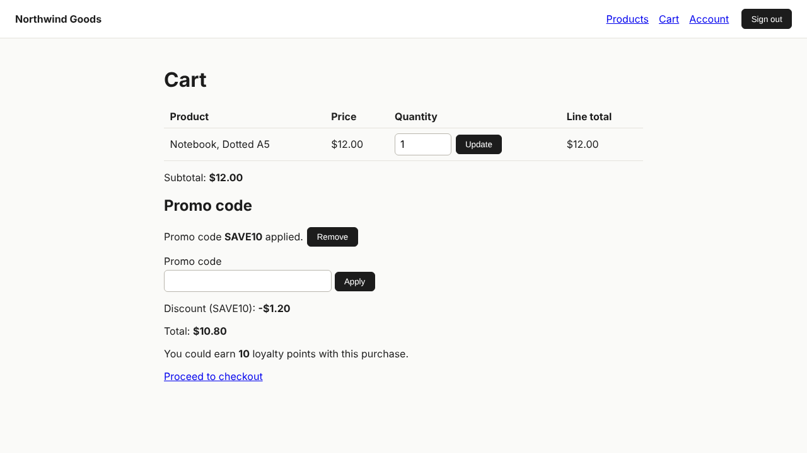
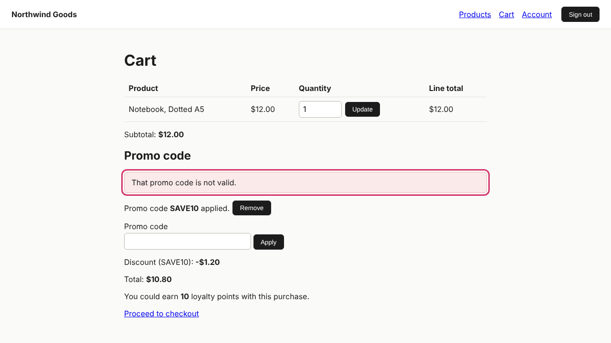
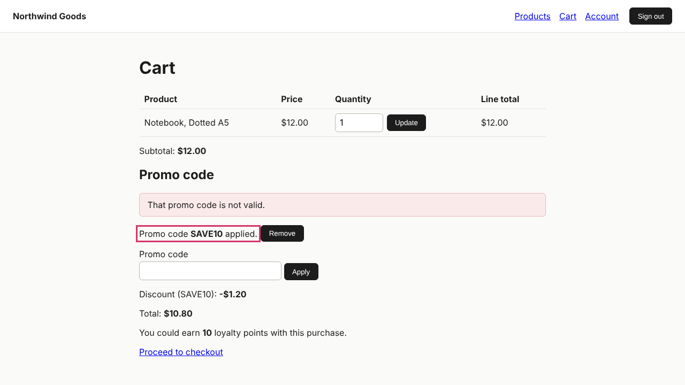
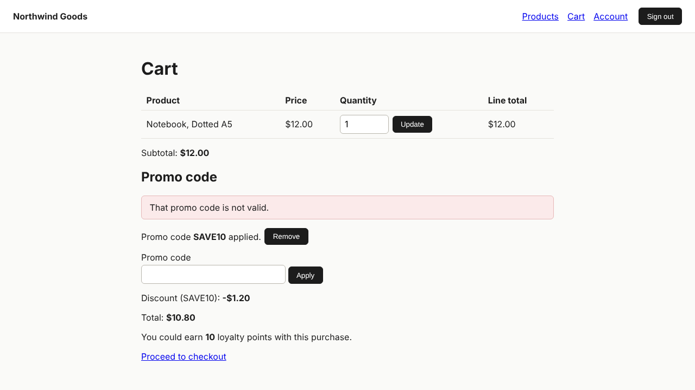
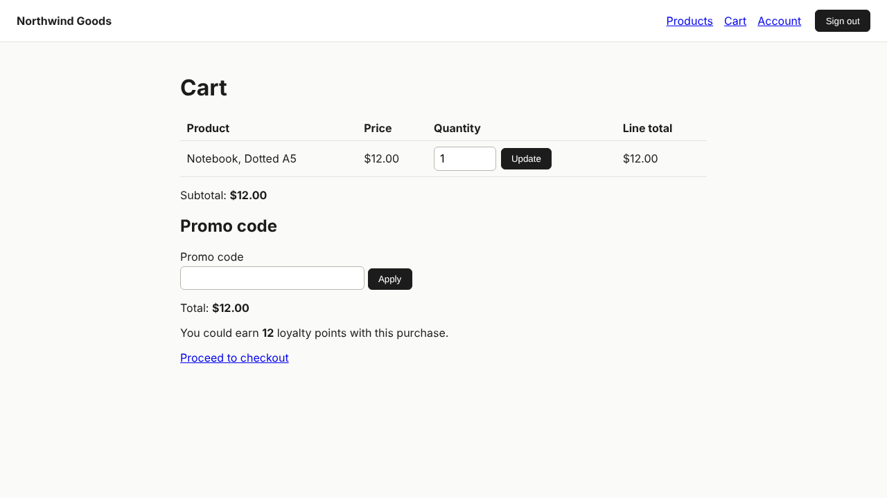
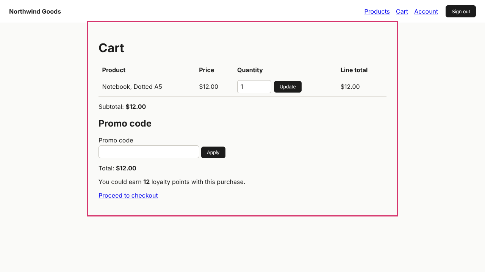

# S4 Lower-case code with surrounding spaces applies; unknown code errors and keeps it; Remove clears it

**Verdict: PASSED** — All 9 assertions matched.

- Steps chosen by: external model via HTTP bridge
- Environment: http://localhost:3000, commit 5ca65f012d822e0a2fe3dc56b1dd3a6a0066570b
- Started 2026-11-18T18:58:14.120Z, took 204.8 s, 46 tool calls
- Basis: requirement; requirements R8, R9, R13, R14, R17

## Objective

Sign in as the customer. Add one Notebook, Dotted A5 ($12.00) to the cart and open the cart page. In the promo code field type the code in lower case with two spaces before and after it ('  save10  ') and apply. Check the applied code is shown, and call GET /api/cart recording subtotalCents (sub1), discountCents (disc1) and totalCents (tot1). Then enter the unknown code BOGUS99 and apply. Record the error message shown, check the applied code is still shown, and call GET /api/cart recording discountCents (disc2) and totalCents (tot2). Finally press the Remove button next to the applied code. On the cart page record the Subtotal (uiSubtotal) and Total (uiTotal) in dollars, and call GET /api/cart recording subtotalCents (sub3), discountCents (disc3) and totalCents (tot3).

## Assertions

Expected values were fixed in the plan; actual values were read and compared in code.

| Id | What | Expected (plan) | Expected (evaluated) | Actual | Result | Evidence |
|---|---|---|---|---|---|---|
| A1 | After applying ' save10 ', discountCents from GET /api/cart (disc1) equals floor(sub1 / 10), i.e. SAVE10 was accepted despite lower case and surrounding spaces. | `floor(sub1 / 10)` | 120 | 120 | match | [check-A1.png](check-A1.png) |
| A2 | After applying ' save10 ', disc1 is at least 1 (the code was applied rather than rejected for the spaces). | `1` | 1 | 120 | match | [check-A2.png](check-A2.png) |
| A3 | After applying BOGUS99, the error message shown on the cart page contains exactly the text 'That promo code is not valid.' | `That promo code is not valid.` | That promo code is not valid. | That promo code is not valid. | match | [check-A3.png](check-A3.png) |
| A4 | After applying BOGUS99, discountCents from GET /api/cart (disc2) is unchanged from disc1. | `disc1` | 120 | 120 | match | [check-A4.png](check-A4.png) |
| A5 | After applying BOGUS99, totalCents from GET /api/cart (tot2) is unchanged from tot1. | `tot1` | 1080 | 1080 | match | [check-A5.png](check-A5.png) |
| A6 | After applying BOGUS99, the cart page's applied-code display still contains SAVE10 (case-insensitive match not needed: compare the displayed code text to SAVE10). | `SAVE10` | SAVE10 | Promo code SAVE10 applied. | match | [check-A6.png](check-A6.png) |
| A7 | After pressing Remove, discountCents from GET /api/cart (disc3) is 0. | `0` | 0 | 0 | match | [check-A7.png](check-A7.png) |
| A8 | After pressing Remove, totalCents from GET /api/cart (tot3) equals subtotalCents (sub3). | `sub3` | 1200 | 1200 | match | [check-A8.png](check-A8.png) |
| A9 | After pressing Remove, the Total shown on the cart page (uiTotal) equals the displayed Subtotal (uiSubtotal). | `uiSubtotal` | 12 | 12 | match | [check-A9.png](check-A9.png) |

## Observations

- `sub1` = 1200
- `disc1` = 120
- `tot1` = 1080
- `disc2` = 120
- `tot2` = 1080
- `uiSubtotal` = 12
- `sub3` = 1200
- `disc3` = 0
- `tot3` = 1200
- `uiTotal` = 12

## Steps

| # | Tool | Input | Outcome | Stated reason |
|---|---|---|---|---|
| 1 | navigate | {"path":"/"} | URL: / | Discover the application home page and sign-in entry. |
| 2 | navigate | {"path":"/login"} | URL: /login | Open the sign-in page to log in as the customer. |
| 3 | fill | {"element":{"by":"label","value":"Email"},"text":"s4-shopper@fixtures.test"} | URL: /login | Enter the shopper email. |
| 4 | fill | {"element":{"by":"label","value":"Password"},"text":"{{secret:shopper.password}}"} | URL: /login | Enter the shopper password placeholder. |
| 5 | click | {"element":{"by":"role","role":"button","value":"Sign in"}} | URL: /account | Submit the sign-in form. |
| 6 | navigate | {"path":"/cart"} | URL: /cart | Check the cart starts empty before adding the item. |
| 7 | navigate | {"path":"/"} | URL: / | Go to products to add the Notebook. |
| 8 | click | {"element":{"by":"role","role":"button","value":"Add Notebook, Dotted A5 to cart"}} | URL: /cart | Add one Notebook, Dotted A5 to the cart. |
| 9 | navigate | {"path":"/cart"} | URL: /cart | Open the cart page to apply the promo code. |
| 10 | fill | {"element":{"by":"label","value":"Promo code"},"text":" save10 "} | URL: /cart | Enter lower-case code with surrounding spaces. |
| 11 | click | {"element":{"by":"role","role":"button","value":"Apply"}} | URL: /cart | Apply the promo code. |
| 12 | api_request | {"method":"GET","path":"/api/cart"} | {"responseId":"R1","status":200,"body":{"lines":[{"productId":3,"name":"Notebook, Dotted A5","priceCents":1200,"quantity":1,"lineCents":1200}],"subtotalCents":1200,"promoCode":"SAVE10","discountCents":120,"totalCents":1080}} | Read cart totals after applying save10. |
| 13 | observe | {"name":"sub1","target":{"source":"api","responseId":"R1","field":"body","jsonPath":"subtotalCents","count":false}} | Recorded sub1 = 1200 | Record subtotalCents after applying save10. |
| 14 | observe | {"name":"disc1","target":{"source":"api","responseId":"R1","field":"body","jsonPath":"discountCents","count":false}} | Recorded disc1 = 120 | Record discountCents after applying save10. |
| 15 | observe | {"name":"tot1","target":{"source":"api","responseId":"R1","field":"body","jsonPath":"totalCents","count":false}} | Recorded tot1 = 1080 | Record totalCents after applying save10. |
| 16 | check | {"assertionId":"A1","target":{"source":"api","responseId":"R1","field":"body","jsonPath":"discountCents","count":false}} | Recorded A1: expected 120, actual 120 -> match. This result is final. | Discount should be floor(sub1/10). |
| 17 | check | {"assertionId":"A2","target":{"source":"api","responseId":"R1","field":"body","jsonPath":"discountCents","count":false}} | Recorded A2: expected 1, actual 120 -> match. This result is final. | Discount should be at least 1. |
| 18 | fill | {"element":{"by":"label","value":"Promo code"},"text":"BOGUS99"} | URL: /cart | Enter the unknown code. |
| 19 | click | {"element":{"by":"role","role":"button","value":"Apply"}} | URL: /cart?promo=unknown&code=BOGUS99 | Apply the unknown code. |
| 20 | check | {"assertionId":"A3","target":{"source":"page","by":"text","value":"promo code is not valid","count":false}} | Recorded A3: expected That promo code is not valid., actual That promo code is not valid. -> match. This result is final. | Check the error alert text after applying BOGUS99. |
| 21 | check | {"assertionId":"A6","target":{"source":"page","by":"role","role":"strong","value":"SAVE10","count":false}} | error: Error: Expected exactly one element for {"source":"page","by":"role","role":"strong","value":"SAVE10","count":false}, found 0. | Check the applied-code display still shows SAVE10. |
| 22 | api_request | {"method":"GET","path":"/api/cart"} | {"responseId":"R2","status":200,"body":{"lines":[{"productId":3,"name":"Notebook, Dotted A5","priceCents":1200,"quantity":1,"lineCents":1200}],"subtotalCents":1200,"promoCode":"SAVE10","discountCents":120,"totalCents":1080}} | Read cart totals after the rejected code. |
| 23 | check | {"assertionId":"A6","target":{"source":"page","by":"text","value":"SAVE10","count":false}} | error: Error: Expected exactly one element for {"source":"page","by":"text","value":"SAVE10","count":false}, found 2. | Check the applied-code display still shows SAVE10. |
| 24 | check | {"assertionId":"A6","target":{"source":"page","by":"text","value":"SAVE10 applied","count":false}} | Recorded A6: expected SAVE10, actual Promo code SAVE10 applied. -> match. This result is final. | Check the applied-code display still shows SAVE10. |
| 25 | observe | {"name":"disc2","target":{"source":"api","responseId":"R2","field":"body","jsonPath":"discountCents","count":false}} | Recorded disc2 = 120 | Record discountCents after BOGUS99. |
| 26 | observe | {"name":"tot2","target":{"source":"api","responseId":"R2","field":"body","jsonPath":"totalCents","count":false}} | Recorded tot2 = 1080 | Record totalCents after BOGUS99. |
| 27 | check | {"assertionId":"A4","target":{"source":"api","responseId":"R2","field":"body","jsonPath":"discountCents","count":false}} | Recorded A4: expected 120, actual 120 -> match. This result is final. | Discount should be unchanged after BOGUS99. |
| 28 | check | {"assertionId":"A5","target":{"source":"api","responseId":"R2","field":"body","jsonPath":"totalCents","count":false}} | Recorded A5: expected 1080, actual 1080 -> match. This result is final. | Total should be unchanged after BOGUS99. |
| 29 | click | {"element":{"by":"role","role":"button","value":"Remove promo code SAVE10"}} | URL: /cart | Remove the applied promo code. |
| 30 | observe | {"name":"uiSubtotal","target":{"source":"page","by":"text","value":"Subtotal:","count":false,"pattern":"\\$([0-9.,]+)"}} | Recorded uiSubtotal = 12 | Record displayed subtotal after Remove. |
| 31 | api_request | {"method":"GET","path":"/api/cart"} | {"responseId":"R3","status":200,"body":{"lines":[{"productId":3,"name":"Notebook, Dotted A5","priceCents":1200,"quantity":1,"lineCents":1200}],"subtotalCents":1200,"promoCode":null,"discountCents":0,"totalCents":1200}} | Read cart totals after removing the code. |
| 32 | observe | {"name":"uiTotal","target":{"source":"page","by":"text","value":"Total:","count":false,"pattern":"\\$([0-9.,]+)"}} | error: Error: Expected exactly one element for {"source":"page","by":"text","value":"Total:","count":false,"pattern":"\\$([0-9.,]+)"}, found 2. | Record displayed total after Remove. |
| 33 | observe | {"name":"sub3","target":{"source":"api","responseId":"R3","field":"body","jsonPath":"subtotalCents","count":false}} | Recorded sub3 = 1200 | Record subtotalCents after Remove. |
| 34 | observe | {"name":"disc3","target":{"source":"api","responseId":"R3","field":"body","jsonPath":"discountCents","count":false}} | Recorded disc3 = 0 | Record discountCents after Remove. |
| 35 | observe | {"name":"tot3","target":{"source":"api","responseId":"R3","field":"body","jsonPath":"totalCents","count":false}} | Recorded tot3 = 1200 | Record totalCents after Remove. |
| 36 | observe | {"name":"uiTotal","target":{"source":"page","by":"text","value":"/^Total:/","count":false,"pattern":"\\$([0-9.,]+)"}} | error: Error: Expected exactly one element for {"source":"page","by":"text","value":"/^Total:/","count":false,"pattern":"\\$([0-9.,]+)"}, found 0. | Record displayed total after Remove. |
| 37 | observe | {"name":"uiTotal","target":{"source":"page","by":"text","value":"Total: $12.00","count":false,"pattern":"\\$([0-9.,]+)"}} | error: Error: Expected exactly one element for {"source":"page","by":"text","value":"Total: $12.00","count":false,"pattern":"\\$([0-9.,]+)"}, found 2. | Record displayed total after Remove. |
| 38 | observe | {"name":"uiTotal","target":{"source":"page","by":"text","value":"Total:$12.00","count":false,"pattern":"\\$([0-9.,]+)"}} | error: Error: Expected exactly one element for {"source":"page","by":"text","value":"Total:$12.00","count":false,"pattern":"\\$([0-9.,]+)"}, found 0. | Record displayed total after Remove. |
| 39 | observe | {"name":"uiTotal","target":{"source":"page","by":"text","value":"Total: $12.00 You could earn","count":false,"pattern":"(?<!Sub)Total:\\s*\\$([0-9.,]+)"}} | error: Error: Expected exactly one element for {"source":"page","by":"text","value":"Total: $12.00 You could earn","count":false,"pattern":"(?<!Sub)Total:\\s*\\$([0-9.,]+)"}, found 0. | Record displayed total after Remove. |
| 40 | observe | {"name":"uiTotal","target":{"source":"page","by":"text","value":"Total: $12.00You could earn","count":false,"pattern":"(?<!Sub)Total:\\s*\\$([0-9.,]+)"}} | Recorded uiTotal = 12 | Record displayed total after Remove. |
| 41 | observe | {"name":"uiTotal","target":{"source":"page","by":"text","value":"Total: $12.00\nYou could earn","count":false,"pattern":"(?<!Sub)Total:\\s*\\$([0-9.,]+)"}} | error: Error: Observation "uiTotal" is already recorded as 12. | Record displayed total after Remove. |
| 42 | observe | {"name":"uiTotal","target":{"source":"page","by":"text","value":"Total:$12.00You could earn","count":false,"pattern":"(?<!Sub)Total:\\s*\\$([0-9.,]+)"}} | error: Error: Observation "uiTotal" is already recorded as 12. | Record displayed total after Remove. |
| 43 | check | {"assertionId":"A7","target":{"source":"api","responseId":"R3","field":"body","jsonPath":"discountCents","count":false}} | Recorded A7: expected 0, actual 0 -> match. This result is final. | Discount should be 0 after Remove. |
| 44 | check | {"assertionId":"A8","target":{"source":"api","responseId":"R3","field":"body","jsonPath":"totalCents","count":false}} | Recorded A8: expected 1200, actual 1200 -> match. This result is final. | Total should equal subtotal after Remove. |
| 45 | check | {"assertionId":"A9","target":{"source":"page","by":"text","value":"Total: $12.00You could earn","count":false,"pattern":"(?<!Sub)Total:\\s*\\$([0-9.,]+)"}} | Recorded A9: expected 12, actual 12 -> match. This result is final. | Displayed Total should equal displayed Subtotal after Remove. |
| 46 | finish | {"outcome":"completed","reason":"All assertions A1-A9 were checked at the scenario points described."} | Scenario ended. | Every planned assertion has been checked. |

## Evidence

- Playwright trace: `trace.zip` (open with `npx playwright show-trace`)
- A1: 
- A2: 
- A3: 
- A6: 
- A4: 
- A5: 
- A7: 
- A8: 
- A9: 
