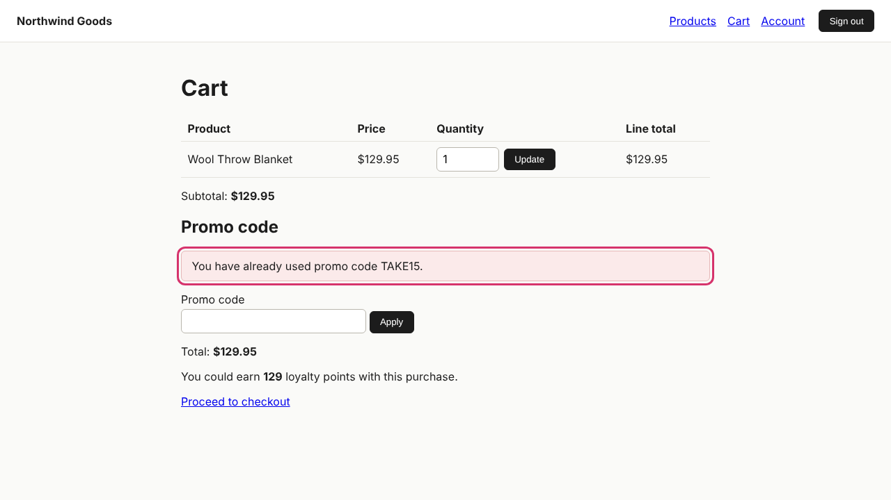
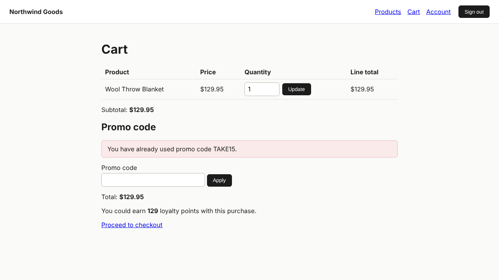
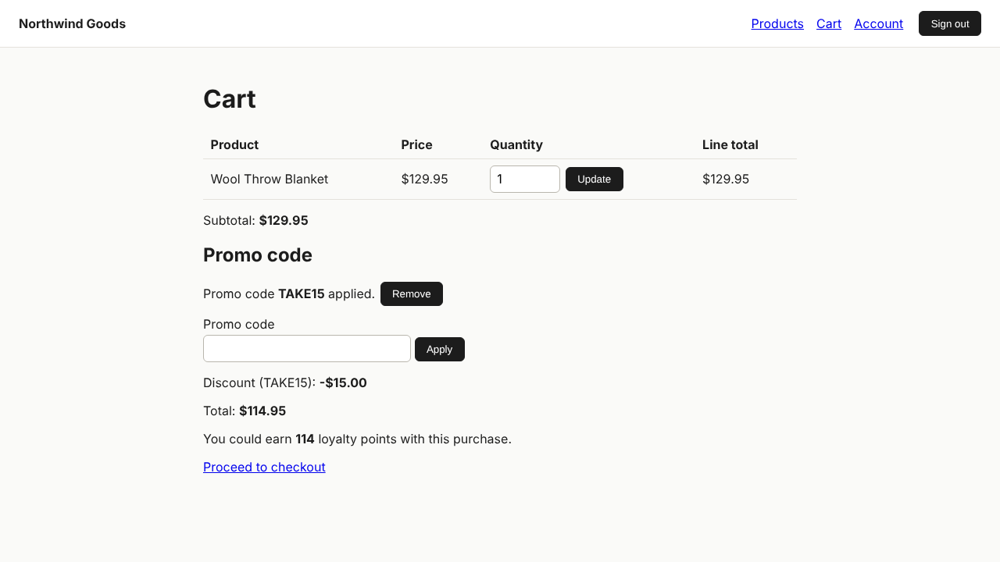
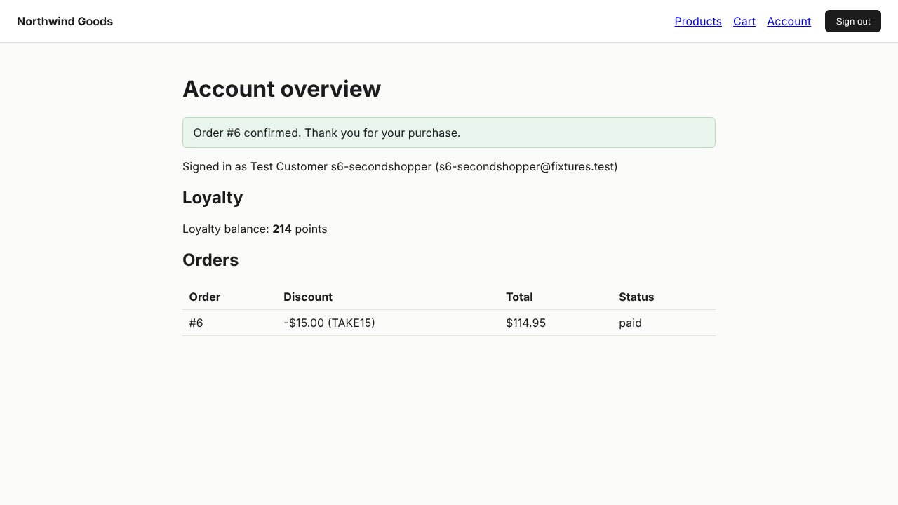

# S6 A code used by one customer is refused for them but still works for another customer

**Verdict: PASSED** — All 6 assertions matched.

- Steps chosen by: external model via HTTP bridge
- Environment: http://localhost:3000, commit 5ca65f012d822e0a2fe3dc56b1dd3a6a0066570b
- Started 2026-11-18T19:00:20.117Z, took 110.3 s, 46 tool calls
- Basis: requirement; requirements R21, R22, R29, R4

## Objective

Sign in as the first customer. Add one Wool Throw Blanket ($129.95) to the cart, apply TAKE15 and pay at checkout with card 4242 4242 4242 4242. Then add another Wool Throw Blanket to the cart, apply TAKE15 (upper case) again, and record the error message shown; call GET /api/cart and record discountCents (firstRetryDiscount). Sign out and sign in as the second customer. Add one Wool Throw Blanket, apply TAKE15 and call GET /api/cart recording subtotalCents (secondSubtotal), discountCents (secondDiscount) and totalCents (secondTotal). Pay at checkout with card 4242 4242 4242 4242, then call GET /api/account and record the order's discountCents (secondOrderDiscount) and totalCents (secondOrderTotal).

## Assertions

Expected values were fixed in the plan; actual values were read and compared in code.

| Id | What | Expected (plan) | Expected (evaluated) | Actual | Result | Evidence |
|---|---|---|---|---|---|---|
| A1 | For the first customer, after paying with TAKE15 and applying TAKE15 again, the error message on the cart page contains exactly 'You have already used promo code TAKE15.' | `You have already used promo code TAKE15.` | You have already used promo code TAKE15. | You have already used promo code TAKE15. | match | [check-A1.png](check-A1.png) |
| A2 | For the first customer after the refused re-apply, discountCents from GET /api/cart (firstRetryDiscount) is 0. | `0` | 0 | 0 | match | [check-A2.png](check-A2.png) |
| A3 | For the second customer after applying TAKE15, discountCents from GET /api/cart (secondDiscount) equals 1500. | `1500` | 1500 | 1500 | match | [check-A3.png](check-A3.png) |
| A4 | For the second customer after applying TAKE15, totalCents from GET /api/cart (secondTotal) equals secondSubtotal minus 1500. | `secondSubtotal - 1500` | 11495 | 11495 | match | [check-A4.png](check-A4.png) |
| A5 | For the second customer's paid order in GET /api/account, discountCents (secondOrderDiscount) equals 1500. | `1500` | 1500 | 1500 | match | [check-A5.png](check-A5.png) |
| A6 | For the second customer's paid order in GET /api/account, totalCents (secondOrderTotal) equals secondSubtotal minus 1500. | `secondSubtotal - 1500` | 11495 | 11495 | match | [check-A6.png](check-A6.png) |

## Observations

- `firstRetryDiscount` = 0
- `secondSubtotal` = 12995
- `secondDiscount` = 1500
- `secondTotal` = 11495
- `secondOrderDiscount` = 1500
- `secondOrderTotal` = 11495

## Steps

| # | Tool | Input | Outcome | Stated reason |
|---|---|---|---|---|
| 1 | navigate | {"path":"/"} | URL: / | Discover the application layout and sign-in entry. |
| 2 | navigate | {"path":"/login"} | URL: /login | Sign in as the first customer. |
| 3 | fill | {"element":{"by":"label","value":"Email"},"text":"s6-firstshopper@fixtures.test"} | URL: /login | Enter first customer email. |
| 4 | fill | {"element":{"by":"label","value":"Password"},"text":"{{secret:firstShopper.password}}"} | URL: /login | Enter first customer password. |
| 5 | click | {"element":{"by":"role","role":"button","value":"Sign in"}} | URL: /account | Submit sign-in. |
| 6 | navigate | {"path":"/cart"} | URL: /cart | Confirm the cart starts empty. |
| 7 | navigate | {"path":"/"} | URL: / | Go to products to add the blanket. |
| 8 | click | {"element":{"by":"role","role":"button","value":"Add Wool Throw Blanket to cart"}} | URL: /cart | Add one Wool Throw Blanket. |
| 9 | fill | {"element":{"by":"label","value":"Promo code"},"text":"TAKE15"} | URL: /cart | Enter the promo code for the first purchase. |
| 10 | click | {"element":{"by":"role","role":"button","value":"Apply"}} | URL: /cart | Apply TAKE15. |
| 11 | click | {"element":{"by":"role","role":"link","value":"Proceed to checkout"}} | URL: /checkout | Go to checkout to pay. |
| 12 | fill | {"element":{"by":"label","value":"Card number"},"text":"4242 4242 4242 4242"} | URL: /checkout | Enter accepted test card. |
| 13 | click | {"element":{"by":"role","role":"button","value":"Pay now"}} | URL: /account?order=2 | Pay for the first order with TAKE15. |
| 14 | navigate | {"path":"/"} | URL: / | Return to products for the second blanket. |
| 15 | click | {"element":{"by":"role","role":"button","value":"Add Wool Throw Blanket to cart"}} | URL: /cart | Add another Wool Throw Blanket. |
| 16 | fill | {"element":{"by":"label","value":"Promo code"},"text":"TAKE15"} | URL: /cart | Re-enter the already used code. |
| 17 | click | {"element":{"by":"role","role":"button","value":"Apply"}} | URL: /cart?promo=used&code=TAKE15 | Try to apply TAKE15 again. |
| 18 | check | {"assertionId":"A1","target":{"source":"page","by":"text","value":"You have already used promo code","count":false}} | Recorded A1: expected You have already used promo code TAKE15., actual You have already used promo code TAKE15. -> match. This result is final. | The refusal alert is on the cart page now. |
| 19 | api_request | {"method":"GET","path":"/api/cart"} | {"responseId":"R1","status":200,"body":{"lines":[{"productId":4,"name":"Wool Throw Blanket","priceCents":12995,"quantity":1,"lineCents":12995}],"subtotalCents":12995,"promoCode":null,"discountCents":0,"totalCents":12995}} | Read cart discount after the refused re-apply. |
| 20 | observe | {"name":"firstRetryDiscount","target":{"source":"api","responseId":"R1","field":"body","jsonPath":"discountCents","count":false}} | Recorded firstRetryDiscount = 0 | Record the discount after the refused re-apply. |
| 21 | check | {"assertionId":"A2","target":{"source":"api","responseId":"R1","field":"body","jsonPath":"discountCents","count":false}} | Recorded A2: expected 0, actual 0 -> match. This result is final. | Check discount is zero after refusal. |
| 22 | click | {"element":{"by":"role","role":"button","value":"Sign out"}} | URL: /login | Sign out the first customer. |
| 23 | navigate | {"path":"/login"} | URL: /login | Sign in as second customer. |
| 24 | fill | {"element":{"by":"label","value":"Email"},"text":"s6-secondshopper@fixtures.test"} | URL: /login | Enter second customer email. |
| 25 | fill | {"element":{"by":"label","value":"Password"},"text":"{{secret:secondShopper.password}}"} | URL: /login | Enter second customer password. |
| 26 | click | {"element":{"by":"role","role":"button","value":"Sign in"}} | URL: /account | Submit sign-in. |
| 27 | navigate | {"path":"/cart"} | URL: /cart | Confirm second customer cart starts empty. |
| 28 | navigate | {"path":"/"} | URL: / | Go to products. |
| 29 | click | {"element":{"by":"role","role":"button","value":"Add Wool Throw Blanket to cart"}} | URL: /cart | Add one blanket for second customer. |
| 30 | fill | {"element":{"by":"label","value":"Promo code"},"text":"TAKE15"} | URL: /cart | Enter the promo code. |
| 31 | click | {"element":{"by":"role","role":"button","value":"Apply"}} | URL: /cart | Apply TAKE15 for second customer. |
| 32 | api_request | {"method":"GET","path":"/api/cart"} | {"responseId":"R2","status":200,"body":{"lines":[{"productId":4,"name":"Wool Throw Blanket","priceCents":12995,"quantity":1,"lineCents":12995}],"subtotalCents":12995,"promoCode":"TAKE15","discountCents":1500,"totalCents":11495}} | Read cart totals after applying TAKE15. |
| 33 | observe | {"name":"secondSubtotal","target":{"source":"api","responseId":"R2","field":"body","jsonPath":"subtotalCents","count":false}} | Recorded secondSubtotal = 12995 | Record second customer cart value. |
| 34 | observe | {"name":"secondDiscount","target":{"source":"api","responseId":"R2","field":"body","jsonPath":"discountCents","count":false}} | Recorded secondDiscount = 1500 | Record second customer cart value. |
| 35 | observe | {"name":"secondTotal","target":{"source":"api","responseId":"R2","field":"body","jsonPath":"totalCents","count":false}} | Recorded secondTotal = 11495 | Record second customer cart value. |
| 36 | check | {"assertionId":"A3","target":{"source":"api","responseId":"R2","field":"body","jsonPath":"discountCents","count":false}} | Recorded A3: expected 1500, actual 1500 -> match. This result is final. | Check second customer discount. |
| 37 | check | {"assertionId":"A4","target":{"source":"api","responseId":"R2","field":"body","jsonPath":"totalCents","count":false}} | Recorded A4: expected 11495, actual 11495 -> match. This result is final. | Check second customer total. |
| 38 | navigate | {"path":"/checkout"} | URL: /checkout | Go to checkout for second customer. |
| 39 | fill | {"element":{"by":"label","value":"Card number"},"text":"4242 4242 4242 4242"} | URL: /checkout | Enter accepted test card. |
| 40 | click | {"element":{"by":"role","role":"button","value":"Pay now"}} | URL: /account?order=6 | Pay second customer order. |
| 41 | api_request | {"method":"GET","path":"/api/account"} | {"responseId":"R3","status":200,"body":{"customer":{"id":8,"email":"s6-secondshopper@fixtures.test","name":"Test Customer s6-secondshopper"},"balance":214,"transactions":[{"id":9,"orderId":6,"points":114,"reason":"purchase"},{"id":10,"orderId":6,"points":100,"reason":"welcome"}],"orders":[{"id":6,"t | Read the paid order discount and total. |
| 42 | observe | {"name":"secondOrderDiscount","target":{"source":"api","responseId":"R3","field":"body","jsonPath":"orders.0.discountCents","count":false}} | Recorded secondOrderDiscount = 1500 | Record paid order discount. |
| 43 | observe | {"name":"secondOrderTotal","target":{"source":"api","responseId":"R3","field":"body","jsonPath":"orders.0.totalCents","count":false}} | Recorded secondOrderTotal = 11495 | Record paid order total. |
| 44 | check | {"assertionId":"A5","target":{"source":"api","responseId":"R3","field":"body","jsonPath":"orders.0.discountCents","count":false}} | Recorded A5: expected 1500, actual 1500 -> match. This result is final. | Check paid order discount. |
| 45 | check | {"assertionId":"A6","target":{"source":"api","responseId":"R3","field":"body","jsonPath":"orders.0.totalCents","count":false}} | Recorded A6: expected 11495, actual 11495 -> match. This result is final. | Check paid order total. |
| 46 | finish | {"outcome":"completed","reason":"All six assertions A1-A6 were checked at the scenario points described."} | Scenario ended. | Every assertion has been checked. |

## Evidence

- Playwright trace: `trace.zip` (open with `npx playwright show-trace`)
- A1: 
- A2: 
- A3: 
- A4: 
- A5: 
- A6: 
