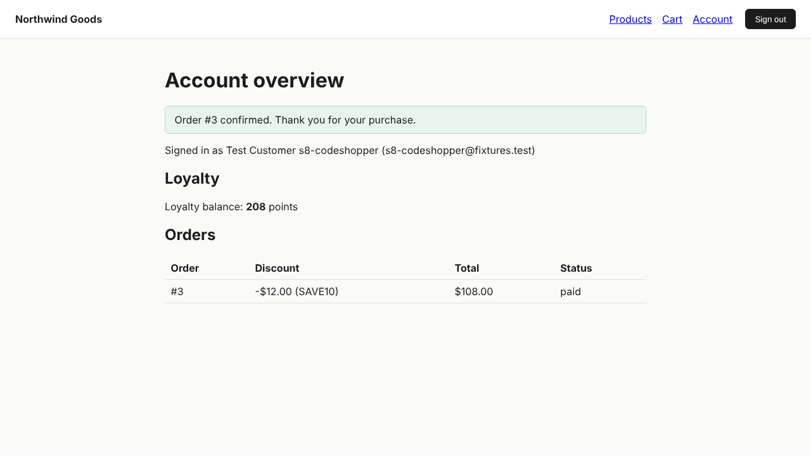
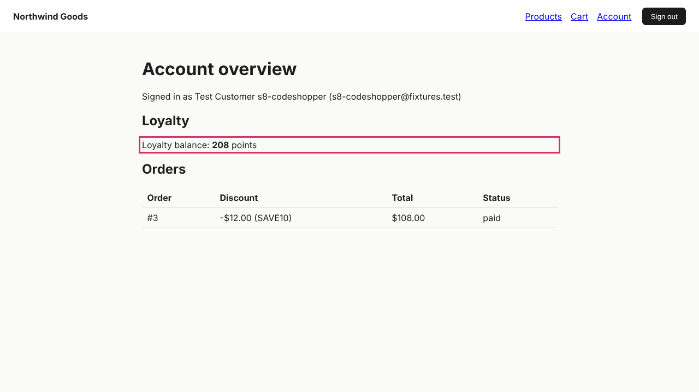

# S8 Loyalty points follow the charged amount: $108.00 after SAVE10 earns the same as $108.00 without a code

**Verdict: PASSED** — All 4 assertions matched.

- Steps chosen by: external model via HTTP bridge
- Environment: http://localhost:3000, commit 5ca65f012d822e0a2fe3dc56b1dd3a6a0066570b
- Started 2026-11-18T19:00:28.569Z, took 99.4 s, 48 tool calls
- Basis: risk; requirements R27, R28, R25

## Objective

Sign in as the first customer. Put Notebook, Dotted A5 ($12.00) in the cart with quantity 10 (subtotal $120.00), apply SAVE10 (discounted total $108.00) and pay at checkout with card 4242 4242 4242 4242. Call GET /api/account and record the order's totalCents (firstOrderTotal). Open the account overview and record the loyalty balance (firstPoints). Sign out and sign in as the second customer. Put Notebook, Dotted A5 in the cart with quantity 9 (subtotal $108.00), apply no code, and pay with card 4242 4242 4242 4242. Call GET /api/account and record the order's totalCents (secondOrderTotal) and discountCents (secondOrderDiscount), and check its promoCode. Open the account overview and record the loyalty balance (secondPoints).

## Assertions

Expected values were fixed in the plan; actual values were read and compared in code.

| Id | What | Expected (plan) | Expected (evaluated) | Actual | Result | Evidence |
|---|---|---|---|---|---|---|
| A1 | The first customer's order totalCents (firstOrderTotal) equals 10800 (12000 minus 10%). | `10800` | 10800 | 10800 | match | [check-A1.png](check-A1.png) |
| A2 | The second customer's order totalCents (secondOrderTotal) equals firstOrderTotal: both were charged the same amount. | `firstOrderTotal` | 10800 | 10800 | match | [check-A2.png](check-A2.png) |
| A3 | After both payments, the first customer's loyalty balance on the account overview (firstPoints) equals the second customer's loyalty balance (secondPoints): points are earned on the amount charged ($108.00 for both), not on the $120.00 pre-discount subtotal. | `secondPoints` | 208 | 208 | match | [check-A3.png](check-A3.png) |
| A4 | The second customer's order (no code) has discountCents (secondOrderDiscount) equal to 0 in GET /api/account. | `0` | 0 | 0 | match | [check-A4.png](check-A4.png) |

## Observations

- `firstOrderTotal` = 10800
- `firstPoints` = 208
- `secondOrderTotal` = 10800
- `secondOrderDiscount` = 0
- `secondPoints` = 208

## Steps

| # | Tool | Input | Outcome | Stated reason |
|---|---|---|---|---|
| 1 | navigate | {"path":"/"} | URL: / | Discover the application structure before signing in. |
| 2 | navigate | {"path":"/login"} | URL: /login | Open the sign-in page to log in as the first customer. |
| 3 | fill | {"element":{"by":"label","value":"Email"},"text":"s8-codeshopper@fixtures.test"} | URL: /login | Enter the first customer email. |
| 4 | fill | {"element":{"by":"label","value":"Password"},"text":"{{secret:codeShopper.password}}"} | URL: /login | Enter the first customer password. |
| 5 | click | {"element":{"by":"role","role":"button","value":"Sign in"}} | URL: /account | Submit the sign-in form. |
| 6 | navigate | {"path":"/"} | URL: / | Go to products to add the notebook. |
| 7 | click | {"element":{"by":"role","role":"button","value":"Add Notebook, Dotted A5 to cart"}} | URL: /cart | Add the notebook to the cart. |
| 8 | navigate | {"path":"/cart"} | URL: /cart | Open the cart to set quantity. |
| 9 | fill | {"element":{"by":"role","role":"spinbutton","value":"Quantity for Notebook, Dotted A5"},"text":"10"} | URL: /cart | Set quantity to 10. |
| 10 | click | {"element":{"by":"role","role":"button","value":"Update quantity for Notebook, Dotted A5"}} | URL: /cart | Apply the quantity change. |
| 11 | fill | {"element":{"by":"role","role":"textbox","value":"Promo code"},"text":"SAVE10"} | URL: /cart | Enter the SAVE10 code. |
| 12 | click | {"element":{"by":"role","role":"button","value":"Apply"}} | URL: /cart | Apply the promo code. |
| 13 | click | {"element":{"by":"role","role":"link","value":"Proceed to checkout"}} | URL: /checkout | Go to checkout to pay. |
| 14 | fill | {"element":{"by":"label","value":"Card number"},"text":"4242 4242 4242 4242"} | URL: /checkout | Enter the accepted test card. |
| 15 | click | {"element":{"by":"role","role":"button","value":"Pay now"}} | URL: /account?order=3 | Pay for the order. |
| 16 | api_request | {"method":"GET","path":"/api/account"} | {"responseId":"R1","status":200,"body":{"customer":{"id":10,"email":"s8-codeshopper@fixtures.test","name":"Test Customer s8-codeshopper"},"balance":208,"transactions":[{"id":5,"orderId":3,"points":108,"reason":"purchase"},{"id":6,"orderId":3,"points":100,"reason":"welcome"}],"orders":[{"id":3,"total | Read the first customer order totals. |
| 17 | observe | {"name":"firstOrderTotal","target":{"source":"api","responseId":"R1","field":"body","jsonPath":"orders.0.totalCents","count":false}} | Recorded firstOrderTotal = 10800 | Record the first order total. |
| 18 | check | {"assertionId":"A1","target":{"source":"api","responseId":"R1","field":"body","jsonPath":"orders.0.totalCents","count":false}} | Recorded A1: expected 10800, actual 10800 -> match. This result is final. | First order totalCents should be 10800. |
| 19 | navigate | {"path":"/account"} | URL: /account | Open the account overview to read the loyalty balance. |
| 20 | observe | {"name":"firstPoints","target":{"source":"page","by":"text","value":"Loyalty balance:","count":false,"pattern":"Loyalty balance:\\s*(\\d+)"}} | Recorded firstPoints = 208 | Record the first customer loyalty balance. |
| 21 | click | {"element":{"by":"role","role":"button","value":"Sign out"}} | URL: /login | Sign out the first customer. |
| 22 | navigate | {"path":"/login"} | URL: /login | Open sign-in for the second customer. |
| 23 | fill | {"element":{"by":"label","value":"Email"},"text":"s8-plainshopper@fixtures.test"} | URL: /login | Enter second customer email. |
| 24 | fill | {"element":{"by":"label","value":"Password"},"text":"{{secret:plainShopper.password}}"} | URL: /login | Enter second customer password. |
| 25 | click | {"element":{"by":"role","role":"button","value":"Sign in"}} | URL: /account | Submit sign-in. |
| 26 | navigate | {"path":"/cart"} | URL: /cart | Check the second customer cart starts empty. |
| 27 | navigate | {"path":"/"} | URL: / | Go to products. |
| 28 | click | {"element":{"by":"role","role":"button","value":"Add Notebook, Dotted A5 to cart"}} | URL: /cart | Add the notebook. |
| 29 | navigate | {"path":"/cart"} | URL: /cart | Open cart. |
| 30 | fill | {"element":{"by":"role","role":"spinbutton","value":"Quantity for Notebook, Dotted A5"},"text":"9"} | URL: /cart | Set quantity to 9. |
| 31 | click | {"element":{"by":"role","role":"button","value":"Update quantity for Notebook, Dotted A5"}} | URL: /cart | Apply quantity. |
| 32 | navigate | {"path":"/checkout"} | URL: /checkout | Go to checkout. |
| 33 | fill | {"element":{"by":"label","value":"Card number"},"text":"4242 4242 4242 4242"} | URL: /checkout | Enter accepted card. |
| 34 | click | {"element":{"by":"role","role":"button","value":"Pay now"}} | URL: /account?order=5 | Pay for the order. |
| 35 | api_request | {"method":"GET","path":"/api/account"} | {"responseId":"R2","status":200,"body":{"customer":{"id":11,"email":"s8-plainshopper@fixtures.test","name":"Test Customer s8-plainshopper"},"balance":208,"transactions":[{"id":7,"orderId":5,"points":108,"reason":"purchase"},{"id":8,"orderId":5,"points":100,"reason":"welcome"}],"orders":[{"id":5,"tot | Read the second customer order fields. |
| 36 | observe | {"name":"secondOrderTotal","target":{"source":"api","responseId":"R2","field":"body","jsonPath":"orders.0.totalCents","count":false}} | Recorded secondOrderTotal = 10800 | Record second order total. |
| 37 | observe | {"name":"secondOrderDiscount","target":{"source":"api","responseId":"R2","field":"body","jsonPath":"orders.0.discountCents","count":false}} | Recorded secondOrderDiscount = 0 | Record second order discount. |
| 38 | check | {"assertionId":"A2","target":{"source":"api","responseId":"R2","field":"body","jsonPath":"orders.0.totalCents","count":false}} | Recorded A2: expected 10800, actual 10800 -> match. This result is final. | Second order total should equal the first. |
| 39 | check | {"assertionId":"A4","target":{"source":"api","responseId":"R2","field":"body","jsonPath":"orders.0.discountCents","count":false}} | Recorded A4: expected 0, actual 0 -> match. This result is final. | Second order discount should be 0. |
| 40 | navigate | {"path":"/account"} | URL: /account | Open account overview for the second customer balance. |
| 41 | observe | {"name":"secondPoints","target":{"source":"page","by":"text","value":"Loyalty balance:","count":false,"pattern":"Loyalty balance:\\s*(\\d+)"}} | Recorded secondPoints = 208 | Record the second customer loyalty balance. |
| 42 | click | {"element":{"by":"role","role":"button","value":"Sign out"}} | URL: /login | Sign out the second customer. |
| 43 | navigate | {"path":"/login"} | URL: /login | Sign back in as the first customer to read their balance after both payments. |
| 44 | fill | {"element":{"by":"label","value":"Email"},"text":"s8-codeshopper@fixtures.test"} | URL: /login | Enter first customer email. |
| 45 | fill | {"element":{"by":"label","value":"Password"},"text":"{{secret:codeShopper.password}}"} | URL: /login | Enter first customer password. |
| 46 | click | {"element":{"by":"role","role":"button","value":"Sign in"}} | URL: /account | Submit sign-in. |
| 47 | check | {"assertionId":"A3","target":{"source":"page","by":"text","value":"Loyalty balance:","count":false,"pattern":"Loyalty balance:\\s*(\\d+)"}} | Recorded A3: expected 208, actual 208 -> match. This result is final. | First customer balance after both payments should equal secondPoints. |
| 48 | finish | {"outcome":"completed","reason":"All four assertions checked. Note: both balances include a 100-point welcome bonus in addition to 108 purchase points; second order promoCode is null."} | Scenario ended. | Every assertion has been checked. |

## Evidence

- Playwright trace: `trace.zip` (open with `npx playwright show-trace`)
- A1: 
- A2: 
- A4: 
- A3: 
