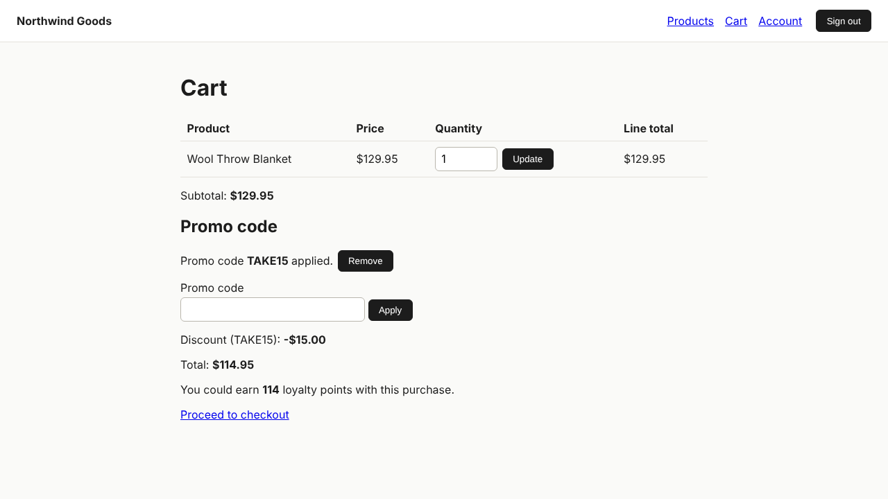

# S9 SAVE10 and TAKE15 do not stack

**Verdict: PASSED** — All 3 assertions matched.

- Steps chosen by: external model via HTTP bridge
- Environment: http://localhost:3000, commit 5ca65f012d822e0a2fe3dc56b1dd3a6a0066570b
- Started 2026-11-18T19:01:03.317Z, took 51.4 s, 23 tool calls
- Basis: requirement; requirements R18

## Objective

Sign in as the customer. Add one Wool Throw Blanket ($129.95) to the cart and open the cart page. Apply SAVE10 and call GET /api/cart recording discountCents (firstDiscount). Then apply TAKE15 (whatever the page does with it) and call GET /api/cart, recording subtotalCents (sub), discountCents (bothDiscount) and totalCents (tot).

## Assertions

Expected values were fixed in the plan; actual values were read and compared in code.

| Id | What | Expected (plan) | Expected (evaluated) | Actual | Result | Evidence |
|---|---|---|---|---|---|---|
| A1 | After attempting to apply TAKE15 on top of SAVE10, discountCents from GET /api/cart (bothDiscount) is at most the larger of the two single discounts, max(firstDiscount, 1500), i.e. never their sum. | `max(firstDiscount, 1500)` | 1500 | 1500 | match | [check-A1.png](check-A1.png) |
| A2 | After attempting to apply TAKE15 on top of SAVE10, totalCents (tot) is at least sub minus max(firstDiscount, 1500). | `sub - max(firstDiscount, 1500)` | 11495 | 11495 | match | [check-A2.png](check-A2.png) |
| A3 | After attempting to apply TAKE15 on top of SAVE10, totalCents (tot) equals sub minus bothDiscount. | `sub - bothDiscount` | 11495 | 11495 | match | [check-A3.png](check-A3.png) |

## Observations

- `firstDiscount` = 1300
- `sub` = 12995
- `bothDiscount` = 1500
- `tot` = 11495

## Steps

| # | Tool | Input | Outcome | Stated reason |
|---|---|---|---|---|
| 1 | navigate | {"path":"/"} | URL: / | Discover the application entry point and sign-in link. |
| 2 | navigate | {"path":"/login"} | URL: /login | Sign in as the customer first. |
| 3 | fill | {"element":{"by":"label","value":"Email"},"text":"s9-shopper@fixtures.test"} | URL: /login | Enter the shopper email. |
| 4 | fill | {"element":{"by":"label","value":"Password"},"text":"{{secret:shopper.password}}"} | URL: /login | Enter the shopper password placeholder. |
| 5 | click | {"element":{"by":"role","role":"button","value":"Sign in"}} | URL: /account | Submit the sign-in form. |
| 6 | api_request | {"method":"GET","path":"/api/cart"} | {"responseId":"R1","status":200,"body":{"lines":[],"subtotalCents":0,"promoCode":null,"discountCents":0,"totalCents":0}} | Confirm the cart starts empty before adding the blanket. |
| 7 | navigate | {"path":"/"} | URL: / | Go to the product list to add the blanket. |
| 8 | click | {"element":{"by":"role","role":"button","value":"Add Wool Throw Blanket to cart"}} | URL: /cart | Add one Wool Throw Blanket to the cart. |
| 9 | navigate | {"path":"/cart"} | URL: /cart | Open the cart page to apply promo codes. |
| 10 | fill | {"element":{"by":"label","value":"Promo code"},"text":"SAVE10"} | URL: /cart | Enter the first promo code. |
| 11 | click | {"element":{"by":"role","role":"button","value":"Apply"}} | URL: /cart | Apply SAVE10. |
| 12 | api_request | {"method":"GET","path":"/api/cart"} | {"responseId":"R2","status":200,"body":{"lines":[{"productId":4,"name":"Wool Throw Blanket","priceCents":12995,"quantity":1,"lineCents":12995}],"subtotalCents":12995,"promoCode":"SAVE10","discountCents":1300,"totalCents":11695}} | Read the cart discount after SAVE10. |
| 13 | observe | {"name":"firstDiscount","target":{"source":"api","responseId":"R2","field":"body","jsonPath":"discountCents","count":false}} | Recorded firstDiscount = 1300 | Record the SAVE10 discount. |
| 14 | fill | {"element":{"by":"label","value":"Promo code"},"text":"TAKE15"} | URL: /cart | Enter the second promo code on top of SAVE10. |
| 15 | click | {"element":{"by":"role","role":"button","value":"Apply"}} | URL: /cart | Attempt to apply TAKE15. |
| 16 | api_request | {"method":"GET","path":"/api/cart"} | {"responseId":"R3","status":200,"body":{"lines":[{"productId":4,"name":"Wool Throw Blanket","priceCents":12995,"quantity":1,"lineCents":12995}],"subtotalCents":12995,"promoCode":"TAKE15","discountCents":1500,"totalCents":11495}} | Read the cart after attempting TAKE15. |
| 17 | observe | {"name":"sub","target":{"source":"api","responseId":"R3","field":"body","jsonPath":"subtotalCents","count":false}} | Recorded sub = 12995 | Record subtotalCents after attempting TAKE15. |
| 18 | observe | {"name":"bothDiscount","target":{"source":"api","responseId":"R3","field":"body","jsonPath":"discountCents","count":false}} | Recorded bothDiscount = 1500 | Record discountCents after attempting TAKE15. |
| 19 | observe | {"name":"tot","target":{"source":"api","responseId":"R3","field":"body","jsonPath":"totalCents","count":false}} | Recorded tot = 11495 | Record totalCents after attempting TAKE15. |
| 20 | check | {"assertionId":"A1","target":{"source":"api","responseId":"R3","field":"body","jsonPath":"discountCents","count":false}} | Recorded A1: expected 1500, actual 1500 -> match. This result is final. | Discount after TAKE15 attempt must not exceed the larger single discount. |
| 21 | check | {"assertionId":"A2","target":{"source":"api","responseId":"R3","field":"body","jsonPath":"totalCents","count":false}} | Recorded A2: expected 11495, actual 11495 -> match. This result is final. | Total after TAKE15 attempt must be at least sub minus the larger single discount. |
| 22 | check | {"assertionId":"A3","target":{"source":"api","responseId":"R3","field":"body","jsonPath":"totalCents","count":false}} | Recorded A3: expected 11495, actual 11495 -> match. This result is final. | Total must equal sub minus the applied discount. |
| 23 | finish | {"outcome":"completed","reason":"All three assertions (A1, A2, A3) were checked against GET /api/cart after attempting TAKE15 on top of SAVE10; the app replaced SAVE10 with TAKE15."} | Scenario ended. | Every planned assertion has been checked. |

## Evidence

- Playwright trace: `trace.zip` (open with `npx playwright show-trace`)
- A1: 
- A2: 
- A3: 
