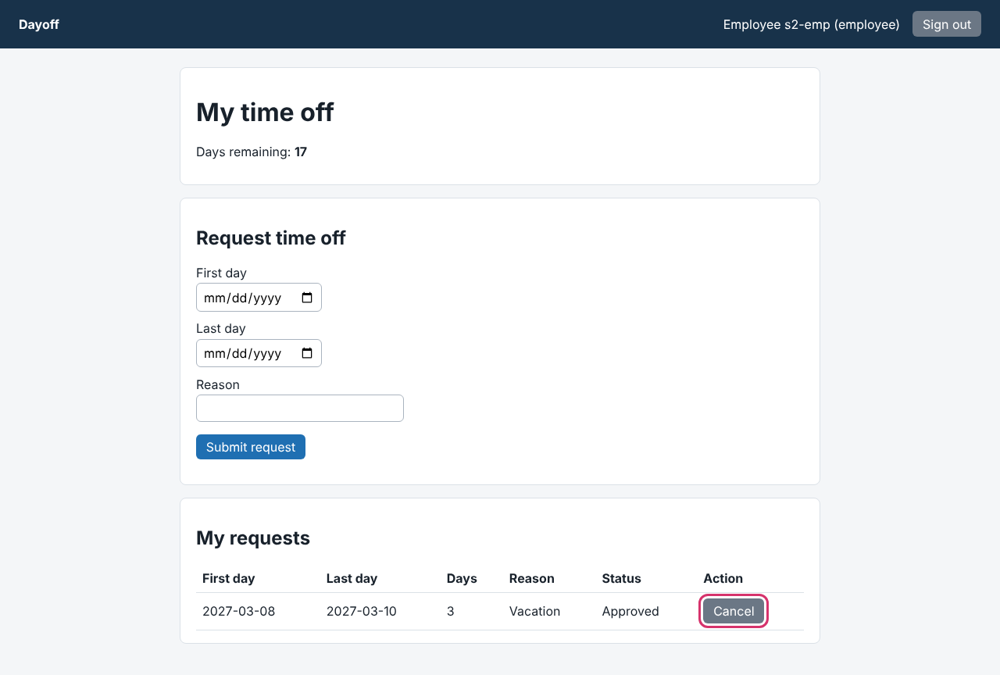
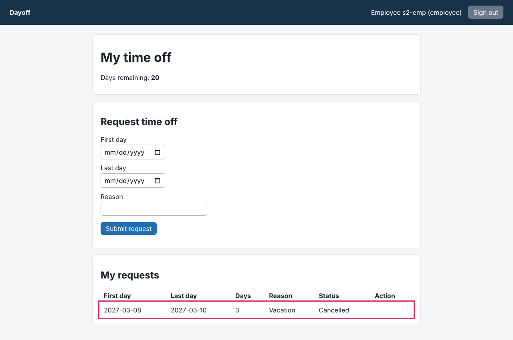
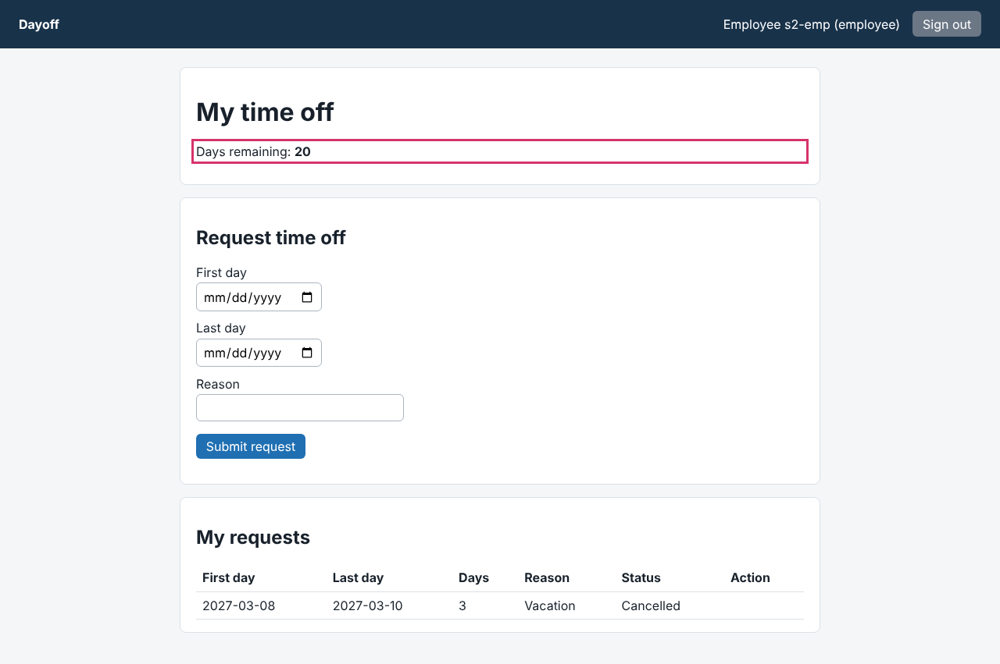

# S2 Employee cancels an Approved far-future request in the UI; days returned immediately and after reload

**Verdict: FAILED** — A2: expected 2027-03-10, got Cancel

- Steps chosen by: external model via HTTP bridge
- Environment: http://localhost:3100, commit 08e7842a56d2988b058d3e07853d2da1601a42f0
- Started 2026-11-18T18:55:47.782Z, took 135.5 s, 30 tool calls
- Basis: requirement; requirements R2, R3, R9, R10, R11, R12

## Objective

Sign in as the employee and request leave with first day 2027-03-08, last day 2027-03-10 and any reason. Record Days remaining as balanceBeforeApproval. Sign out, sign in as the manager and approve this request. Sign out and sign in again as the employee. Record Days remaining as balanceApproved. In My requests, look at the Cancel button on the Approved row and its accessible name. Click Cancel. Without reloading, record Days remaining as balanceAfterCancel and look at the row's status. Reload the page and record Days remaining as balanceAfterReload, and look at the row's status again.

## Assertions

Expected values were fixed in the plan; actual values were read and compared in code.

| Id | What | Expected (plan) | Expected (evaluated) | Actual | Result | Evidence |
|---|---|---|---|---|---|---|
| A1 | After approval, before cancelling: a Cancel button exists in the My requests row of the Approved request 2027-03-08 to 2027-03-10. | `present` | present | present | match | [check-A1.png](check-A1.png) |
| A2 | After approval: the accessible name of that Approved row's Cancel button contains the last day 2027-03-10. | `2027-03-10` | 2027-03-10 | Cancel | **MISMATCH** | [check-A2.png](check-A2.png) |
| A3 | Right after clicking Cancel, without reload: the status shown in the row for 2027-03-08 to 2027-03-10 contains Cancelled. | `Cancelled` | Cancelled | 2027-03-08 2027-03-10 3 Vacation Cancelled | match | [check-A3.png](check-A3.png) |
| A4 | Days remaining right after the cancel without reload (balanceAfterCancel) equals balanceBeforeApproval, i.e. the request's days were returned. | `balanceBeforeApproval` | 20 | 20 | match | [check-A4.png](check-A4.png) |
| A5 | Days remaining right after the cancel (balanceAfterCancel) is at least balanceApproved + 1 (the balance went up). | `balanceApproved + 1` | 18 | 20 | match | [check-A5.png](check-A5.png) |
| A6 | Days remaining after reloading the page (balanceAfterReload) equals balanceBeforeApproval. | `balanceBeforeApproval` | 20 | 20 | match | [check-A6.png](check-A6.png) |

## Observations

- `balanceBeforeApproval` = 20
- `balanceApproved` = 17
- `balanceAfterCancel` = 20
- `balanceAfterReload` = 20

## Steps

| # | Tool | Input | Outcome | Stated reason |
|---|---|---|---|---|
| 1 | navigate | {"path":"/"} | URL: / | Start at the app root to find sign-in. |
| 2 | fill | {"element":{"by":"label","value":"Username"},"text":"s2-emp"} | URL: / | Enter employee username. |
| 3 | fill | {"element":{"by":"label","value":"Password"},"text":"{{secret:emp.password}}"} | URL: / | Enter employee password. |
| 4 | click | {"element":{"by":"role","role":"button","value":"Sign in"}} | URL: / | Sign in as employee. |
| 5 | fill | {"element":{"by":"label","value":"First day"},"text":"2027-03-08"} | URL: / | Enter first day. |
| 6 | fill | {"element":{"by":"label","value":"Last day"},"text":"2027-03-10"} | URL: / | Enter last day. |
| 7 | fill | {"element":{"by":"label","value":"Reason"},"text":"Vacation"} | URL: / | Enter a reason. |
| 8 | click | {"element":{"by":"role","role":"button","value":"Submit request"}} | URL: / | Submit the leave request. |
| 9 | observe | {"name":"balanceBeforeApproval","target":{"source":"page","by":"text","value":"Days remaining:","count":false,"pattern":"Days remaining:\\s*(\\d+)"}} | Recorded balanceBeforeApproval = 20 | Record balance after request, before approval. |
| 10 | click | {"element":{"by":"role","role":"button","value":"Sign out"}} | URL: / | Sign out employee. |
| 11 | fill | {"element":{"by":"label","value":"Username"},"text":"s2-mgr"} | URL: / | Enter manager username. |
| 12 | fill | {"element":{"by":"label","value":"Password"},"text":"{{secret:mgr.password}}"} | URL: / | Enter manager password. |
| 13 | click | {"element":{"by":"role","role":"button","value":"Sign in"}} | URL: / | Sign in as manager. |
| 14 | click | {"element":{"by":"role","role":"button","value":"Approve request 4 from Employee s2-emp"}} | URL: / | Approve the s2-emp request. |
| 15 | click | {"element":{"by":"role","role":"button","value":"Sign out"}} | URL: / | Sign out manager. |
| 16 | fill | {"element":{"by":"label","value":"Username"},"text":"s2-emp"} | URL: / | Enter employee username. |
| 17 | fill | {"element":{"by":"label","value":"Password"},"text":"{{secret:emp.password}}"} | URL: / | Enter employee password. |
| 18 | click | {"element":{"by":"role","role":"button","value":"Sign in"}} | URL: / | Sign in as employee again. |
| 19 | observe | {"name":"balanceApproved","target":{"source":"page","by":"text","value":"Days remaining:","count":false,"pattern":"Days remaining:\\s*(\\d+)"}} | Recorded balanceApproved = 17 | Record balance after approval. |
| 20 | check | {"assertionId":"A1","target":{"source":"page","by":"role","role":"button","value":"Cancel request from 2027-03-08 to 2027-03-10","count":false}} | Recorded A1: expected present, actual present -> match. This result is final. | Cancel button in the Approved row exists. |
| 21 | check | {"assertionId":"A2","target":{"source":"page","by":"role","role":"button","value":"Cancel request from 2027-03-08 to 2027-03-10","count":false}} | Recorded A2: expected 2027-03-10, actual Cancel -> MISMATCH. This result is final. | Read accessible name of the Cancel button. |
| 22 | click | {"element":{"by":"role","role":"button","value":"Cancel request from 2027-03-08 to 2027-03-10"}} | URL: / | Cancel the Approved request. |
| 23 | observe | {"name":"balanceAfterCancel","target":{"source":"page","by":"text","value":"Days remaining:","count":false,"pattern":"Days remaining:\\s*(\\d+)"}} | Recorded balanceAfterCancel = 20 | Record balance right after cancel. |
| 24 | check | {"assertionId":"A3","target":{"source":"page","by":"role","role":"row","value":"2027-03-08 2027-03-10 3 Vacation Cancelled","count":false}} | Recorded A3: expected Cancelled, actual 2027-03-08 2027-03-10 3 Vacation Cancelled -> match. This result is final. | Status in the row after cancel. |
| 25 | check | {"assertionId":"A4","target":{"source":"page","by":"text","value":"Days remaining:","count":false,"pattern":"Days remaining:\\s*(\\d+)"}} | Recorded A4: expected 20, actual 20 -> match. This result is final. | Balance after cancel equals before approval. |
| 26 | check | {"assertionId":"A5","target":{"source":"page","by":"text","value":"Days remaining:","count":false,"pattern":"Days remaining:\\s*(\\d+)"}} | Recorded A5: expected 18, actual 20 -> match. This result is final. | Balance after cancel went up. |
| 27 | navigate | {"path":"/"} | URL: / | Reload the page. |
| 28 | observe | {"name":"balanceAfterReload","target":{"source":"page","by":"text","value":"Days remaining:","count":false,"pattern":"Days remaining:\\s*(\\d+)"}} | Recorded balanceAfterReload = 20 | Record balance after reload. |
| 29 | check | {"assertionId":"A6","target":{"source":"page","by":"text","value":"Days remaining:","count":false,"pattern":"Days remaining:\\s*(\\d+)"}} | Recorded A6: expected 20, actual 20 -> match. This result is final. | Balance after reload equals before approval. |
| 30 | finish | {"outcome":"completed","reason":"All assertions A1-A6 checked. Note: A2 targeted the button by role+accessible name \"Cancel request from 2027-03-08 to 2027-03-10\", but the check tool compared the visible text \"Cancel\" instead of the accessible name, so it recorded a mismatch even though the accessibility tree shows the name contains 2027-03-10."} | Scenario ended. | Every planned assertion has been checked. |

## Evidence

- Playwright trace: `trace.zip` (open with `npx playwright show-trace`)
- A1: 
- A2: 
- A3: 
- A4: 
- A5: 
- A6: 
