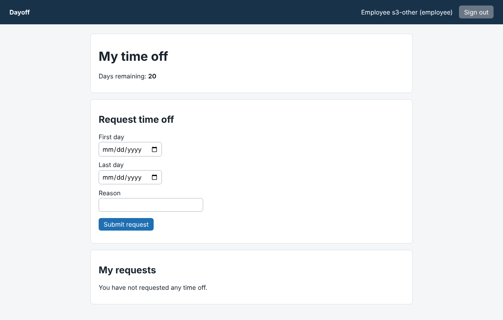
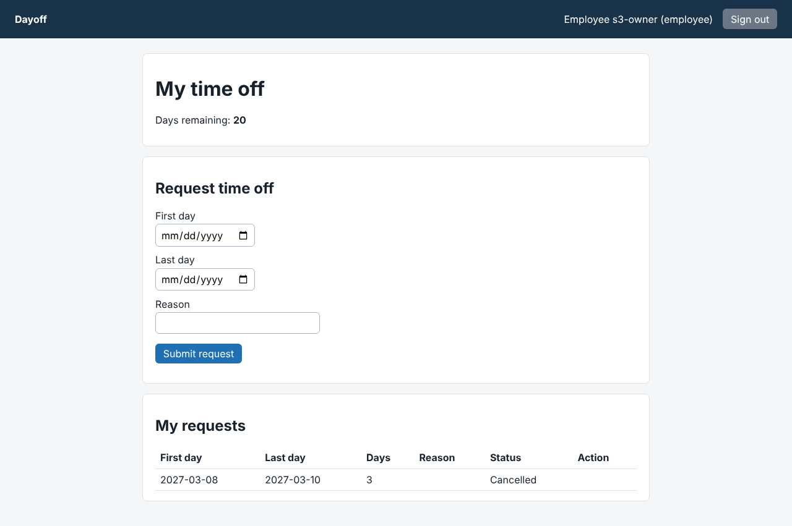

# S3 Non-owner employee cannot cancel someone else's Approved request

**Verdict: FAILED** — A1: expected 403, got 200; A2: expected Approved, got Cancelled; A3: expected 17, got 20

- Steps chosen by: external model via HTTP bridge
- Environment: http://localhost:3100, commit 08e7842a56d2988b058d3e07853d2da1601a42f0
- Started 2026-11-18T18:55:47.782Z, took 133.4 s, 34 tool calls
- Basis: risk; requirements R18, R20

## Objective

Sign in as employee owner and create a request with first day 2027-03-08, last day 2027-03-10. Sign out, sign in as the manager and approve it; note the request id. Sign out and sign in as owner; record Days remaining as ownerBalanceBefore. Sign out and sign in as employee other. As other, POST /api/requests/<id>/cancel for owner's request and record the HTTP status code as otherCancelStatus. Sign out, sign in as owner, record Days remaining as ownerBalanceAfter and look at the request's status in GET /api/requests.

## Assertions

Expected values were fixed in the plan; actual values were read and compared in code.

| Id | What | Expected (plan) | Expected (evaluated) | Actual | Result | Evidence |
|---|---|---|---|---|---|---|
| A1 | HTTP status code of other's POST /api/requests/<owner request id>/cancel (otherCancelStatus) equals 403. | `403` | 403 | 200 | **MISMATCH** | [check-A1.png](check-A1.png) |
| A2 | After other's attempt, signed in as owner: status field of the request in GET /api/requests equals Approved. | `Approved` | Approved | Cancelled | **MISMATCH** | [check-A2.png](check-A2.png) |
| A3 | After other's attempt: owner's Days remaining (ownerBalanceAfter) equals ownerBalanceBefore. | `ownerBalanceBefore` | 17 | 20 | **MISMATCH** | [check-A3.png](check-A3.png) |

## Observations

- `ownerBalanceBefore` = 17
- `otherCancelStatus` = 200
- `ownerBalanceAfter` = 20

## Steps

| # | Tool | Input | Outcome | Stated reason |
|---|---|---|---|---|
| 1 | navigate | {"path":"/"} | URL: / | Discover the app entry page and sign-in form. |
| 2 | fill | {"element":{"by":"role","role":"textbox","value":"Username"},"text":"s3-owner"} | URL: / | Sign in as owner. |
| 3 | fill | {"element":{"by":"role","role":"textbox","value":"Password"},"text":"{{secret:owner.password}}"} | URL: / | Owner password. |
| 4 | click | {"element":{"by":"role","role":"button","value":"Sign in"}} | URL: / | Submit sign in. |
| 5 | fill | {"element":{"by":"role","role":"textbox","value":"First day"},"text":"2027-03-08"} | URL: / | Set first day. |
| 6 | fill | {"element":{"by":"role","role":"textbox","value":"Last day"},"text":"2027-03-10"} | URL: / | Set last day. |
| 7 | click | {"element":{"by":"role","role":"button","value":"Submit request"}} | URL: / | Create the request. |
| 8 | api_request | {"method":"GET","path":"/api/requests"} | {"responseId":"R1","status":200,"body":[{"id":2,"employee":"s3-owner","employeeName":"Employee s3-owner","start":"2027-03-08","end":"2027-03-10","days":3,"reason":"","status":"Pending"}]} | Find the request id. |
| 9 | click | {"element":{"by":"role","role":"button","value":"Sign out"}} | URL: / | Sign out owner. |
| 10 | fill | {"element":{"by":"role","role":"textbox","value":"Username"},"text":"s3-mgr"} | URL: / | Sign in as manager. |
| 11 | fill | {"element":{"by":"role","role":"textbox","value":"Password"},"text":"{{secret:mgr.password}}"} | URL: / | Manager password. |
| 12 | click | {"element":{"by":"role","role":"button","value":"Sign in"}} | URL: / | Submit sign in. |
| 13 | click | {"element":{"by":"role","role":"button","value":"Approve request 2 from Employee s3-owner"}} | URL: / | Approve owner request #2. |
| 14 | click | {"element":{"by":"role","role":"button","value":"Sign out"}} | URL: / | Sign out manager. |
| 15 | fill | {"element":{"by":"role","role":"textbox","value":"Username"},"text":"s3-owner"} | URL: / | Sign in as owner. |
| 16 | fill | {"element":{"by":"role","role":"textbox","value":"Password"},"text":"{{secret:owner.password}}"} | URL: / | Owner password. |
| 17 | click | {"element":{"by":"role","role":"button","value":"Sign in"}} | URL: / | Submit sign in. |
| 18 | observe | {"name":"ownerBalanceBefore","target":{"source":"page","by":"text","value":"Days remaining:","count":false,"pattern":"(\\d+)"}} | Recorded ownerBalanceBefore = 17 | Record owner balance before other attempts cancel. |
| 19 | click | {"element":{"by":"role","role":"button","value":"Sign out"}} | URL: / | Sign out owner. |
| 20 | fill | {"element":{"by":"role","role":"textbox","value":"Username"},"text":"s3-other"} | URL: / | Sign in as other. |
| 21 | fill | {"element":{"by":"role","role":"textbox","value":"Password"},"text":"{{secret:other.password}}"} | URL: / | Other password. |
| 22 | click | {"element":{"by":"role","role":"button","value":"Sign in"}} | URL: / | Submit sign in. |
| 23 | api_request | {"method":"POST","path":"/api/requests/2/cancel"} | {"responseId":"R2","status":200,"body":{"id":2,"employee":"s3-owner","employeeName":"Employee s3-owner","start":"2027-03-08","end":"2027-03-10","days":3,"reason":"","status":"Cancelled"}} | Other attempts to cancel owner request #2. |
| 24 | observe | {"name":"otherCancelStatus","target":{"source":"api","responseId":"R2","field":"status","jsonPath":"","count":false}} | Recorded otherCancelStatus = 200 | Record status code of other cancel attempt. |
| 25 | check | {"assertionId":"A1","target":{"source":"api","responseId":"R2","field":"status","jsonPath":"","count":false}} | Recorded A1: expected 403, actual 200 -> MISMATCH. This result is final. | A1: status code of other cancel attempt. |
| 26 | click | {"element":{"by":"role","role":"button","value":"Sign out"}} | URL: / | Sign out other. |
| 27 | fill | {"element":{"by":"role","role":"textbox","value":"Username"},"text":"s3-owner"} | URL: / | Sign in as owner. |
| 28 | fill | {"element":{"by":"role","role":"textbox","value":"Password"},"text":"{{secret:owner.password}}"} | URL: / | Owner password. |
| 29 | click | {"element":{"by":"role","role":"button","value":"Sign in"}} | URL: / | Submit sign in. |
| 30 | api_request | {"method":"GET","path":"/api/requests"} | {"responseId":"R3","status":200,"body":[{"id":2,"employee":"s3-owner","employeeName":"Employee s3-owner","start":"2027-03-08","end":"2027-03-10","days":3,"reason":"","status":"Cancelled"}]} | Read request status as owner. |
| 31 | check | {"assertionId":"A2","target":{"source":"api","responseId":"R3","field":"body","jsonPath":"0.status","count":false}} | Recorded A2: expected Approved, actual Cancelled -> MISMATCH. This result is final. | A2: status of owner request #2 after other attempt. |
| 32 | observe | {"name":"ownerBalanceAfter","target":{"source":"page","by":"text","value":"Days remaining:","count":false,"pattern":"(\\d+)"}} | Recorded ownerBalanceAfter = 20 | Record owner balance after other attempt. |
| 33 | check | {"assertionId":"A3","target":{"source":"page","by":"text","value":"Days remaining:","count":false,"pattern":"(\\d+)"}} | Recorded A3: expected 17, actual 20 -> MISMATCH. This result is final. | A3: owner balance after equals before. |
| 34 | finish | {"outcome":"completed","reason":"All three assertions checked. Other employee POST /api/requests/2/cancel returned 200 and cancelled owner request; owner balance went 17 -> 20."} | Scenario ended. | Every assertion has been checked. |

## Evidence

- Playwright trace: `trace.zip` (open with `npx playwright show-trace`)
- A1: 
- A2: 
- A3: 
