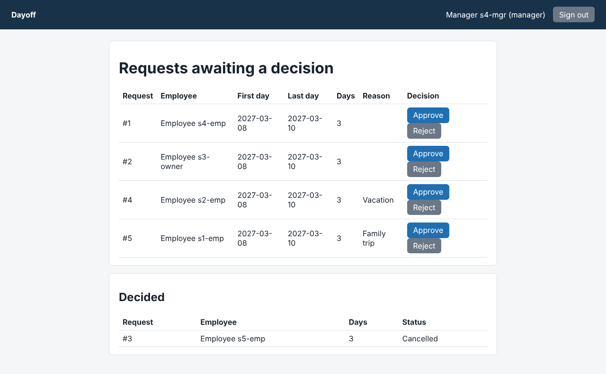
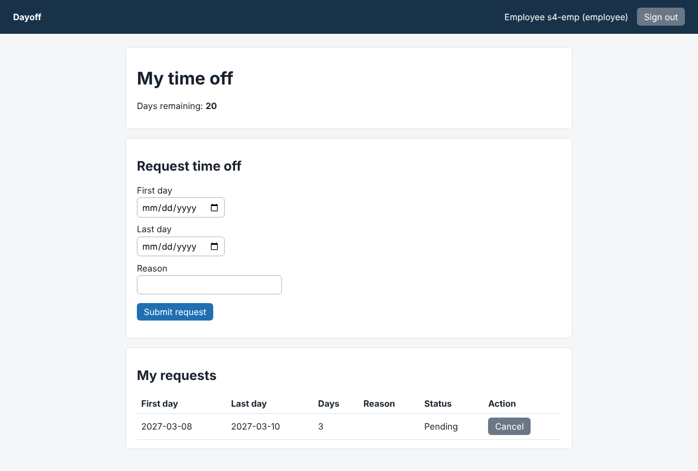
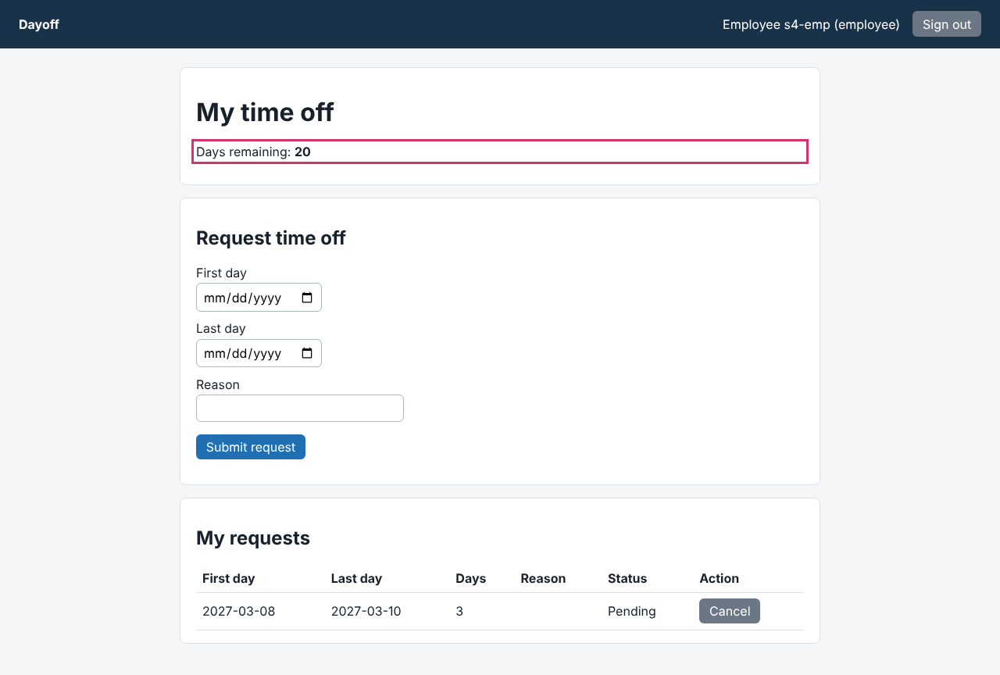

# S4 Manager cannot cancel an employee's request

**Verdict: PASSED** — All 3 assertions matched.

- Steps chosen by: external model via HTTP bridge
- Environment: http://localhost:3100, commit 08e7842a56d2988b058d3e07853d2da1601a42f0
- Started 2026-11-18T18:55:47.782Z, took 125.2 s, 25 tool calls
- Basis: requirement; requirements R19, R20

## Objective

Sign in as the employee and create a request with first day 2027-03-08, last day 2027-03-10; note its id and record Days remaining as balanceBefore. Sign out, sign in as the manager and POST /api/requests/<id>/cancel; record the HTTP status code as mgrCancelStatus. Sign out, sign in as the employee, read the request's status from GET /api/requests and record Days remaining as balanceAfter.

## Assertions

Expected values were fixed in the plan; actual values were read and compared in code.

| Id | What | Expected (plan) | Expected (evaluated) | Actual | Result | Evidence |
|---|---|---|---|---|---|---|
| A1 | HTTP status code of the manager's POST /api/requests/<id>/cancel (mgrCancelStatus) equals 403. | `403` | 403 | 403 | match | [check-A1.png](check-A1.png) |
| A2 | After the manager's attempt, as the employee: status field of the request in GET /api/requests equals Pending. | `Pending` | Pending | Pending | match | [check-A2.png](check-A2.png) |
| A3 | After the manager's attempt: employee's Days remaining (balanceAfter) equals balanceBefore. | `balanceBefore` | 20 | 20 | match | [check-A3.png](check-A3.png) |

## Observations

- `balanceBefore` = 20
- `mgrCancelStatus` = 403
- `balanceAfter` = 20

## Steps

| # | Tool | Input | Outcome | Stated reason |
|---|---|---|---|---|
| 1 | navigate | {"path":"/"} | URL: / | Discover the landing page and sign-in form. |
| 2 | fill | {"element":{"by":"label","value":"Username"},"text":"s4-emp"} | URL: / | Enter employee handle. |
| 3 | fill | {"element":{"by":"label","value":"Password"},"text":"{{secret:emp.password}}"} | URL: / | Enter employee password. |
| 4 | click | {"element":{"by":"role","role":"button","value":"Sign in"}} | URL: / | Sign in as employee. |
| 5 | fill | {"element":{"by":"label","value":"First day"},"text":"2027-03-08"} | URL: / | Set first day. |
| 6 | fill | {"element":{"by":"label","value":"Last day"},"text":"2027-03-10"} | URL: / | Set last day. |
| 7 | click | {"element":{"by":"role","role":"button","value":"Submit request"}} | URL: / | Create the request. |
| 8 | observe | {"name":"balanceBefore","target":{"source":"page","by":"text","value":"Days remaining:","count":false,"pattern":"Days remaining:\\s*(\\d+)"}} | Recorded balanceBefore = 20 | Record Days remaining after creating the request. |
| 9 | api_request | {"method":"GET","path":"/api/requests"} | {"responseId":"R1","status":200,"body":[{"id":1,"employee":"s4-emp","employeeName":"Employee s4-emp","start":"2027-03-08","end":"2027-03-10","days":3,"reason":"","status":"Pending"}]} | Find the new request id. |
| 10 | click | {"element":{"by":"role","role":"button","value":"Sign out"}} | URL: / | Sign out employee. |
| 11 | fill | {"element":{"by":"label","value":"Username"},"text":"s4-mgr"} | URL: / | Manager handle. |
| 12 | fill | {"element":{"by":"label","value":"Password"},"text":"{{secret:mgr.password}}"} | URL: / | Manager password. |
| 13 | click | {"element":{"by":"role","role":"button","value":"Sign in"}} | URL: / | Sign in as manager. |
| 14 | api_request | {"method":"POST","path":"/api/requests/1/cancel"} | {"responseId":"R2","status":403,"body":{"error":"Only the employee who made a request can cancel it."}} | Manager attempts to cancel the employee request. |
| 15 | observe | {"name":"mgrCancelStatus","target":{"source":"api","responseId":"R2","field":"status","jsonPath":"","count":false}} | Recorded mgrCancelStatus = 403 | Record manager cancel status. |
| 16 | check | {"assertionId":"A1","target":{"source":"api","responseId":"R2","field":"status","jsonPath":"","count":false}} | Recorded A1: expected 403, actual 403 -> match. This result is final. | Check manager cancel HTTP status. |
| 17 | click | {"element":{"by":"role","role":"button","value":"Sign out"}} | URL: / | Sign out manager. |
| 18 | fill | {"element":{"by":"label","value":"Username"},"text":"s4-emp"} | URL: / | Employee handle. |
| 19 | fill | {"element":{"by":"label","value":"Password"},"text":"{{secret:emp.password}}"} | URL: / | Employee password. |
| 20 | click | {"element":{"by":"role","role":"button","value":"Sign in"}} | URL: / | Sign back in as employee. |
| 21 | api_request | {"method":"GET","path":"/api/requests"} | {"responseId":"R3","status":200,"body":[{"id":1,"employee":"s4-emp","employeeName":"Employee s4-emp","start":"2027-03-08","end":"2027-03-10","days":3,"reason":"","status":"Pending"}]} | Read request status after manager attempt. |
| 22 | check | {"assertionId":"A2","target":{"source":"api","responseId":"R3","field":"body","jsonPath":"0.status","count":false}} | Recorded A2: expected Pending, actual Pending -> match. This result is final. | Check status of request 1 (index 0) after manager attempt. |
| 23 | observe | {"name":"balanceAfter","target":{"source":"page","by":"text","value":"Days remaining:","count":false,"pattern":"Days remaining:\\s*(\\d+)"}} | Recorded balanceAfter = 20 | Record Days remaining after the manager attempt. |
| 24 | check | {"assertionId":"A3","target":{"source":"page","by":"text","value":"Days remaining:","count":false,"pattern":"Days remaining:\\s*(\\d+)"}} | Recorded A3: expected 20, actual 20 -> match. This result is final. | Compare Days remaining to balanceBefore. |
| 25 | finish | {"outcome":"completed","reason":"All three assertions (A1, A2, A3) were checked in the states the scenario required."} | Scenario ended. | Every assertion has been checked. |

## Evidence

- Playwright trace: `trace.zip` (open with `npx playwright show-trace`)
- A1: 
- A2: 
- A3: 
