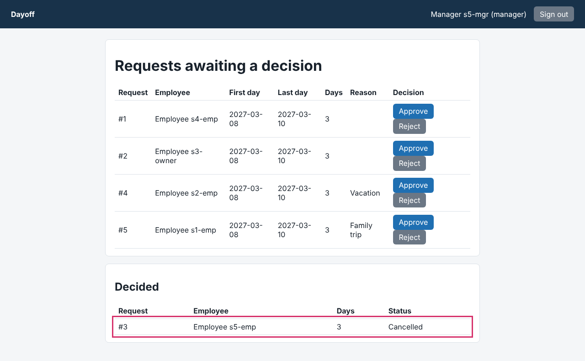
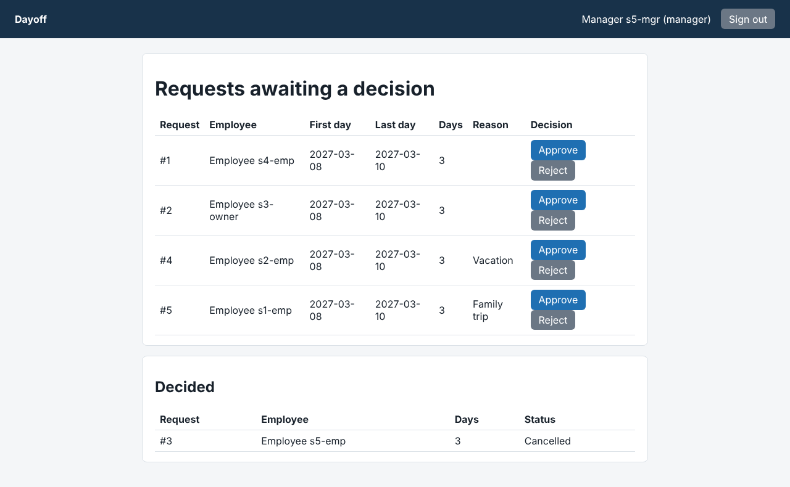
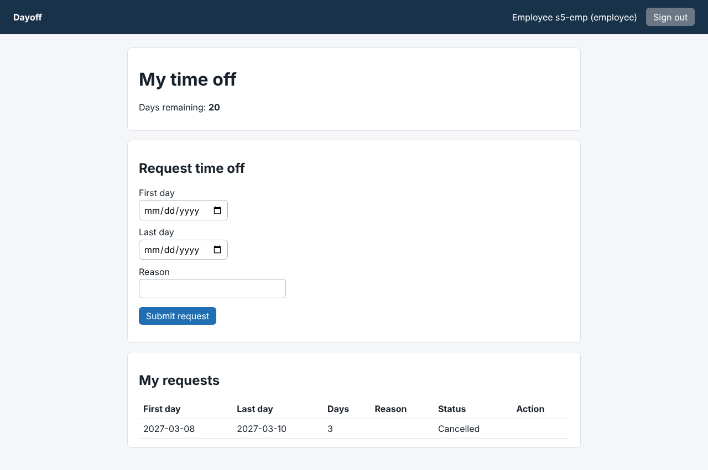

# S5 Cancelled request leaves the manager's queue, shows under Decided and cannot be approved or rejected

**Verdict: PASSED** — All 6 assertions matched.

- Steps chosen by: external model via HTTP bridge
- Environment: http://localhost:3100, commit 08e7842a56d2988b058d3e07853d2da1601a42f0
- Started 2026-11-18T18:55:47.782Z, took 131.8 s, 31 tool calls
- Basis: requirement; requirements R21, R22, R23, R24

## Objective

Sign in as the employee, create a request with first day 2027-03-08, last day 2027-03-10, note its id, record Days remaining as balanceBefore, and cancel it with the Cancel button in My requests. Sign out, sign in as the manager and view the main page: look for the request in the Requests awaiting a decision section and in the Decided section, and read its status in Decided. Then POST /api/requests/<id>/decision with decision approve and record the HTTP status code as approveStatus; then with decision reject and record it as rejectStatus. Sign out, sign in as the employee, read the request's status from GET /api/requests and record Days remaining as balanceAfter.

## Assertions

Expected values were fixed in the plan; actual values were read and compared in code.

| Id | What | Expected (plan) | Expected (evaluated) | Actual | Result | Evidence |
|---|---|---|---|---|---|---|
| A1 | Manager main page after the cancel: no entry for the request 2027-03-08 to 2027-03-10 is listed under Requests awaiting a decision. | `absent` | absent | absent | match | [check-A1.png](check-A1.png) |
| A2 | Manager main page after the cancel: the entry for the request 2027-03-08 to 2027-03-10 under Decided shows a status containing Cancelled. | `Cancelled` | Cancelled | #3 Employee s5-emp 3 Cancelled | match | [check-A2.png](check-A2.png) |
| A3 | HTTP status code of the manager's POST /api/requests/<id>/decision with approve (approveStatus) equals 409. | `409` | 409 | 409 | match | [check-A3.png](check-A3.png) |
| A4 | HTTP status code of the manager's POST /api/requests/<id>/decision with reject (rejectStatus) equals 409. | `409` | 409 | 409 | match | [check-A4.png](check-A4.png) |
| A5 | After both decision attempts, as the employee: status field of the request in GET /api/requests equals Cancelled. | `Cancelled` | Cancelled | Cancelled | match | [check-A5.png](check-A5.png) |
| A6 | After both decision attempts: employee's Days remaining (balanceAfter) equals balanceBefore. | `balanceBefore` | 20 | 20 | match | [check-A6.png](check-A6.png) |

## Observations

- `balanceBefore` = 20
- `approveStatus` = 409
- `rejectStatus` = 409
- `balanceAfter` = 20

## Steps

| # | Tool | Input | Outcome | Stated reason |
|---|---|---|---|---|
| 1 | navigate | {"path":"/"} | URL: / | Open the app to find the sign-in page. |
| 2 | fill | {"element":{"by":"role","role":"textbox","value":"Username"},"text":"s5-emp"} | URL: / | Enter employee username. |
| 3 | fill | {"element":{"by":"role","role":"textbox","value":"Password"},"text":"{{secret:emp.password}}"} | URL: / | Enter employee password. |
| 4 | click | {"element":{"by":"role","role":"button","value":"Sign in"}} | URL: / | Sign in as employee. |
| 5 | fill | {"element":{"by":"role","role":"textbox","value":"First day"},"text":"2027-03-08"} | URL: / | Set first day. |
| 6 | fill | {"element":{"by":"role","role":"textbox","value":"Last day"},"text":"2027-03-10"} | URL: / | Set last day. |
| 7 | click | {"element":{"by":"role","role":"button","value":"Submit request"}} | URL: / | Create the request. |
| 8 | api_request | {"method":"GET","path":"/api/requests"} | {"responseId":"R1","status":200,"body":[{"id":3,"employee":"s5-emp","employeeName":"Employee s5-emp","start":"2027-03-08","end":"2027-03-10","days":3,"reason":"","status":"Pending"}]} | Find the new request id. |
| 9 | observe | {"name":"balanceBefore","target":{"source":"page","by":"text","value":"Days remaining:","count":false,"pattern":"(\\d+)"}} | Recorded balanceBefore = 20 | Record Days remaining before cancel. |
| 10 | click | {"element":{"by":"role","role":"button","value":"Cancel request from 2027-03-08 to 2027-03-10"}} | URL: / | Cancel the request via My requests. |
| 11 | click | {"element":{"by":"role","role":"button","value":"Sign out"}} | URL: / | Sign out employee. |
| 12 | fill | {"element":{"by":"role","role":"textbox","value":"Username"},"text":"s5-mgr"} | URL: / | Enter manager username. |
| 13 | fill | {"element":{"by":"role","role":"textbox","value":"Password"},"text":"{{secret:mgr.password}}"} | URL: / | Enter manager password. |
| 14 | click | {"element":{"by":"role","role":"button","value":"Sign in"}} | URL: / | Sign in as manager to view main page. |
| 15 | check | {"assertionId":"A1","target":{"source":"page","by":"role","role":"button","value":"Approve request 3 from Employee s5-emp","count":false}} | Recorded A1: expected absent, actual absent -> match. This result is final. | Awaiting entries carry an Approve button named after the request; request 3 should have none. |
| 16 | check | {"assertionId":"A2","target":{"source":"page","by":"role","role":"row","value":"#3 Employee s5-emp 3 Cancelled","count":false}} | Recorded A2: expected Cancelled, actual #3 Employee s5-emp 3 Cancelled -> match. This result is final. | The Decided row for request 3 shows its status. |
| 17 | api_request | {"method":"POST","path":"/api/requests/3/decision","body":{"decision":"approve"}} | {"responseId":"R2","status":409,"body":{"error":"This request was already decided."}} | Attempt to approve the cancelled request. |
| 18 | api_request | {"method":"POST","path":"/api/requests/3/decision","body":{"decision":"reject"}} | {"responseId":"R3","status":409,"body":{"error":"This request was already decided."}} | Attempt to reject the cancelled request. |
| 19 | observe | {"name":"approveStatus","target":{"source":"api","responseId":"R2","field":"status","jsonPath":"","count":false}} | Recorded approveStatus = 409 | Record approve status code. |
| 20 | observe | {"name":"rejectStatus","target":{"source":"api","responseId":"R3","field":"status","jsonPath":"","count":false}} | Recorded rejectStatus = 409 | Record reject status code. |
| 21 | check | {"assertionId":"A3","target":{"source":"api","responseId":"R2","field":"status","jsonPath":"","count":false}} | Recorded A3: expected 409, actual 409 -> match. This result is final. | Approve attempt status code. |
| 22 | check | {"assertionId":"A4","target":{"source":"api","responseId":"R3","field":"status","jsonPath":"","count":false}} | Recorded A4: expected 409, actual 409 -> match. This result is final. | Reject attempt status code. |
| 23 | click | {"element":{"by":"role","role":"button","value":"Sign out"}} | URL: / | Sign out manager. |
| 24 | fill | {"element":{"by":"role","role":"textbox","value":"Username"},"text":"s5-emp"} | URL: / | Enter employee username. |
| 25 | fill | {"element":{"by":"role","role":"textbox","value":"Password"},"text":"{{secret:emp.password}}"} | URL: / | Enter employee password. |
| 26 | click | {"element":{"by":"role","role":"button","value":"Sign in"}} | URL: / | Sign in as employee. |
| 27 | api_request | {"method":"GET","path":"/api/requests"} | {"responseId":"R4","status":200,"body":[{"id":3,"employee":"s5-emp","employeeName":"Employee s5-emp","start":"2027-03-08","end":"2027-03-10","days":3,"reason":"","status":"Cancelled"}]} | Read the request status after decision attempts. |
| 28 | check | {"assertionId":"A5","target":{"source":"api","responseId":"R4","field":"body","jsonPath":"0.status","count":false}} | Recorded A5: expected Cancelled, actual Cancelled -> match. This result is final. | Status of request 3 (only entry) in GET /api/requests. |
| 29 | observe | {"name":"balanceAfter","target":{"source":"page","by":"text","value":"Days remaining:","count":false,"pattern":"(\\d+)"}} | Recorded balanceAfter = 20 | Record Days remaining after decision attempts. |
| 30 | check | {"assertionId":"A6","target":{"source":"page","by":"text","value":"Days remaining:","count":false,"pattern":"(\\d+)"}} | Recorded A6: expected 20, actual 20 -> match. This result is final. | Days remaining should equal balanceBefore. |
| 31 | finish | {"outcome":"completed","reason":"All assertions A1-A6 were checked at the states the scenario describes."} | Scenario ended. | Every planned assertion has been checked. |

## Evidence

- Playwright trace: `trace.zip` (open with `npx playwright show-trace`)
- A1: 
- A2: 
- A3: 
- A4: 
- A5: 
- A6: 
