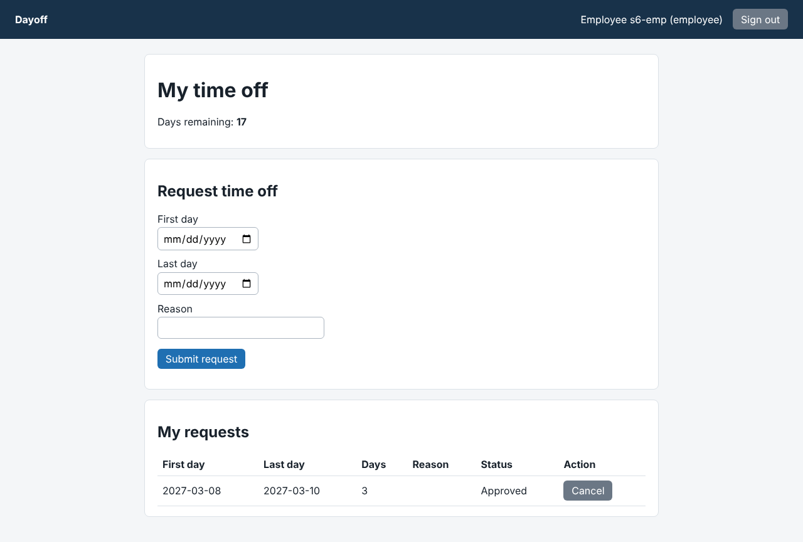

# S6 Double cancel of an Approved request via API: 409 and no second refund

**Verdict: PASSED** — All 4 assertions matched.

- Steps chosen by: external model via HTTP bridge
- Environment: http://localhost:3100, commit 08e7842a56d2988b058d3e07853d2da1601a42f0
- Started 2026-11-18T18:57:52.972Z, took 89.7 s, 33 tool calls
- Basis: risk; requirements R25, R26, R27, R10

## Objective

Sign in as the employee, create a request with first day 2027-03-08, last day 2027-03-10 and note its id. Sign out, sign in as the manager and approve it. Sign out, sign in as the employee and record balance from GET /api/me as balanceApproved. POST /api/requests/<id>/cancel; keep its response body and record the HTTP status. Record balance from GET /api/me as balanceAfterFirst. POST the same cancel again and record its HTTP status code as secondCancelStatus. Record balance from GET /api/me as balanceAfterSecond.

## Assertions

Expected values were fixed in the plan; actual values were read and compared in code.

| Id | What | Expected (plan) | Expected (evaluated) | Actual | Result | Evidence |
|---|---|---|---|---|---|---|
| A1 | Response body of the first POST /api/requests/<id>/cancel: its status field equals Cancelled. | `Cancelled` | Cancelled | Cancelled | match | [check-A1.png](check-A1.png) |
| A2 | balanceAfterFirst (GET /api/me balance after the first cancel) is at least balanceApproved + 1. | `balanceApproved + 1` | 18 | 20 | match | [check-A2.png](check-A2.png) |
| A3 | HTTP status code of the second POST /api/requests/<id>/cancel (secondCancelStatus) equals 409. | `409` | 409 | 409 | match | [check-A3.png](check-A3.png) |
| A4 | balanceAfterSecond (GET /api/me balance after the second cancel) equals balanceAfterFirst. | `balanceAfterFirst` | 20 | 20 | match | [check-A4.png](check-A4.png) |

## Observations

- `balanceApproved` = 17
- `firstCancelStatus` = 200
- `balanceAfterFirst` = 20
- `secondCancelStatus` = 409
- `balanceAfterSecond` = 20

## Steps

| # | Tool | Input | Outcome | Stated reason |
|---|---|---|---|---|
| 1 | navigate | {"path":"/"} | URL: / | Discover the app entry page and sign-in form. |
| 2 | fill | {"element":{"by":"role","role":"textbox","value":"Username"},"text":"s6-emp"} | URL: / | Sign in as employee. |
| 3 | fill | {"element":{"by":"role","role":"textbox","value":"Password"},"text":"{{secret:emp.password}}"} | URL: / | Employee password. |
| 4 | click | {"element":{"by":"role","role":"button","value":"Sign in"}} | URL: / | Submit sign-in. |
| 5 | fill | {"element":{"by":"role","role":"textbox","value":"First day"},"text":"2027-03-08"} | URL: / | Set first day. |
| 6 | fill | {"element":{"by":"role","role":"textbox","value":"Last day"},"text":"2027-03-10"} | URL: / | Set last day. |
| 7 | click | {"element":{"by":"role","role":"button","value":"Submit request"}} | URL: / | Create the request. |
| 8 | api_request | {"method":"GET","path":"/api/me"} | {"responseId":"R1","status":200,"body":{"handle":"s6-emp","name":"Employee s6-emp","role":"employee","balance":20}} | Look at the API shape for the employee. |
| 9 | api_request | {"method":"GET","path":"/api/requests"} | {"responseId":"R2","status":200,"body":[{"id":6,"employee":"s6-emp","employeeName":"Employee s6-emp","start":"2027-03-08","end":"2027-03-10","days":3,"reason":"","status":"Pending"}]} | Find the id of the new request. |
| 10 | click | {"element":{"by":"role","role":"button","value":"Sign out"}} | URL: / | Switch to manager. |
| 11 | fill | {"element":{"by":"role","role":"textbox","value":"Username"},"text":"s6-mgr"} | URL: / | Manager username. |
| 12 | fill | {"element":{"by":"role","role":"textbox","value":"Password"},"text":"{{secret:mgr.password}}"} | URL: / | Manager password. |
| 13 | click | {"element":{"by":"role","role":"button","value":"Sign in"}} | URL: / | Submit manager sign-in. |
| 14 | click | {"element":{"by":"role","role":"button","value":"Approve request 6 from Employee s6-emp"}} | URL: / | Approve the scenario request. |
| 15 | click | {"element":{"by":"role","role":"button","value":"Sign out"}} | URL: / | Switch back to employee. |
| 16 | fill | {"element":{"by":"role","role":"textbox","value":"Username"},"text":"s6-emp"} | URL: / | Employee username. |
| 17 | fill | {"element":{"by":"role","role":"textbox","value":"Password"},"text":"{{secret:emp.password}}"} | URL: / | Employee password. |
| 18 | click | {"element":{"by":"role","role":"button","value":"Sign in"}} | URL: / | Submit sign-in. |
| 19 | api_request | {"method":"GET","path":"/api/me"} | {"responseId":"R3","status":200,"body":{"handle":"s6-emp","name":"Employee s6-emp","role":"employee","balance":17}} | Balance after approval. |
| 20 | observe | {"name":"balanceApproved","target":{"source":"api","responseId":"R3","field":"body","jsonPath":"balance","count":false}} | Recorded balanceApproved = 17 | Record balance after approval. |
| 21 | api_request | {"method":"POST","path":"/api/requests/6/cancel"} | {"responseId":"R4","status":200,"body":{"id":6,"employee":"s6-emp","employeeName":"Employee s6-emp","start":"2027-03-08","end":"2027-03-10","days":3,"reason":"","status":"Cancelled"}} | First cancel of the approved request. |
| 22 | observe | {"name":"firstCancelStatus","target":{"source":"api","responseId":"R4","field":"status","jsonPath":"","count":false}} | Recorded firstCancelStatus = 200 | Record HTTP status of first cancel as the scenario asks. |
| 23 | check | {"assertionId":"A1","target":{"source":"api","responseId":"R4","field":"body","jsonPath":"status","count":false}} | Recorded A1: expected Cancelled, actual Cancelled -> match. This result is final. | First cancel response status field. |
| 24 | api_request | {"method":"GET","path":"/api/me"} | {"responseId":"R5","status":200,"body":{"handle":"s6-emp","name":"Employee s6-emp","role":"employee","balance":20}} | Balance after first cancel. |
| 25 | observe | {"name":"balanceAfterFirst","target":{"source":"api","responseId":"R5","field":"body","jsonPath":"balance","count":false}} | Recorded balanceAfterFirst = 20 | Record balance after first cancel. |
| 26 | check | {"assertionId":"A2","target":{"source":"api","responseId":"R5","field":"body","jsonPath":"balance","count":false}} | Recorded A2: expected 18, actual 20 -> match. This result is final. | Balance after first cancel vs balanceApproved+1. |
| 27 | api_request | {"method":"POST","path":"/api/requests/6/cancel"} | {"responseId":"R6","status":409,"body":{"error":"This request was already cancelled."}} | Second cancel of the same request. |
| 28 | observe | {"name":"secondCancelStatus","target":{"source":"api","responseId":"R6","field":"status","jsonPath":"","count":false}} | Recorded secondCancelStatus = 409 | Record second cancel HTTP status. |
| 29 | check | {"assertionId":"A3","target":{"source":"api","responseId":"R6","field":"status","jsonPath":"","count":false}} | Recorded A3: expected 409, actual 409 -> match. This result is final. | Second cancel status should be 409. |
| 30 | api_request | {"method":"GET","path":"/api/me"} | {"responseId":"R7","status":200,"body":{"handle":"s6-emp","name":"Employee s6-emp","role":"employee","balance":20}} | Balance after second cancel. |
| 31 | observe | {"name":"balanceAfterSecond","target":{"source":"api","responseId":"R7","field":"body","jsonPath":"balance","count":false}} | Recorded balanceAfterSecond = 20 | Record balance after second cancel. |
| 32 | check | {"assertionId":"A4","target":{"source":"api","responseId":"R7","field":"body","jsonPath":"balance","count":false}} | Recorded A4: expected 20, actual 20 -> match. This result is final. | Balance after second cancel should equal balanceAfterFirst. |
| 33 | finish | {"outcome":"completed","reason":"All four assertions A1-A4 checked at the states the scenario specifies."} | Scenario ended. | Every assertion has been checked. |

## Evidence

- Playwright trace: `trace.zip` (open with `npx playwright show-trace`)
- A1: 
- A2: 
- A3: 
- A4: 
