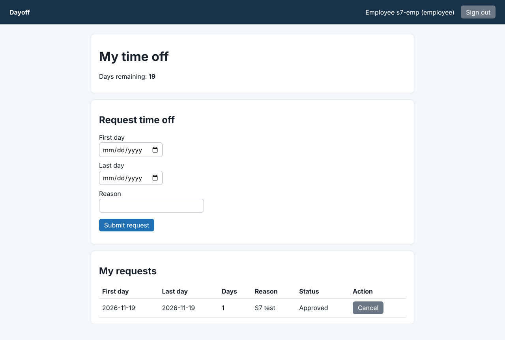

# S7 Approved request starting tomorrow cannot be cancelled (inside notice window)

**Verdict: PASSED** — All 3 assertions matched.

- Steps chosen by: external model via HTTP bridge
- Environment: http://localhost:3100, commit 08e7842a56d2988b058d3e07853d2da1601a42f0
- Started 2026-11-18T18:57:59.589Z, took 71.0 s, 29 tool calls
- Basis: requirement; requirements R14, R15, R16, R17

## Objective

Work out today's date (use the Date header of a response from the application if available) and let D be today + 1 day in YYYY-MM-DD. Sign in as the employee, create a request with first and last day D, note its id. Sign out, sign in as the manager and approve it. Sign out, sign in as the employee and record balance from GET /api/me as balanceApproved. POST /api/requests/<id>/cancel via the API and keep the response body (including any error message). Then record balance from GET /api/me as balanceAfter and read the request's status from GET /api/requests.

## Assertions

Expected values were fixed in the plan; actual values were read and compared in code.

| Id | What | Expected (plan) | Expected (evaluated) | Actual | Result | Evidence |
|---|---|---|---|---|---|---|
| A1 | After the refused cancel: status field of the request in GET /api/requests equals Approved. | `Approved` | Approved | Approved | match | [check-A1.png](check-A1.png) |
| A2 | After the refused cancel: balanceAfter equals balanceApproved. | `balanceApproved` | 19 | 19 | match | [check-A2.png](check-A2.png) |
| A3 | The error message text returned in the response body of the refused cancel contains the number 3. | `3` | 3 | Approved leave can only be cancelled at least 3 days before its first day. | match | [check-A3.png](check-A3.png) |

## Observations

- `balanceApproved` = 19
- `balanceAfter` = 19

## Steps

| # | Tool | Input | Outcome | Stated reason |
|---|---|---|---|---|
| 1 | navigate | {"path":"/"} | URL: / | Discover the application landing page and sign-in form. |
| 2 | fill | {"element":{"by":"role","role":"textbox","value":"Username"},"text":"s7-emp"} | URL: / | Enter employee username to sign in. |
| 3 | fill | {"element":{"by":"role","role":"textbox","value":"Password"},"text":"{{secret:emp.password}}"} | URL: / | Enter employee password. |
| 4 | click | {"element":{"by":"role","role":"button","value":"Sign in"}} | URL: / | Submit the sign-in form as employee. |
| 5 | api_request | {"method":"GET","path":"/api/me"} | {"responseId":"R1","status":200,"body":{"handle":"s7-emp","name":"Employee s7-emp","role":"employee","balance":20}} | Read current user and look for a Date header to determine today. |
| 6 | fill | {"element":{"by":"role","role":"textbox","value":"First day"},"text":"2026-11-19"} | URL: / | Set first day to tomorrow. |
| 7 | fill | {"element":{"by":"role","role":"textbox","value":"Last day"},"text":"2026-11-19"} | URL: / | Set last day to tomorrow. |
| 8 | fill | {"element":{"by":"role","role":"textbox","value":"Reason"},"text":"S7 test"} | URL: / | Provide a reason in case it is required. |
| 9 | click | {"element":{"by":"role","role":"button","value":"Submit request"}} | URL: / | Create the request. |
| 10 | api_request | {"method":"GET","path":"/api/requests"} | {"responseId":"R2","status":200,"body":[{"id":9,"employee":"s7-emp","employeeName":"Employee s7-emp","start":"2026-11-19","end":"2026-11-19","days":1,"reason":"S7 test","status":"Pending"}]} | Find the new request id. |
| 11 | click | {"element":{"by":"role","role":"button","value":"Sign out"}} | URL: / | Sign out the employee so the manager can approve. |
| 12 | fill | {"element":{"by":"role","role":"textbox","value":"Username"},"text":"s7-mgr"} | URL: / | Enter manager username. |
| 13 | fill | {"element":{"by":"role","role":"textbox","value":"Password"},"text":"{{secret:mgr.password}}"} | URL: / | Enter manager password. |
| 14 | click | {"element":{"by":"role","role":"button","value":"Sign in"}} | URL: / | Sign in as manager. |
| 15 | click | {"element":{"by":"role","role":"button","value":"Approve request 9 from Employee s7-emp"}} | URL: / | Approve the scenario request #9. |
| 16 | click | {"element":{"by":"role","role":"button","value":"Sign out"}} | URL: / | Sign out the manager. |
| 17 | fill | {"element":{"by":"role","role":"textbox","value":"Username"},"text":"s7-emp"} | URL: / | Enter employee username. |
| 18 | fill | {"element":{"by":"role","role":"textbox","value":"Password"},"text":"{{secret:emp.password}}"} | URL: / | Enter employee password. |
| 19 | click | {"element":{"by":"role","role":"button","value":"Sign in"}} | URL: / | Sign in as employee again. |
| 20 | api_request | {"method":"GET","path":"/api/me"} | {"responseId":"R3","status":200,"body":{"handle":"s7-emp","name":"Employee s7-emp","role":"employee","balance":19}} | Read balance after approval. |
| 21 | observe | {"name":"balanceApproved","target":{"source":"api","responseId":"R3","field":"body","jsonPath":"balance","count":false}} | Recorded balanceApproved = 19 | Record balance after approval. |
| 22 | api_request | {"method":"POST","path":"/api/requests/9/cancel"} | {"responseId":"R4","status":409,"body":{"error":"Approved leave can only be cancelled at least 3 days before its first day."}} | Attempt to cancel the approved request starting tomorrow. |
| 23 | api_request | {"method":"GET","path":"/api/me"} | {"responseId":"R5","status":200,"body":{"handle":"s7-emp","name":"Employee s7-emp","role":"employee","balance":19}} | Read balance after refused cancel. |
| 24 | api_request | {"method":"GET","path":"/api/requests"} | {"responseId":"R6","status":200,"body":[{"id":9,"employee":"s7-emp","employeeName":"Employee s7-emp","start":"2026-11-19","end":"2026-11-19","days":1,"reason":"S7 test","status":"Approved"}]} | Read request status after refused cancel. |
| 25 | observe | {"name":"balanceAfter","target":{"source":"api","responseId":"R5","field":"body","jsonPath":"balance","count":false}} | Recorded balanceAfter = 19 | Record balance after refused cancel. |
| 26 | check | {"assertionId":"A1","target":{"source":"api","responseId":"R6","field":"body","jsonPath":"0.status","count":false}} | Recorded A1: expected Approved, actual Approved -> match. This result is final. | Request 9 status after refused cancel. |
| 27 | check | {"assertionId":"A2","target":{"source":"api","responseId":"R5","field":"body","jsonPath":"balance","count":false}} | Recorded A2: expected 19, actual 19 -> match. This result is final. | balanceAfter compared with balanceApproved. |
| 28 | check | {"assertionId":"A3","target":{"source":"api","responseId":"R4","field":"body","jsonPath":"error","count":false}} | Recorded A3: expected 3, actual Approved leave can only be cancelled at least 3 days before its first day. -> match. This result is final. | Error message of the refused cancel. |
| 29 | finish | {"outcome":"completed","reason":"All assertions A1-A3 checked: request 9 (2026-11-19) approved, API cancel refused with 409, status and balance unchanged."} | Scenario ended. | Every assertion has been checked. |

## Evidence

- Playwright trace: `trace.zip` (open with `npx playwright show-trace`)
- A1: 
- A2: 
- A3: 
