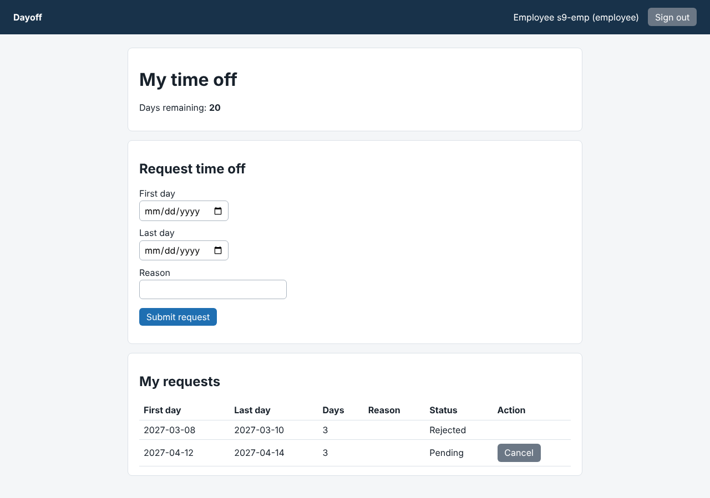

# S9 Rejected request has no Cancel button while a Pending one does

**Verdict: PASSED** — All 3 assertions matched.

- Steps chosen by: external model via HTTP bridge
- Environment: http://localhost:3100, commit 08e7842a56d2988b058d3e07853d2da1601a42f0
- Started 2026-11-18T18:58:03.314Z, took 56.6 s, 23 tool calls
- Basis: requirement; requirements R1, R4

## Objective

Sign in as the employee and create two requests: one with first day 2027-03-08, last day 2027-03-10, and one with first day 2027-04-12, last day 2027-04-14. Sign out, sign in as the manager and reject only the 2027-03-08 request. Sign out, sign in as the employee and look at My requests: check the row of each request for a Cancel button and read the status of the rejected row.

## Assertions

Expected values were fixed in the plan; actual values were read and compared in code.

| Id | What | Expected (plan) | Expected (evaluated) | Actual | Result | Evidence |
|---|---|---|---|---|---|---|
| A1 | My requests after rejection: the status shown in the row for 2027-03-08 to 2027-03-10 contains Rejected. | `Rejected` | Rejected | 2027-03-08 2027-03-10 3 Rejected | match | [check-A1.png](check-A1.png) |
| A2 | My requests after rejection: the row for 2027-03-08 to 2027-03-10 has no Cancel button. | `absent` | absent | absent | match | [check-A2.png](check-A2.png) |
| A3 | My requests after rejection: the row for the Pending request 2027-04-12 to 2027-04-14 has a Cancel button. | `present` | present | present | match | [check-A3.png](check-A3.png) |

## Steps

| # | Tool | Input | Outcome | Stated reason |
|---|---|---|---|---|
| 1 | navigate | {"path":"/"} | URL: / | Discover the application start page and sign-in. |
| 2 | fill | {"element":{"by":"role","role":"textbox","value":"Username"},"text":"s9-emp"} | URL: / | Sign in as employee. |
| 3 | fill | {"element":{"by":"role","role":"textbox","value":"Password"},"text":"{{secret:emp.password}}"} | URL: / | Employee password. |
| 4 | click | {"element":{"by":"role","role":"button","value":"Sign in"}} | URL: / | Submit sign-in. |
| 5 | fill | {"element":{"by":"role","role":"textbox","value":"First day"},"text":"2027-03-08"} | URL: / | First request start date. |
| 6 | fill | {"element":{"by":"role","role":"textbox","value":"Last day"},"text":"2027-03-10"} | URL: / | First request end date. |
| 7 | click | {"element":{"by":"role","role":"button","value":"Submit request"}} | URL: / | Submit first request. |
| 8 | fill | {"element":{"by":"role","role":"textbox","value":"First day"},"text":"2027-04-12"} | URL: / | Second request start date. |
| 9 | fill | {"element":{"by":"role","role":"textbox","value":"Last day"},"text":"2027-04-14"} | URL: / | Second request end date. |
| 10 | click | {"element":{"by":"role","role":"button","value":"Submit request"}} | URL: / | Submit second request. |
| 11 | click | {"element":{"by":"role","role":"button","value":"Sign out"}} | URL: / | Sign out to switch to manager. |
| 12 | fill | {"element":{"by":"role","role":"textbox","value":"Username"},"text":"s9-mgr"} | URL: / | Sign in as manager. |
| 13 | fill | {"element":{"by":"role","role":"textbox","value":"Password"},"text":"{{secret:mgr.password}}"} | URL: / | Manager password. |
| 14 | click | {"element":{"by":"role","role":"button","value":"Sign in"}} | URL: / | Submit sign-in. |
| 15 | click | {"element":{"by":"role","role":"button","value":"Reject request 7 from Employee s9-emp"}} | URL: / | Reject only the s9-emp 2027-03-08 request. |
| 16 | click | {"element":{"by":"role","role":"button","value":"Sign out"}} | URL: / | Sign out to return as employee. |
| 17 | fill | {"element":{"by":"role","role":"textbox","value":"Username"},"text":"s9-emp"} | URL: / | Sign in as employee. |
| 18 | fill | {"element":{"by":"role","role":"textbox","value":"Password"},"text":"{{secret:emp.password}}"} | URL: / | Employee password. |
| 19 | click | {"element":{"by":"role","role":"button","value":"Sign in"}} | URL: / | Submit sign-in to view My requests. |
| 20 | check | {"assertionId":"A1","target":{"source":"page","by":"role","role":"row","value":"2027-03-08 2027-03-10 3 Rejected","count":false}} | Recorded A1: expected Rejected, actual 2027-03-08 2027-03-10 3 Rejected -> match. This result is final. | Read the row for 2027-03-08 to 2027-03-10, which includes its status cell. |
| 21 | check | {"assertionId":"A2","target":{"source":"page","by":"role","role":"button","value":"Cancel request from 2027-03-08 to 2027-03-10","count":false}} | Recorded A2: expected absent, actual absent -> match. This result is final. | The Cancel button for the rejected row should not exist. |
| 22 | check | {"assertionId":"A3","target":{"source":"page","by":"role","role":"button","value":"Cancel request from 2027-04-12 to 2027-04-14","count":false}} | Recorded A3: expected present, actual present -> match. This result is final. | The Cancel button for the Pending row should exist. |
| 23 | finish | {"outcome":"completed","reason":"All three assertions (A1, A2, A3) were checked after the manager rejected request #7 (2027-03-08 to 2027-03-10) and the employee reopened My requests."} | Scenario ended. | Every planned assertion has been checked. |

## Evidence

- Playwright trace: `trace.zip` (open with `npx playwright show-trace`)
- A1: 
- A2: 
- A3: 
