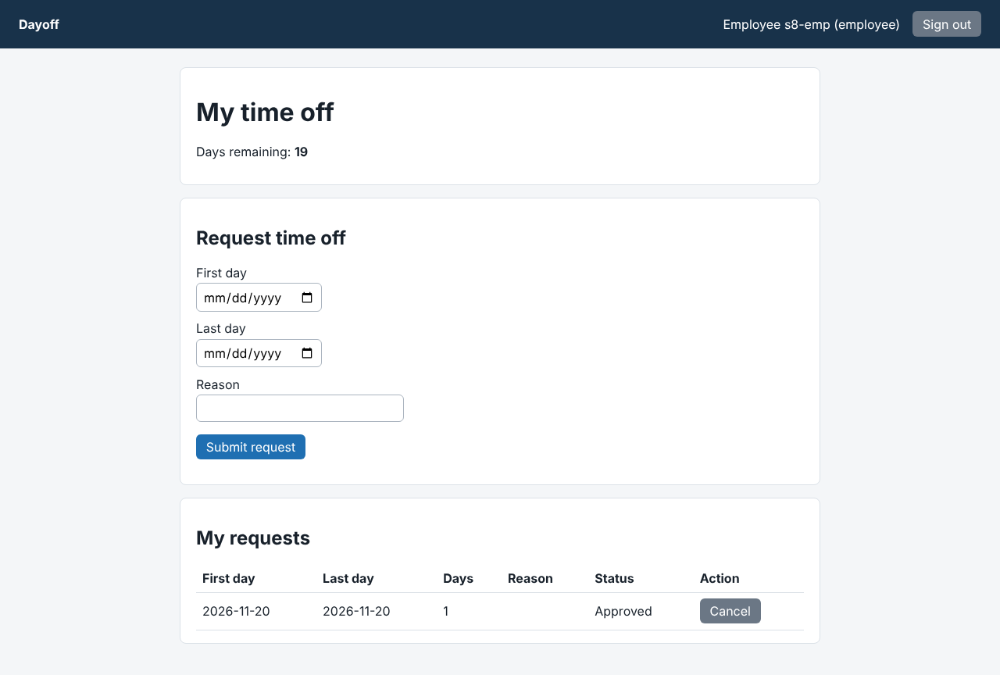

# S8 Approved request starting today + 2 cannot be cancelled (boundary just inside window)

**Verdict: PASSED** — All 2 assertions matched.

- Steps chosen by: external model via HTTP bridge
- Environment: http://localhost:3100, commit 88372b53ef8a2a157f3cb8744e7cec56c339fd1e
- Started 2026-11-18T19:07:00.241Z, took 72.9 s, 26 tool calls
- Basis: risk; requirements R14, R16, R17

## Objective

Work out today's date (use the Date header of a response from the application) and let D be today + 2 calendar days in YYYY-MM-DD. Sign in as the employee, create a request with first and last day D, note its id. Sign out, sign in as the manager and approve it. Sign out, sign in as the employee and record balance from GET /api/me as balanceApproved. POST /api/requests/<id>/cancel via the API and keep the response. Then record balance from GET /api/me as balanceAfter and read the request's status from GET /api/requests.

## Assertions

Expected values were fixed in the plan; actual values were read and compared in code.

| Id | What | Expected (plan) | Expected (evaluated) | Actual | Result | Evidence |
|---|---|---|---|---|---|---|
| A1 | After the cancel attempt on the request starting today + 2: status field of the request in GET /api/requests equals Approved. | `Approved` | Approved | Approved | match | [check-A1.png](check-A1.png) |
| A2 | After the cancel attempt: balanceAfter equals balanceApproved. | `balanceApproved` | 19 | 19 | match | [check-A2.png](check-A2.png) |

## Observations

- `balanceApproved` = 19
- `balanceAfter` = 19

## Steps

| # | Tool | Input | Outcome | Stated reason |
|---|---|---|---|---|
| 1 | navigate | {"path":"/"} | URL: / | Discover the application landing page and sign-in. |
| 2 | fill | {"element":{"by":"role","role":"textbox","value":"Username"},"text":"s8-emp"} | URL: / | Sign in as employee. |
| 3 | fill | {"element":{"by":"role","role":"textbox","value":"Password"},"text":"{{secret:emp.password}}"} | URL: / | Employee password. |
| 4 | click | {"element":{"by":"role","role":"button","value":"Sign in"}} | URL: / | Submit sign-in. |
| 5 | fill | {"element":{"by":"role","role":"textbox","value":"First day"},"text":"2026-11-20"} | URL: / | First day D. |
| 6 | fill | {"element":{"by":"role","role":"textbox","value":"Last day"},"text":"2026-11-20"} | URL: / | Last day D. |
| 7 | click | {"element":{"by":"role","role":"button","value":"Submit request"}} | URL: / | Create the request. |
| 8 | api_request | {"method":"GET","path":"/api/requests"} | {"responseId":"R1","status":200,"body":[{"id":1,"employee":"s8-emp","employeeName":"Employee s8-emp","start":"2026-11-20","end":"2026-11-20","days":1,"reason":"","status":"Pending"}]} | Find the new request id. |
| 9 | click | {"element":{"by":"role","role":"button","value":"Sign out"}} | URL: / | Sign out employee. |
| 10 | fill | {"element":{"by":"role","role":"textbox","value":"Username"},"text":"s8-mgr"} | URL: / | Sign in as manager. |
| 11 | fill | {"element":{"by":"role","role":"textbox","value":"Password"},"text":"{{secret:mgr.password}}"} | URL: / | Manager password. |
| 12 | click | {"element":{"by":"role","role":"button","value":"Sign in"}} | URL: / | Submit manager sign-in. |
| 13 | click | {"element":{"by":"role","role":"button","value":"Approve request 1 from Employee s8-emp"}} | URL: / | Approve the scenario request. |
| 14 | click | {"element":{"by":"role","role":"button","value":"Sign out"}} | URL: / | Sign out manager. |
| 15 | fill | {"element":{"by":"role","role":"textbox","value":"Username"},"text":"s8-emp"} | URL: / | Sign in as employee. |
| 16 | fill | {"element":{"by":"role","role":"textbox","value":"Password"},"text":"{{secret:emp.password}}"} | URL: / | Employee password. |
| 17 | click | {"element":{"by":"role","role":"button","value":"Sign in"}} | URL: / | Submit employee sign-in. |
| 18 | api_request | {"method":"GET","path":"/api/me"} | {"responseId":"R2","status":200,"body":{"handle":"s8-emp","name":"Employee s8-emp","role":"employee","balance":19}} | Read balance after approval. |
| 19 | observe | {"name":"balanceApproved","target":{"source":"api","responseId":"R2","field":"body","jsonPath":"balance","count":false}} | Recorded balanceApproved = 19 | Balance after approval, before cancel. |
| 20 | api_request | {"method":"POST","path":"/api/requests/1/cancel"} | {"responseId":"R3","status":409,"body":{"error":"Approved leave can only be cancelled at least 3 days before its first day."}} | Attempt to cancel the approved request starting today+2. |
| 21 | api_request | {"method":"GET","path":"/api/me"} | {"responseId":"R4","status":200,"body":{"handle":"s8-emp","name":"Employee s8-emp","role":"employee","balance":19}} | Read balance after cancel attempt. |
| 22 | api_request | {"method":"GET","path":"/api/requests"} | {"responseId":"R5","status":200,"body":[{"id":1,"employee":"s8-emp","employeeName":"Employee s8-emp","start":"2026-11-20","end":"2026-11-20","days":1,"reason":"","status":"Approved"}]} | Read request status after cancel attempt. |
| 23 | observe | {"name":"balanceAfter","target":{"source":"api","responseId":"R4","field":"body","jsonPath":"balance","count":false}} | Recorded balanceAfter = 19 | Balance after cancel attempt. |
| 24 | check | {"assertionId":"A1","target":{"source":"api","responseId":"R5","field":"body","jsonPath":"0.status","count":false}} | Recorded A1: expected Approved, actual Approved -> match. This result is final. | Status of request 1 after cancel attempt. |
| 25 | check | {"assertionId":"A2","target":{"source":"api","responseId":"R4","field":"body","jsonPath":"balance","count":false}} | Recorded A2: expected 19, actual 19 -> match. This result is final. | balanceAfter compared with balanceApproved. |
| 26 | finish | {"outcome":"completed","reason":"Both assertions checked: request 1 (2026-11-20) approved, cancel returned 409, status remained Approved and balance stayed 19."} | Scenario ended. | All assertions have been checked. |

## Evidence

- Playwright trace: `trace.zip` (open with `npx playwright show-trace`)
- A1: 
- A2: 
