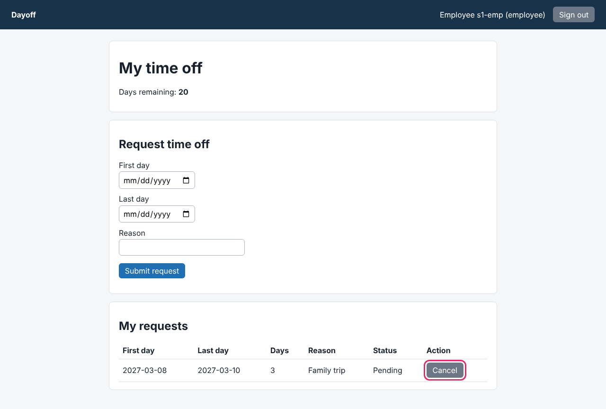
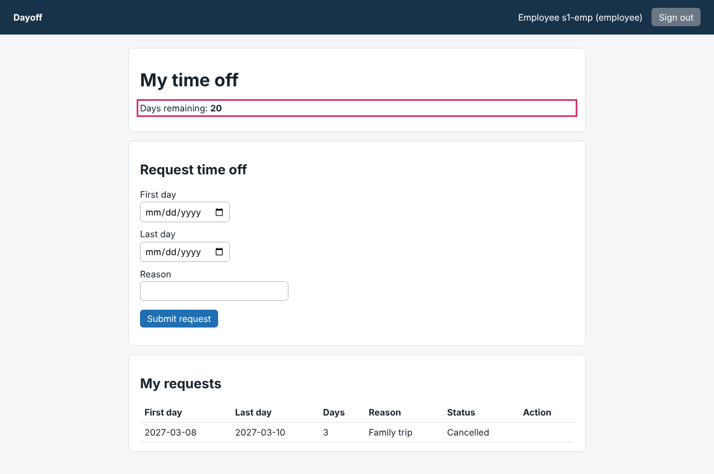
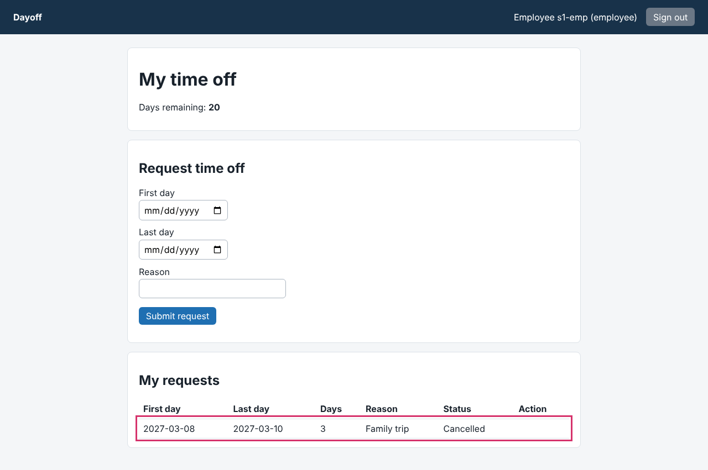

# S1 Employee cancels a Pending request from My requests; balance unchanged

**Verdict: PASSED** — All 8 assertions matched.

- Steps chosen by: external model via HTTP bridge
- Environment: http://localhost:3100, commit 08e7842a56d2988b058d3e07853d2da1601a42f0
- Started 2026-11-18T19:04:58.690Z, took 96.3 s, 24 tool calls
- Basis: requirement; requirements R1, R3, R5, R6, R7, R28

## Objective

Sign in as the employee. Record the number shown as Days remaining as balanceBefore. Using the Request time off form, request leave with first day 2027-03-08, last day 2027-03-10 and any reason. In My requests, find the row for this new Pending request and look at its Cancel button and that button's accessible name. Click that Cancel button. Without reloading, look at the row's status and record Days remaining as balanceAfterCancel. Then reload the page and look again at the row's status, check whether the row still offers a Cancel button, and record Days remaining as balanceAfterReload.

## Assertions

Expected values were fixed in the plan; actual values were read and compared in code.

| Id | What | Expected (plan) | Expected (evaluated) | Actual | Result | Evidence |
|---|---|---|---|---|---|---|
| A1 | Before cancelling: a Cancel button exists in the My requests row of the new Pending request (2027-03-08 to 2027-03-10). | `present` | present | present | match | [check-A1.png](check-A1.png) |
| A2 | Before cancelling: the accessible name of that row's Cancel button contains the first day 2027-03-08. | `2027-03-08` | 2027-03-08 | Cancel request from 2027-03-08 to 2027-03-10 | match | [check-A2.png](check-A2.png) |
| A3 | Before cancelling: the accessible name of that row's Cancel button contains the last day 2027-03-10. | `2027-03-10` | 2027-03-10 | Cancel request from 2027-03-08 to 2027-03-10 | match | [check-A3.png](check-A3.png) |
| A4 | After clicking Cancel and reloading: the status shown in the My requests row for 2027-03-08 to 2027-03-10 contains Cancelled. | `Cancelled` | Cancelled | 2027-03-08 2027-03-10 3 Family trip Cancelled | match | [check-A4.png](check-A4.png) |
| A5 | Days remaining right after the cancel (no reload), balanceAfterCancel, equals balanceBefore recorded before the request was made. | `balanceBefore` | 20 | 20 | match | [check-A5.png](check-A5.png) |
| A6 | Days remaining after reload, balanceAfterReload, equals balanceBefore. | `balanceBefore` | 20 | 20 | match | [check-A6.png](check-A6.png) |
| A7 | After reload: the My requests row for the now Cancelled request 2027-03-08 to 2027-03-10 has no Cancel button. | `absent` | absent | absent | match | [check-A7.png](check-A7.png) |
| A8 | Via GET /api/requests as the employee after the cancel: the status field of the request with first day 2027-03-08 equals Cancelled. | `Cancelled` | Cancelled | Cancelled | match | [check-A8.png](check-A8.png) |

## Observations

- `balanceBefore` = 20
- `balanceAfterCancel` = 20
- `balanceAfterReload` = 20

## Steps

| # | Tool | Input | Outcome | Stated reason |
|---|---|---|---|---|
| 1 | navigate | {"path":"/"} | URL: / | Open the application to find the sign-in page. |
| 2 | fill | {"element":{"by":"role","role":"textbox","value":"Username"},"text":"s1-emp"} | URL: / | Enter employee handle. |
| 3 | fill | {"element":{"by":"role","role":"textbox","value":"Password"},"text":"{{secret:emp.password}}"} | URL: / | Enter employee password. |
| 4 | click | {"element":{"by":"role","role":"button","value":"Sign in"}} | URL: / | Submit sign-in. |
| 5 | observe | {"name":"balanceBefore","target":{"source":"page","by":"text","value":"Days remaining:","count":false,"read":"text","pattern":"Days remaining:\\s*(\\d+(?:\\.\\d+)?)"}} | Recorded balanceBefore = 20 | Record balance before requesting. |
| 6 | fill | {"element":{"by":"role","role":"textbox","value":"First day"},"text":"2027-03-08"} | URL: / | Set first day. |
| 7 | fill | {"element":{"by":"role","role":"textbox","value":"Last day"},"text":"2027-03-10"} | URL: / | Set last day. |
| 8 | fill | {"element":{"by":"role","role":"textbox","value":"Reason"},"text":"Family trip"} | URL: / | Set reason. |
| 9 | click | {"element":{"by":"role","role":"button","value":"Submit request"}} | URL: / | Submit the leave request. |
| 10 | undefined | undefined | error: Error: Unknown tool "undefined". |  |
| 11 | check | {"assertionId":"A1","target":{"source":"page","by":"role","role":"button","value":"Cancel request from 2027-03-08 to 2027-03-10","count":false,"read":"name"}} | Recorded A1: expected present, actual present -> match. This result is final. | Cancel button of the new Pending row exists. |
| 12 | check | {"assertionId":"A2","target":{"source":"page","by":"role","role":"button","value":"Cancel request from 2027-03-08 to 2027-03-10","count":false,"read":"name"}} | Recorded A2: expected 2027-03-08, actual Cancel request from 2027-03-08 to 2027-03-10 -> match. This result is final. | Button accessible name should include first day. |
| 13 | check | {"assertionId":"A3","target":{"source":"page","by":"role","role":"button","value":"Cancel request from 2027-03-08 to 2027-03-10","count":false,"read":"name"}} | Recorded A3: expected 2027-03-10, actual Cancel request from 2027-03-08 to 2027-03-10 -> match. This result is final. | Button accessible name should include last day. |
| 14 | click | {"element":{"by":"role","role":"button","value":"Cancel request from 2027-03-08 to 2027-03-10"}} | URL: / | Cancel the pending request. |
| 15 | observe | {"name":"balanceAfterCancel","target":{"source":"page","by":"text","value":"Days remaining:","count":false,"read":"text","pattern":"Days remaining:\\s*(\\d+(?:\\.\\d+)?)"}} | Recorded balanceAfterCancel = 20 | Balance right after cancel, no reload. |
| 16 | check | {"assertionId":"A5","target":{"source":"page","by":"text","value":"Days remaining:","count":false,"read":"text","pattern":"Days remaining:\\s*(\\d+(?:\\.\\d+)?)"}} | Recorded A5: expected 20, actual 20 -> match. This result is final. | Balance after cancel should equal balanceBefore. |
| 17 | navigate | {"path":"/"} | URL: / | Reload the page after cancelling. |
| 18 | check | {"assertionId":"A4","target":{"source":"page","by":"role","role":"row","value":"2027-03-08 2027-03-10 3 Family trip Cancelled","count":false,"read":"text"}} | Recorded A4: expected Cancelled, actual 2027-03-08 2027-03-10 3 Family trip Cancelled -> match. This result is final. | Status in the 2027-03-08 to 2027-03-10 row after reload. |
| 19 | observe | {"name":"balanceAfterReload","target":{"source":"page","by":"text","value":"Days remaining:","count":false,"read":"text","pattern":"Days remaining:\\s*(\\d+(?:\\.\\d+)?)"}} | Recorded balanceAfterReload = 20 | Balance after reload. |
| 20 | check | {"assertionId":"A6","target":{"source":"page","by":"text","value":"Days remaining:","count":false,"read":"text","pattern":"Days remaining:\\s*(\\d+(?:\\.\\d+)?)"}} | Recorded A6: expected 20, actual 20 -> match. This result is final. | Balance after reload should equal balanceBefore. |
| 21 | check | {"assertionId":"A7","target":{"source":"page","by":"role","role":"button","value":"Cancel request from 2027-03-08 to 2027-03-10","count":false,"read":"name"}} | Recorded A7: expected absent, actual absent -> match. This result is final. | Cancelled row should no longer offer a Cancel button. |
| 22 | api_request | {"method":"GET","path":"/api/requests"} | {"responseId":"R1","status":200,"body":[{"id":16,"employee":"s1-emp","employeeName":"Employee s1-emp","start":"2027-03-08","end":"2027-03-10","days":3,"reason":"Family trip","status":"Cancelled"}]} | Read requests as the employee for A8. |
| 23 | check | {"assertionId":"A8","target":{"source":"api","responseId":"R1","field":"body","jsonPath":"0.status","count":false}} | Recorded A8: expected Cancelled, actual Cancelled -> match. This result is final. | Element 0 is the request starting 2027-03-08; its status should be Cancelled. |
| 24 | finish | {"outcome":"completed","reason":"All assertions A1-A8 were checked."} | Scenario ended. | Every planned assertion has been run. |

## Evidence

- Playwright trace: `trace.zip` (open with `npx playwright show-trace`)
- A1: 
- A2: 
- A3: 
- A5: 
- A4: 
- A6: 
- A7: 
- A8: 
