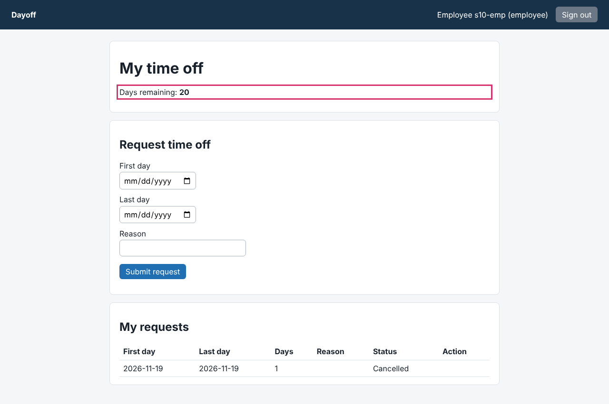

# S10 Pending request starting tomorrow can still be cancelled (notice rule only for Approved)

**Verdict: PASSED** — All 2 assertions matched.

- Steps chosen by: external model via HTTP bridge
- Environment: http://localhost:3100, commit 08e7842a56d2988b058d3e07853d2da1601a42f0
- Started 2026-11-18T19:04:58.719Z, took 67.4 s, 15 tool calls
- Basis: risk; requirements R8, R6, R7

## Objective

Work out today's date (use the Date header of a response from the application) and let D be today + 1 day in YYYY-MM-DD. Sign in as the employee, record Days remaining as balanceBefore, create a request with first and last day D and leave it Pending. In My requests click the Cancel button of that row. Read the row's status and record Days remaining as balanceAfter.

## Assertions

Expected values were fixed in the plan; actual values were read and compared in code.

| Id | What | Expected (plan) | Expected (evaluated) | Actual | Result | Evidence |
|---|---|---|---|---|---|---|
| A1 | After clicking Cancel on the Pending request starting tomorrow: status field of that request in GET /api/requests equals Cancelled. | `Cancelled` | Cancelled | Cancelled | match | [check-A1.png](check-A1.png) |
| A2 | After the cancel: Days remaining (balanceAfter) equals balanceBefore. | `balanceBefore` | 20 | 20 | match | [check-A2.png](check-A2.png) |

## Observations

- `balanceBefore` = 20
- `balanceAfter` = 20

## Steps

| # | Tool | Input | Outcome | Stated reason |
|---|---|---|---|---|
| 1 | navigate | {"path":"/"} | URL: / | Open the application to find the sign-in page. |
| 2 | fill | {"element":{"by":"role","role":"textbox","value":"Username"},"text":"s10-emp"} | URL: / | Enter employee username. |
| 3 | fill | {"element":{"by":"role","role":"textbox","value":"Password"},"text":"{{secret:emp.password}}"} | URL: / | Enter employee password. |
| 4 | click | {"element":{"by":"role","role":"button","value":"Sign in"}} | URL: / | Sign in as the employee. |
| 5 | api_request | {"method":"GET","path":"/api/requests"} | {"responseId":"R1","status":200,"body":[]} | Read the Date header to determine today. |
| 6 | observe | {"name":"balanceBefore","target":{"source":"page","by":"text","value":"Days remaining:","count":false,"read":"text","pattern":"Days remaining:\\s*(\\d+)"}} | Recorded balanceBefore = 20 | Record balance before creating the request. |
| 7 | fill | {"element":{"by":"role","role":"textbox","value":"First day"},"text":"2026-11-19"} | URL: / | Set first day to tomorrow. |
| 8 | fill | {"element":{"by":"role","role":"textbox","value":"Last day"},"text":"2026-11-19"} | URL: / | Set last day to tomorrow. |
| 9 | click | {"element":{"by":"role","role":"button","value":"Submit request"}} | URL: / | Create the pending request. |
| 10 | click | {"element":{"by":"role","role":"button","value":"Cancel request from 2026-11-19 to 2026-11-19"}} | URL: / | Cancel the pending request starting tomorrow. |
| 11 | api_request | {"method":"GET","path":"/api/requests"} | {"responseId":"R2","status":200,"body":[{"id":15,"employee":"s10-emp","employeeName":"Employee s10-emp","start":"2026-11-19","end":"2026-11-19","days":1,"reason":"","status":"Cancelled"}]} | Read the request status after cancelling. |
| 12 | observe | {"name":"balanceAfter","target":{"source":"page","by":"text","value":"Days remaining:","count":false,"read":"text","pattern":"Days remaining:\\s*(\\d+)"}} | Recorded balanceAfter = 20 | Record balance after the cancel. |
| 13 | check | {"assertionId":"A1","target":{"source":"api","responseId":"R2","field":"body","jsonPath":"0.status","count":false}} | Recorded A1: expected Cancelled, actual Cancelled -> match. This result is final. | Status of the cancelled request in GET /api/requests. |
| 14 | check | {"assertionId":"A2","target":{"source":"page","by":"text","value":"Days remaining:","count":false,"read":"text","pattern":"Days remaining:\\s*(\\d+)"}} | Recorded A2: expected 20, actual 20 -> match. This result is final. | Days remaining after the cancel versus balanceBefore. |
| 15 | finish | {"outcome":"completed","reason":"All assertions (A1, A2) checked."} | Scenario ended. | Every assertion has been checked. |

## Evidence

- Playwright trace: `trace.zip` (open with `npx playwright show-trace`)
- A1: 
- A2: 
