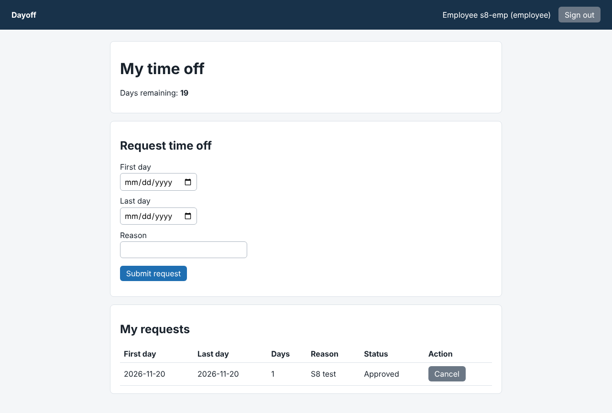

# S8 Approved request starting today + 2 cannot be cancelled (boundary just inside window)

**Verdict: FAILED** — A1: expected Approved, got Cancelled; A2: expected 19, got 20

- Steps chosen by: external model via HTTP bridge
- Environment: http://localhost:3100, commit 08e7842a56d2988b058d3e07853d2da1601a42f0
- Started 2026-11-18T19:04:58.923Z, took 88.5 s, 27 tool calls
- Basis: risk; requirements R14, R16, R17

## Objective

Work out today's date (use the Date header of a response from the application) and let D be today + 2 calendar days in YYYY-MM-DD. Sign in as the employee, create a request with first and last day D, note its id. Sign out, sign in as the manager and approve it. Sign out, sign in as the employee and record balance from GET /api/me as balanceApproved. POST /api/requests/<id>/cancel via the API and keep the response. Then record balance from GET /api/me as balanceAfter and read the request's status from GET /api/requests.

## Assertions

Expected values were fixed in the plan; actual values were read and compared in code.

| Id | What | Expected (plan) | Expected (evaluated) | Actual | Result | Evidence |
|---|---|---|---|---|---|---|
| A1 | After the cancel attempt on the request starting today + 2: status field of the request in GET /api/requests equals Approved. | `Approved` | Approved | Cancelled | **MISMATCH** | [check-A1.png](check-A1.png) |
| A2 | After the cancel attempt: balanceAfter equals balanceApproved. | `balanceApproved` | 19 | 20 | **MISMATCH** | [check-A2.png](check-A2.png) |

## Observations

- `balanceApproved` = 19
- `balanceAfter` = 20

## Steps

| # | Tool | Input | Outcome | Stated reason |
|---|---|---|---|---|
| 1 | navigate | {"path":"/"} | URL: / | See the landing page and find sign-in. |
| 2 | fill | {"element":{"by":"role","role":"textbox","value":"Username"},"text":"s8-emp"} | URL: / | Sign in as employee. |
| 3 | fill | {"element":{"by":"role","role":"textbox","value":"Password"},"text":"{{secret:emp.password}}"} | URL: / | Enter employee password. |
| 4 | click | {"element":{"by":"role","role":"button","value":"Sign in"}} | URL: / | Submit sign-in. |
| 5 | fill | {"element":{"by":"role","role":"textbox","value":"First day"},"text":"2026-11-20"} | URL: / | Set first day D. |
| 6 | fill | {"element":{"by":"role","role":"textbox","value":"Last day"},"text":"2026-11-20"} | URL: / | Set last day D. |
| 7 | fill | {"element":{"by":"role","role":"textbox","value":"Reason"},"text":"S8 test"} | URL: / | Provide a reason. |
| 8 | click | {"element":{"by":"role","role":"button","value":"Submit request"}} | URL: / | Create the request. |
| 9 | api_request | {"method":"GET","path":"/api/requests"} | {"responseId":"R1","status":200,"body":[{"id":13,"employee":"s8-emp","employeeName":"Employee s8-emp","start":"2026-11-20","end":"2026-11-20","days":1,"reason":"S8 test","status":"Pending"}]} | Find the new request id. |
| 10 | click | {"element":{"by":"role","role":"button","value":"Sign out"}} | URL: / | Sign out employee. |
| 11 | fill | {"element":{"by":"role","role":"textbox","value":"Username"},"text":"s8-mgr"} | URL: / | Sign in as manager. |
| 12 | fill | {"element":{"by":"role","role":"textbox","value":"Password"},"text":"{{secret:mgr.password}}"} | URL: / | Enter manager password. |
| 13 | click | {"element":{"by":"role","role":"button","value":"Sign in"}} | URL: / | Submit sign-in. |
| 14 | click | {"element":{"by":"role","role":"button","value":"Approve request 13 from Employee s8-emp"}} | URL: / | Approve the S8 request. |
| 15 | click | {"element":{"by":"role","role":"button","value":"Sign out"}} | URL: / | Sign out manager. |
| 16 | fill | {"element":{"by":"role","role":"textbox","value":"Username"},"text":"s8-emp"} | URL: / | Sign in as employee. |
| 17 | fill | {"element":{"by":"role","role":"textbox","value":"Password"},"text":"{{secret:emp.password}}"} | URL: / | Enter employee password. |
| 18 | click | {"element":{"by":"role","role":"button","value":"Sign in"}} | URL: / | Submit sign-in. |
| 19 | api_request | {"method":"GET","path":"/api/me"} | {"responseId":"R2","status":200,"body":{"handle":"s8-emp","name":"Employee s8-emp","role":"employee","balance":19}} | Read balance after approval. |
| 20 | observe | {"name":"balanceApproved","target":{"source":"api","responseId":"R2","field":"body","jsonPath":"balance","count":false}} | Recorded balanceApproved = 19 | Record balance after approval. |
| 21 | api_request | {"method":"POST","path":"/api/requests/13/cancel"} | {"responseId":"R3","status":200,"body":{"id":13,"employee":"s8-emp","employeeName":"Employee s8-emp","start":"2026-11-20","end":"2026-11-20","days":1,"reason":"S8 test","status":"Cancelled"}} | Attempt cancel within window. |
| 22 | api_request | {"method":"GET","path":"/api/me"} | {"responseId":"R4","status":200,"body":{"handle":"s8-emp","name":"Employee s8-emp","role":"employee","balance":20}} | Read balance after cancel attempt. |
| 23 | observe | {"name":"balanceAfter","target":{"source":"api","responseId":"R4","field":"body","jsonPath":"balance","count":false}} | Recorded balanceAfter = 20 | Record balance after cancel attempt. |
| 24 | api_request | {"method":"GET","path":"/api/requests"} | {"responseId":"R5","status":200,"body":[{"id":13,"employee":"s8-emp","employeeName":"Employee s8-emp","start":"2026-11-20","end":"2026-11-20","days":1,"reason":"S8 test","status":"Cancelled"}]} | Read request status after cancel attempt. |
| 25 | check | {"assertionId":"A1","target":{"source":"api","responseId":"R5","field":"body","jsonPath":"0.status","count":false}} | Recorded A1: expected Approved, actual Cancelled -> MISMATCH. This result is final. | Status of request 13 after cancel attempt. |
| 26 | check | {"assertionId":"A2","target":{"source":"api","responseId":"R4","field":"body","jsonPath":"balance","count":false}} | Recorded A2: expected 19, actual 20 -> MISMATCH. This result is final. | balanceAfter from GET /api/me after cancel attempt. |
| 27 | finish | {"outcome":"completed","reason":"All assertions checked. Request 13 (2026-11-20, today+2) was approved; POST /api/requests/13/cancel returned 200 with status Cancelled and balance was restored from 19 to 20."} | Scenario ended. | Both assertions have been checked. |

## Evidence

- Playwright trace: `trace.zip` (open with `npx playwright show-trace`)
- A1: 
- A2: 
