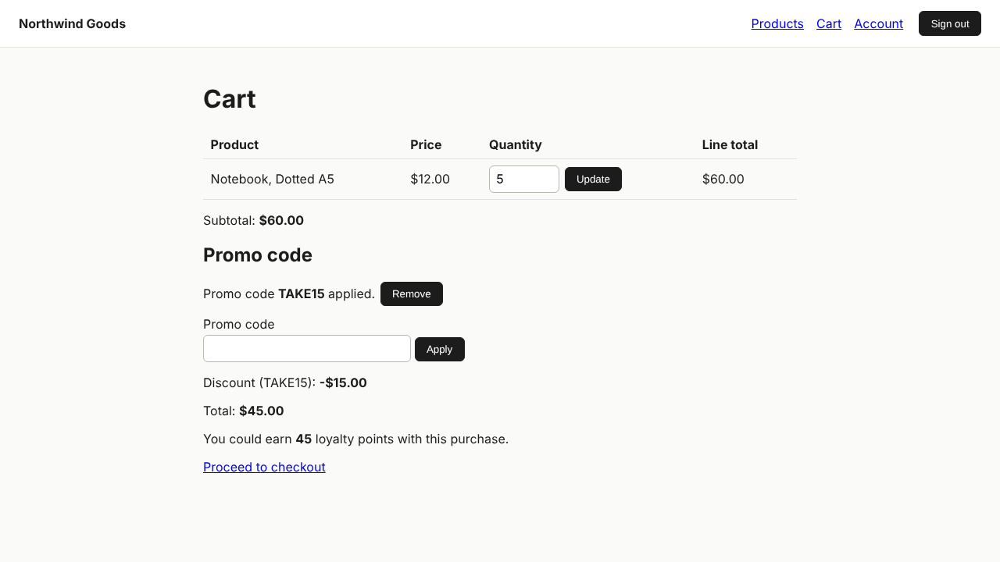
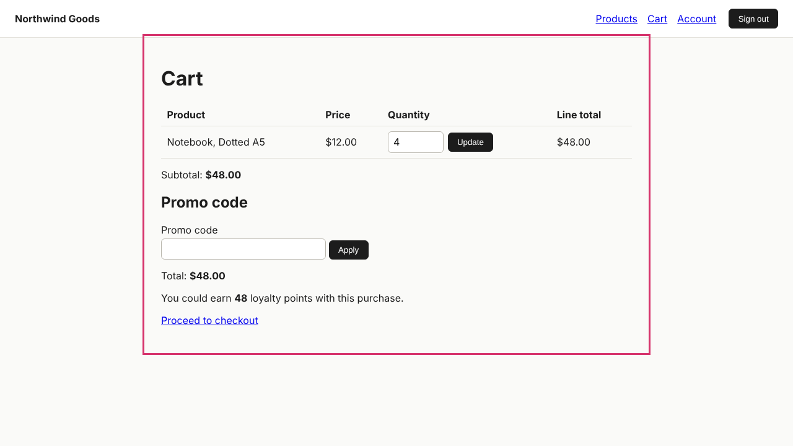
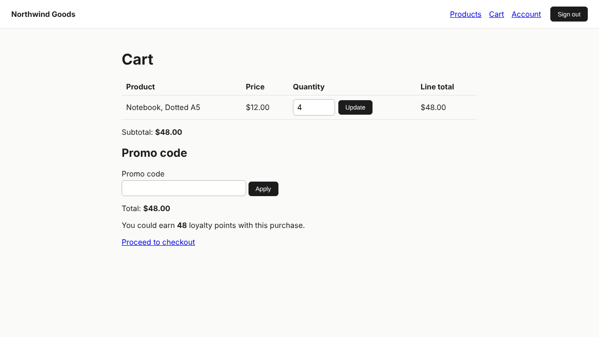

# S3 TAKE15 at exactly $60.00 applies; dropping the quantity below the minimum removes it

**Verdict: PASSED** — All 5 assertions matched.

- Steps chosen by: external model via HTTP bridge
- Environment: http://localhost:3000, commit 608909953f5ee06a34141dcbeea03fffc4bae337
- Started 2026-11-18T19:04:02.771Z, took 110.8 s, 33 tool calls
- Basis: risk; requirements R6, R7, R16, R4

## Objective

Sign in as the customer. Add Notebook, Dotted A5 ($12.00) to the cart with quantity 5 so the subtotal is exactly $60.00. On the cart page apply TAKE15. Call GET /api/cart and record subtotalCents (atSubtotal), discountCents (atDiscount) and totalCents (atTotal). Then, on the cart page, change the notebook quantity to 4 (subtotal $48.00). After the cart page has updated, record the displayed Subtotal (uiSubtotal) and Total (uiTotal) in dollars, then call GET /api/cart and record subtotalCents (afterSubtotal), discountCents (afterDiscount) and totalCents (afterTotal).

## Assertions

Expected values were fixed in the plan; actual values were read and compared in code.

| Id | What | Expected (plan) | Expected (evaluated) | Actual | Result | Evidence |
|---|---|---|---|---|---|---|
| A1 | With 5 notebooks (subtotal exactly $60.00) and TAKE15 applied, discountCents from GET /api/cart (atDiscount) equals 1500: exactly $60.00 qualifies. | `1500` | 1500 | 1500 | match | [check-A1.png](check-A1.png) |
| A2 | With 5 notebooks and TAKE15 applied, totalCents from GET /api/cart (atTotal) equals atSubtotal minus 1500 (the code stays applied even though the discounted total is below $60.00, since the minimum is checked before discount). | `atSubtotal - 1500` | 4500 | 4500 | match | [check-A2.png](check-A2.png) |
| A3 | After changing the quantity to 4 (subtotal $48.00), discountCents from GET /api/cart (afterDiscount) is 0. | `0` | 0 | 0 | match | [check-A3.png](check-A3.png) |
| A4 | After changing the quantity to 4, totalCents from GET /api/cart (afterTotal) equals subtotalCents (afterSubtotal). | `afterSubtotal` | 4800 | 4800 | match | [check-A4.png](check-A4.png) |
| A5 | After changing the quantity to 4, the Total shown on the cart page (uiTotal, dollars) equals the displayed Subtotal (uiSubtotal). | `uiSubtotal` | 48 | 48 | match | [check-A5.png](check-A5.png) |

## Observations

- `atSubtotal` = 6000
- `atDiscount` = 1500
- `atTotal` = 4500
- `uiSubtotal` = 48
- `uiTotal` = 48
- `afterSubtotal` = 4800
- `afterDiscount` = 0
- `afterTotal` = 4800

## Steps

| # | Tool | Input | Outcome | Stated reason |
|---|---|---|---|---|
| 1 | navigate | {"path":"/"} | URL: / | Discover the app entry page and sign-in link. |
| 2 | navigate | {"path":"/login"} | URL: /login | Sign in as the customer first. |
| 3 | fill | {"element":{"by":"label","value":"Email"},"text":"s3-shopper@fixtures.test"} | URL: /login | Enter shopper email. |
| 4 | fill | {"element":{"by":"label","value":"Password"},"text":"{{secret:shopper.password}}"} | URL: /login | Enter shopper password. |
| 5 | click | {"element":{"by":"role","role":"button","value":"Sign in"}} | URL: /account | Submit sign-in. |
| 6 | navigate | {"path":"/cart"} | URL: /cart | Check the cart starts empty before adding items. |
| 7 | navigate | {"path":"/"} | URL: / | Go to products to add the notebook. |
| 8 | click | {"element":{"by":"role","role":"button","value":"Add Notebook, Dotted A5 to cart"}} | URL: /cart | Add the notebook to the cart. |
| 9 | fill | {"element":{"by":"label","value":"Quantity for Notebook, Dotted A5"},"text":"5"} | URL: /cart | Set quantity to 5 for a $60.00 subtotal. |
| 10 | click | {"element":{"by":"role","role":"button","value":"Update quantity for Notebook, Dotted A5"}} | URL: /cart | Apply the quantity change. |
| 11 | fill | {"element":{"by":"label","value":"Promo code"},"text":"TAKE15"} | URL: /cart | Enter the promo code. |
| 12 | click | {"element":{"by":"role","role":"button","value":"Apply"}} | URL: /cart | Apply TAKE15 at subtotal $60.00. |
| 13 | api_request | {"method":"GET","path":"/api/cart"} | {"responseId":"R1","status":200,"body":{"lines":[{"productId":3,"name":"Notebook, Dotted A5","priceCents":1200,"quantity":5,"lineCents":6000}],"subtotalCents":6000,"promoCode":"TAKE15","discountCents":1500,"totalCents":4500}} | Read cart totals with TAKE15 applied at $60.00. |
| 14 | observe | {"name":"atSubtotal","target":{"source":"api","responseId":"R1","field":"body","jsonPath":"subtotalCents","count":false}} | Recorded atSubtotal = 6000 | Record subtotalCents at qty 5 with TAKE15. |
| 15 | observe | {"name":"atDiscount","target":{"source":"api","responseId":"R1","field":"body","jsonPath":"discountCents","count":false}} | Recorded atDiscount = 1500 | Record discountCents at qty 5 with TAKE15. |
| 16 | observe | {"name":"atTotal","target":{"source":"api","responseId":"R1","field":"body","jsonPath":"totalCents","count":false}} | Recorded atTotal = 4500 | Record totalCents at qty 5 with TAKE15. |
| 17 | check | {"assertionId":"A1","target":{"source":"api","responseId":"R1","field":"body","jsonPath":"discountCents","count":false}} | Recorded A1: expected 1500, actual 1500 -> match. This result is final. | Discount at exactly $60.00. |
| 18 | check | {"assertionId":"A2","target":{"source":"api","responseId":"R1","field":"body","jsonPath":"totalCents","count":false}} | Recorded A2: expected 4500, actual 4500 -> match. This result is final. | Total at exactly $60.00 with TAKE15. |
| 19 | fill | {"element":{"by":"label","value":"Quantity for Notebook, Dotted A5"},"text":"4"} | URL: /cart | Drop quantity to 4 (subtotal $48.00). |
| 20 | click | {"element":{"by":"role","role":"button","value":"Update quantity for Notebook, Dotted A5"}} | URL: /cart | Apply the quantity change. |
| 21 | observe | {"name":"uiSubtotal","target":{"source":"page","by":"text","value":"Subtotal:","count":false,"pattern":"Subtotal:\\s*\\$([0-9.,]+)"}} | Recorded uiSubtotal = 48 | Record displayed subtotal after qty change. |
| 22 | observe | {"name":"uiTotal","target":{"source":"page","by":"text","value":"Total:","count":false,"pattern":"^\\s*Total:\\s*\\$([0-9.,]+)"}} | error: Error: Expected exactly one element for {"source":"page","by":"text","value":"Total:","count":false,"pattern":"^\\s*Total:\\s*\\$([0-9.,]+)"}, found 2. | Record displayed total after qty change. |
| 23 | observe | {"name":"uiTotal","target":{"source":"page","by":"text","value":"Total: $48.00","count":false,"pattern":"Total:\\s*\\$([0-9.,]+)"}} | error: Error: Expected exactly one element for {"source":"page","by":"text","value":"Total: $48.00","count":false,"pattern":"Total:\\s*\\$([0-9.,]+)"}, found 2. | Record displayed total after qty change. |
| 24 | observe | {"name":"uiTotal","target":{"source":"page","by":"text","value":"ApplyTotal:","count":false,"pattern":"Apply\\s*Total:\\s*\\$([0-9.,]+)"}} | Recorded uiTotal = 48 | Record displayed total after qty change. |
| 25 | observe | {"name":"uiTotal","target":{"source":"page","by":"text","value":"Apply Total:","count":false,"pattern":"Apply\\s*Total:\\s*\\$([0-9.,]+)"}} | error: Error: Observation "uiTotal" is already recorded as 48. | Record displayed total after qty change. |
| 26 | check | {"assertionId":"A5","target":{"source":"page","by":"text","value":"ApplyTotal:","count":false,"pattern":"Apply\\s*Total:\\s*\\$([0-9.,]+)"}} | Recorded A5: expected 48, actual 48 -> match. This result is final. | Displayed Total after quantity 4 should equal displayed Subtotal. |
| 27 | api_request | {"method":"GET","path":"/api/cart"} | {"responseId":"R2","status":200,"body":{"lines":[{"productId":3,"name":"Notebook, Dotted A5","priceCents":1200,"quantity":4,"lineCents":4800}],"subtotalCents":4800,"promoCode":null,"discountCents":0,"totalCents":4800}} | Read cart totals after dropping quantity to 4. |
| 28 | observe | {"name":"afterSubtotal","target":{"source":"api","responseId":"R2","field":"body","jsonPath":"subtotalCents","count":false}} | Recorded afterSubtotal = 4800 | Record subtotalCents at qty 4. |
| 29 | observe | {"name":"afterDiscount","target":{"source":"api","responseId":"R2","field":"body","jsonPath":"discountCents","count":false}} | Recorded afterDiscount = 0 | Record discountCents at qty 4. |
| 30 | observe | {"name":"afterTotal","target":{"source":"api","responseId":"R2","field":"body","jsonPath":"totalCents","count":false}} | Recorded afterTotal = 4800 | Record totalCents at qty 4. |
| 31 | check | {"assertionId":"A3","target":{"source":"api","responseId":"R2","field":"body","jsonPath":"discountCents","count":false}} | Recorded A3: expected 0, actual 0 -> match. This result is final. | Discount after dropping below minimum. |
| 32 | check | {"assertionId":"A4","target":{"source":"api","responseId":"R2","field":"body","jsonPath":"totalCents","count":false}} | Recorded A4: expected 4800, actual 4800 -> match. This result is final. | Total equals subtotal after dropping below minimum. |
| 33 | finish | {"outcome":"completed","reason":"All assertions A1-A5 checked: TAKE15 applied at exactly $60.00 subtotal, then quantity dropped to 4 and the cart was re-read in UI and API."} | Scenario ended. | Every planned assertion has been checked. |

## Evidence

- Playwright trace: `trace.zip` (open with `npx playwright show-trace`)
- A1: 
- A2: 
- A5: 
- A3: 
- A4: 
