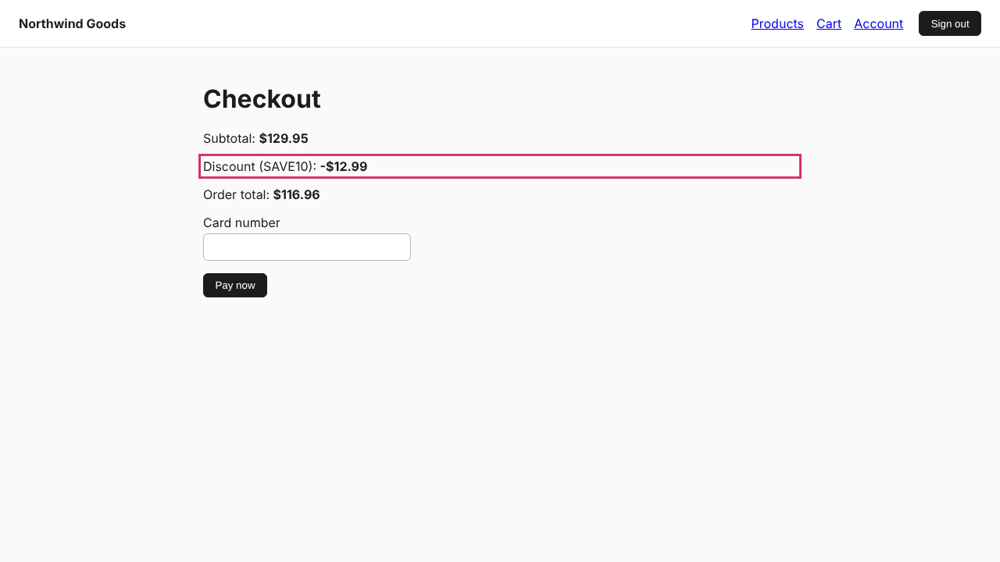
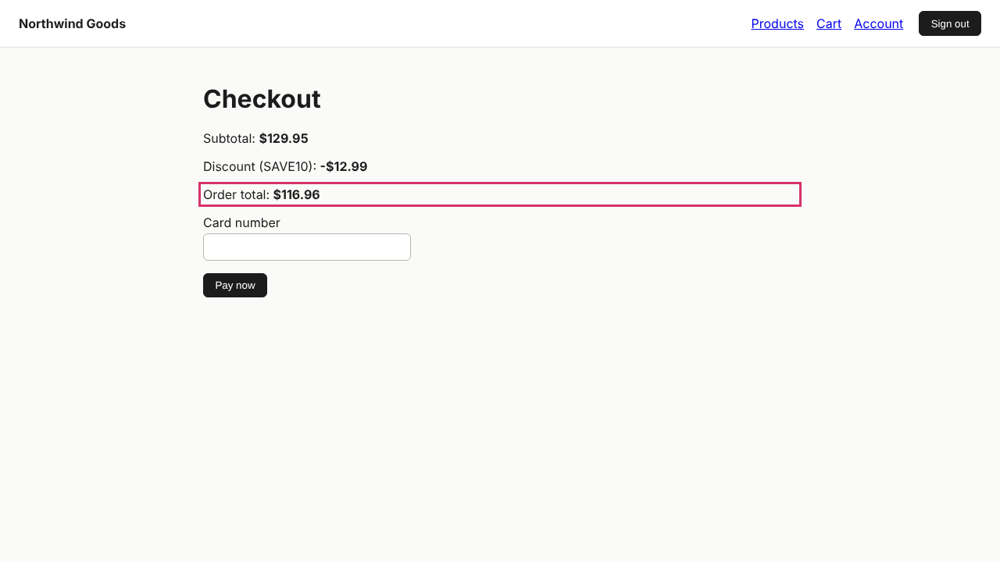
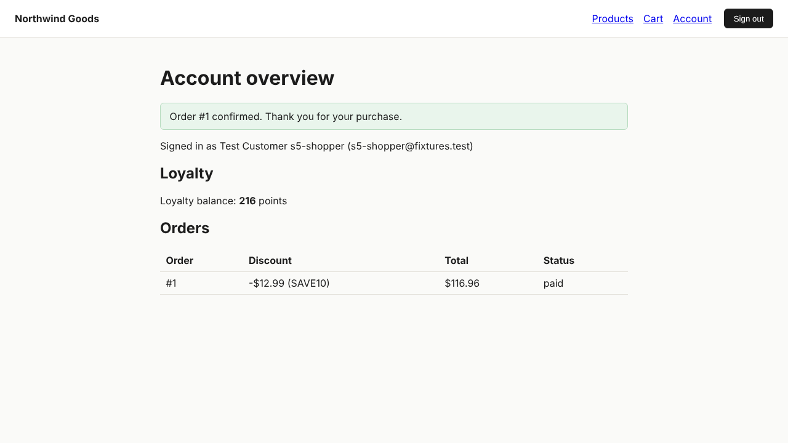
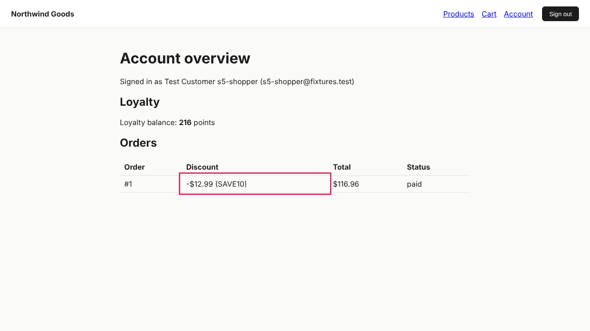
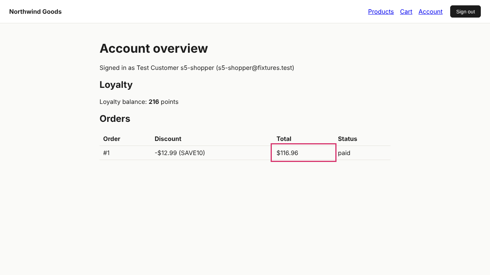
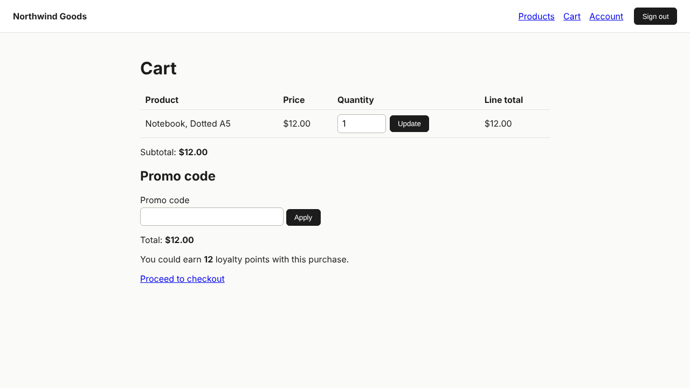
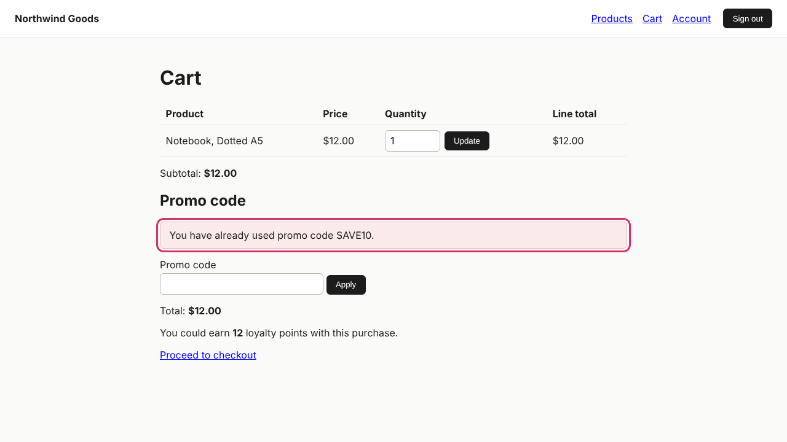
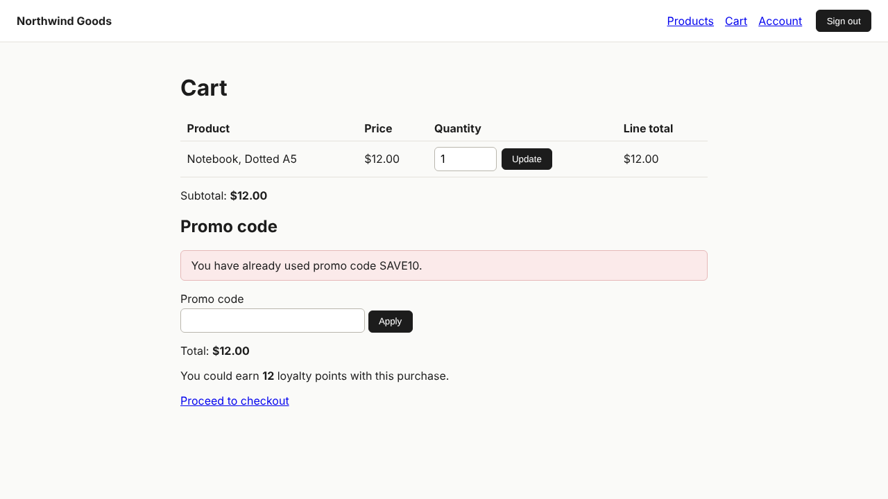

# S5 Paying with SAVE10: checkout matches cart, order records discount, code cleared and then refused

**Verdict: PASSED** — All 13 assertions matched.

- Steps chosen by: external model via HTTP bridge
- Environment: http://localhost:3000, commit 608909953f5ee06a34141dcbeea03fffc4bae337
- Started 2026-11-18T19:04:16.841Z, took 115.0 s, 49 tool calls
- Basis: requirement; requirements R11, R12, R19, R20, R21, R24, R25, R28, R29, R8

## Objective

Sign in as the customer. Add one Wool Throw Blanket ($129.95) to the cart, open the cart page and apply SAVE10. Record the cart page's Discount (cartDiscount) and Total (cartTotal) in dollars. Go to checkout and record the checkout page's discount (checkoutDiscount) and Order total (checkoutTotal) in dollars. Pay with card number 4242 4242 4242 4242. Then call GET /api/account and, for the single order, record totalCents (orderTotal) and discountCents (orderDiscount) and check promoCode. Open the account overview and record that order's discount (accountDiscount) and total charged (accountTotal) in dollars. Then add one Notebook, Dotted A5 to the cart and call GET /api/cart, recording subtotalCents (newSubtotal), discountCents (newDiscount) and totalCents (newTotal). Finally, on the cart page apply 'save10' in lower case and record the error message shown, then call GET /api/cart again and record discountCents (retryDiscount).

## Assertions

Expected values were fixed in the plan; actual values were read and compared in code.

| Id | What | Expected (plan) | Expected (evaluated) | Actual | Result | Evidence |
|---|---|---|---|---|---|---|
| A1 | The checkout page's discount (checkoutDiscount) equals the cart page's Discount (cartDiscount) recorded just before. | `cartDiscount` | 12.99 | 12.99 | match | [check-A1.png](check-A1.png) |
| A2 | The checkout page's Order total (checkoutTotal) equals the cart page's discounted Total (cartTotal). | `cartTotal` | 116.96 | 116.96 | match | [check-A2.png](check-A2.png) |
| A3 | The checkout page's Order total (checkoutTotal) equals 116.96: $129.95 minus 10% rounded down to the cent ($12.99). | `116.96` | 116.96 | 116.96 | match | [check-A3.png](check-A3.png) |
| A4 | After payment, the order's totalCents in GET /api/account (orderTotal) equals 11696, the discounted total that was charged. | `11696` | 11696 | 11696 | match | [check-A4.png](check-A4.png) |
| A5 | After payment, the order's discountCents in GET /api/account (orderDiscount) equals 1299. | `1299` | 1299 | 1299 | match | [check-A5.png](check-A5.png) |
| A6 | After payment, the order's promoCode in GET /api/account equals SAVE10. | `SAVE10` | SAVE10 | SAVE10 | match | [check-A6.png](check-A6.png) |
| A7 | After payment, the order's totalCents (orderTotal) equals checkoutTotal * 100 (the amount charged equals the checkout Order total). | `round(checkoutTotal * 100)` | 11696 | 11696 | match | [check-A7.png](check-A7.png) |
| A8 | On the account overview, the order's discount (accountDiscount, dollars) equals 12.99. | `12.99` | 12.99 | 12.99 | match | [check-A8.png](check-A8.png) |
| A9 | On the account overview, the order's total charged (accountTotal, dollars) equals 116.96. | `116.96` | 116.96 | 116.96 | match | [check-A9.png](check-A9.png) |
| A10 | After the successful payment and adding a Notebook, discountCents from GET /api/cart (newDiscount) is 0: the code was cleared from the cart. | `0` | 0 | 0 | match | [check-A10.png](check-A10.png) |
| A11 | After the successful payment and adding a Notebook, totalCents from GET /api/cart (newTotal) equals subtotalCents (newSubtotal). | `newSubtotal` | 1200 | 1200 | match | [check-A11.png](check-A11.png) |
| A12 | After applying 'save10' again (lower case), the error message shown on the cart page contains 'You have already used promo code'. | `You have already used promo code` | You have already used promo code | You have already used promo code SAVE10. | match | [check-A12.png](check-A12.png) |
| A13 | After the refused re-apply of save10, discountCents from GET /api/cart (retryDiscount) is 0 (the used code was not applied). | `0` | 0 | 0 | match | [check-A13.png](check-A13.png) |

## Observations

- `cartDiscount` = 12.99
- `cartTotal` = 116.96
- `checkoutDiscount` = 12.99
- `checkoutTotal` = 116.96
- `orderTotal` = 11696
- `orderDiscount` = 1299
- `accountDiscount` = 12.99
- `accountTotal` = 116.96
- `newSubtotal` = 1200
- `newDiscount` = 0
- `newTotal` = 1200
- `retryDiscount` = 0

## Steps

| # | Tool | Input | Outcome | Stated reason |
|---|---|---|---|---|
| 1 | navigate | {"path":"/"} | URL: / | Find the sign-in entry point. |
| 2 | navigate | {"path":"/login"} | URL: /login | Sign in as the customer. |
| 3 | fill | {"element":{"by":"label","value":"Email"},"text":"s5-shopper@fixtures.test"} | URL: /login | Enter shopper email. |
| 4 | fill | {"element":{"by":"label","value":"Password"},"text":"{{secret:shopper.password}}"} | URL: /login | Enter shopper password. |
| 5 | click | {"element":{"by":"role","role":"button","value":"Sign in"}} | URL: /account | Submit sign-in. |
| 6 | navigate | {"path":"/"} | URL: / | Go to products list. |
| 7 | click | {"element":{"by":"role","role":"button","value":"Add Wool Throw Blanket to cart"}} | URL: /cart | Add one blanket. |
| 8 | navigate | {"path":"/cart"} | URL: /cart | Open cart page to apply promo. |
| 9 | fill | {"element":{"by":"label","value":"Promo code"},"text":"SAVE10"} | URL: /cart | Enter SAVE10. |
| 10 | click | {"element":{"by":"role","role":"button","value":"Apply"}} | URL: /cart | Apply SAVE10. |
| 11 | observe | {"name":"cartDiscount","target":{"source":"page","by":"text","value":"Discount (SAVE10):","count":false,"pattern":"\\$([0-9]+\\.[0-9]{2})"}} | Recorded cartDiscount = 12.99 | Record cart discount in dollars. |
| 12 | observe | {"name":"cartTotal","target":{"source":"page","by":"text","value":"Total:","count":false,"pattern":"^\\s*Total:\\s*\\$([0-9]+\\.[0-9]{2})"}} | error: Error: Expected exactly one element for {"source":"page","by":"text","value":"Total:","count":false,"pattern":"^\\s*Total:\\s*\\$([0-9]+\\.[0-9]{2})"}, found 2. | Record cart total in dollars. |
| 13 | observe | {"name":"cartTotal","target":{"source":"page","by":"text","value":"Total: $116.96","count":false,"pattern":"\\$([0-9]+\\.[0-9]{2})"}} | Recorded cartTotal = 116.96 | Record cart total in dollars. |
| 14 | click | {"element":{"by":"role","role":"link","value":"Proceed to checkout"}} | URL: /checkout | Go to checkout. |
| 15 | observe | {"name":"checkoutDiscount","target":{"source":"page","by":"text","value":"Discount (SAVE10):","count":false,"pattern":"\\$([0-9]+\\.[0-9]{2})"}} | Recorded checkoutDiscount = 12.99 | Record checkout discount. |
| 16 | observe | {"name":"checkoutTotal","target":{"source":"page","by":"text","value":"Order total:","count":false,"pattern":"\\$([0-9]+\\.[0-9]{2})"}} | Recorded checkoutTotal = 116.96 | Record checkout order total. |
| 17 | check | {"assertionId":"A1","target":{"source":"page","by":"text","value":"Discount (SAVE10):","count":false,"pattern":"\\$([0-9]+\\.[0-9]{2})"}} | Recorded A1: expected 12.99, actual 12.99 -> match. This result is final. | Checkout discount vs cart discount. |
| 18 | check | {"assertionId":"A2","target":{"source":"page","by":"text","value":"Order total:","count":false,"pattern":"\\$([0-9]+\\.[0-9]{2})"}} | Recorded A2: expected 116.96, actual 116.96 -> match. This result is final. | Checkout total vs cart total. |
| 19 | check | {"assertionId":"A3","target":{"source":"page","by":"text","value":"Order total:","count":false,"pattern":"\\$([0-9]+\\.[0-9]{2})"}} | Recorded A3: expected 116.96, actual 116.96 -> match. This result is final. | Checkout total equals 116.96. |
| 20 | fill | {"element":{"by":"label","value":"Card number"},"text":"4242 4242 4242 4242"} | URL: /checkout | Enter accepted card. |
| 21 | click | {"element":{"by":"role","role":"button","value":"Pay now"}} | URL: /account?order=1 | Pay. |
| 22 | api_request | {"method":"GET","path":"/api/account"} | {"responseId":"R1","status":200,"body":{"customer":{"id":8,"email":"s5-shopper@fixtures.test","name":"Test Customer s5-shopper"},"balance":216,"transactions":[{"id":1,"orderId":1,"points":116,"reason":"purchase"},{"id":2,"orderId":1,"points":100,"reason":"welcome"}],"orders":[{"id":1,"totalCents":11 | Read the recorded order. |
| 23 | observe | {"name":"orderTotal","target":{"source":"api","responseId":"R1","field":"body","jsonPath":"orders.0.totalCents","count":false}} | Recorded orderTotal = 11696 | Record order total. |
| 24 | observe | {"name":"orderDiscount","target":{"source":"api","responseId":"R1","field":"body","jsonPath":"orders.0.discountCents","count":false}} | Recorded orderDiscount = 1299 | Record order discount. |
| 25 | check | {"assertionId":"A4","target":{"source":"api","responseId":"R1","field":"body","jsonPath":"orders.0.totalCents","count":false}} | Recorded A4: expected 11696, actual 11696 -> match. This result is final. | Order total cents. |
| 26 | check | {"assertionId":"A5","target":{"source":"api","responseId":"R1","field":"body","jsonPath":"orders.0.discountCents","count":false}} | Recorded A5: expected 1299, actual 1299 -> match. This result is final. | Order discount cents. |
| 27 | check | {"assertionId":"A6","target":{"source":"api","responseId":"R1","field":"body","jsonPath":"orders.0.promoCode","count":false}} | Recorded A6: expected SAVE10, actual SAVE10 -> match. This result is final. | Order promo code. |
| 28 | check | {"assertionId":"A7","target":{"source":"api","responseId":"R1","field":"body","jsonPath":"orders.0.totalCents","count":false}} | Recorded A7: expected 11696, actual 11696 -> match. This result is final. | Charged equals checkout total. |
| 29 | navigate | {"path":"/account"} | URL: /account | Open account overview. |
| 30 | observe | {"name":"accountDiscount","target":{"source":"page","by":"role","role":"cell","value":"-$12.99 (SAVE10)","count":false,"pattern":"\\$([0-9]+\\.[0-9]{2})"}} | Recorded accountDiscount = 12.99 | Record account order discount. |
| 31 | observe | {"name":"accountTotal","target":{"source":"page","by":"role","role":"cell","value":"$116.96","count":false,"pattern":"\\$([0-9]+\\.[0-9]{2})"}} | Recorded accountTotal = 116.96 | Record account order total. |
| 32 | check | {"assertionId":"A8","target":{"source":"page","by":"role","role":"cell","value":"-$12.99 (SAVE10)","count":false,"pattern":"\\$([0-9]+\\.[0-9]{2})"}} | Recorded A8: expected 12.99, actual 12.99 -> match. This result is final. | Account discount. |
| 33 | check | {"assertionId":"A9","target":{"source":"page","by":"role","role":"cell","value":"$116.96","count":false,"pattern":"\\$([0-9]+\\.[0-9]{2})"}} | Recorded A9: expected 116.96, actual 116.96 -> match. This result is final. | Account total charged. |
| 34 | navigate | {"path":"/"} | URL: / | Products list. |
| 35 | click | {"element":{"by":"role","role":"button","value":"Add Notebook, Dotted A5 to cart"}} | URL: /cart | Add one notebook. |
| 36 | api_request | {"method":"GET","path":"/api/cart"} | {"responseId":"R2","status":200,"body":{"lines":[{"productId":3,"name":"Notebook, Dotted A5","priceCents":1200,"quantity":1,"lineCents":1200}],"subtotalCents":1200,"promoCode":null,"discountCents":0,"totalCents":1200}} | Read cart after purchase. |
| 37 | observe | {"name":"newSubtotal","target":{"source":"api","responseId":"R2","field":"body","jsonPath":"subtotalCents","count":false}} | Recorded newSubtotal = 1200 | Record cart value. |
| 38 | observe | {"name":"newDiscount","target":{"source":"api","responseId":"R2","field":"body","jsonPath":"discountCents","count":false}} | Recorded newDiscount = 0 | Record cart value. |
| 39 | observe | {"name":"newTotal","target":{"source":"api","responseId":"R2","field":"body","jsonPath":"totalCents","count":false}} | Recorded newTotal = 1200 | Record cart value. |
| 40 | check | {"assertionId":"A10","target":{"source":"api","responseId":"R2","field":"body","jsonPath":"discountCents","count":false}} | Recorded A10: expected 0, actual 0 -> match. This result is final. | Code cleared. |
| 41 | check | {"assertionId":"A11","target":{"source":"api","responseId":"R2","field":"body","jsonPath":"totalCents","count":false}} | Recorded A11: expected 1200, actual 1200 -> match. This result is final. | Total equals subtotal. |
| 42 | navigate | {"path":"/cart"} | URL: /cart | Open cart page. |
| 43 | fill | {"element":{"by":"label","value":"Promo code"},"text":"save10"} | URL: /cart | Enter lower-case code. |
| 44 | click | {"element":{"by":"role","role":"button","value":"Apply"}} | URL: /cart?promo=used&code=SAVE10 | Try to re-apply used code. |
| 45 | check | {"assertionId":"A12","target":{"source":"page","by":"text","value":"You have already used promo code","count":false}} | Recorded A12: expected You have already used promo code, actual You have already used promo code SAVE10. -> match. This result is final. | Error message on re-apply. |
| 46 | api_request | {"method":"GET","path":"/api/cart"} | {"responseId":"R3","status":200,"body":{"lines":[{"productId":3,"name":"Notebook, Dotted A5","priceCents":1200,"quantity":1,"lineCents":1200}],"subtotalCents":1200,"promoCode":null,"discountCents":0,"totalCents":1200}} | Confirm code not applied. |
| 47 | observe | {"name":"retryDiscount","target":{"source":"api","responseId":"R3","field":"body","jsonPath":"discountCents","count":false}} | Recorded retryDiscount = 0 | Record retry discount. |
| 48 | check | {"assertionId":"A13","target":{"source":"api","responseId":"R3","field":"body","jsonPath":"discountCents","count":false}} | Recorded A13: expected 0, actual 0 -> match. This result is final. | Used code not applied. |
| 49 | finish | {"outcome":"completed","reason":"All 13 assertions checked."} | Scenario ended. | Every assertion has been checked. |

## Evidence

- Playwright trace: `trace.zip` (open with `npx playwright show-trace`)
- A1: 
- A2: 
- A3: 
- A4: 
- A5: 
- A6: 
- A7: 
- A8: 
- A9: 
- A10: 
- A11: 
- A12: 
- A13: 
