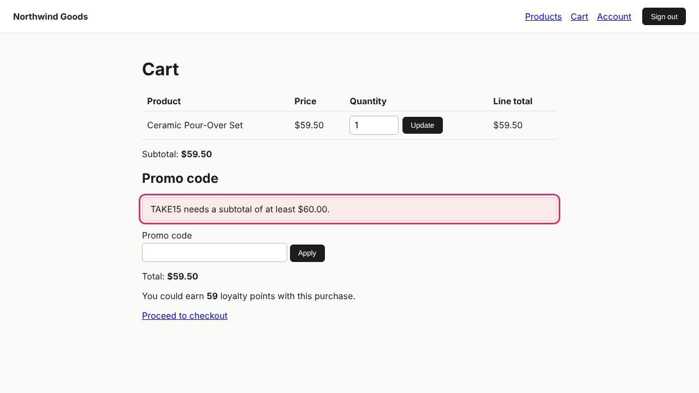
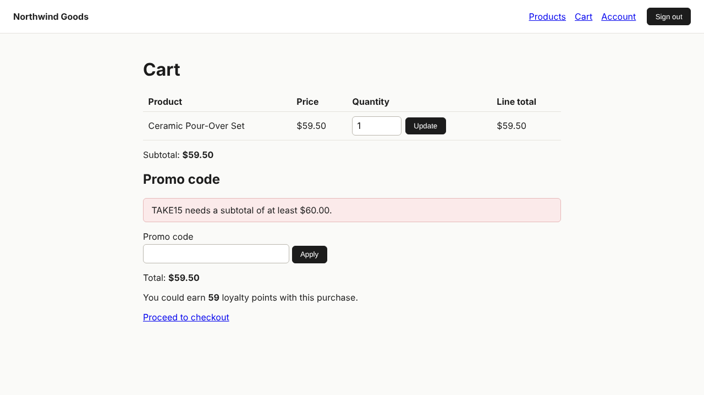
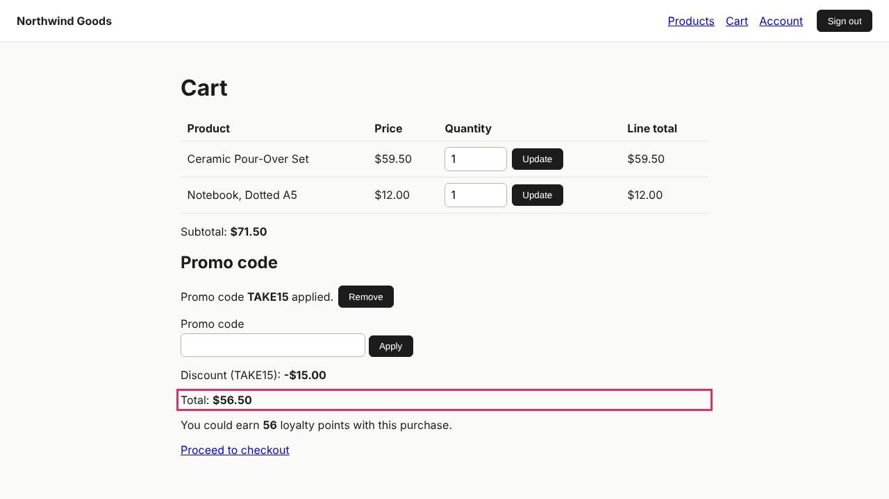
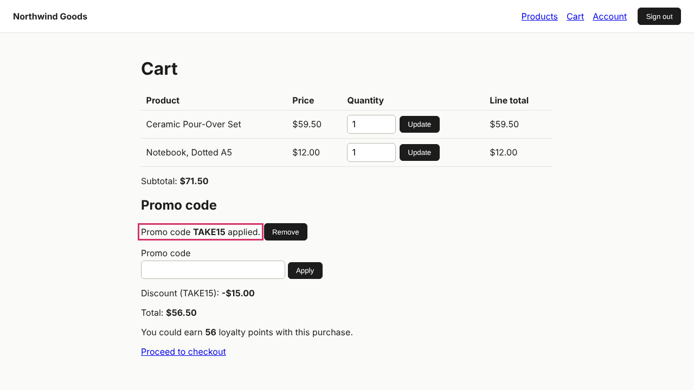
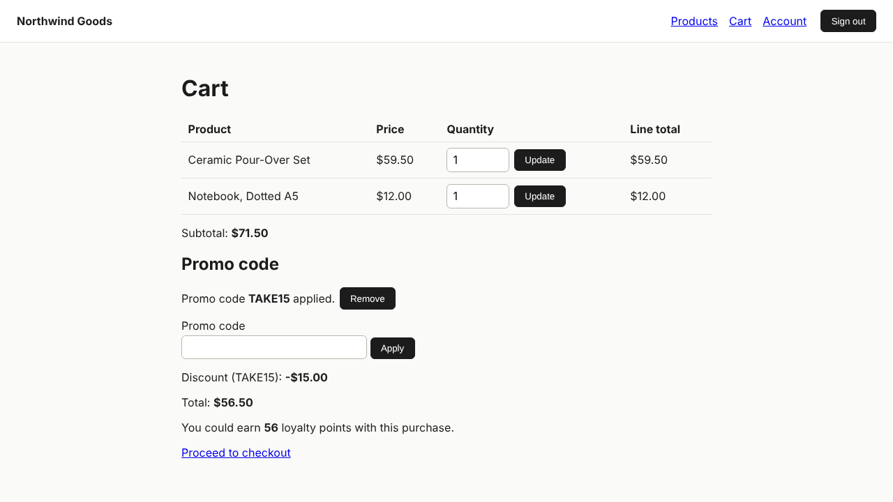

# S2 TAKE15 refused at $59.50 with an error naming $60.00, then accepted at $71.50

**Verdict: PASSED** — All 7 assertions matched.

- Steps chosen by: recording (no model)
- Environment: http://localhost:3000, commit 608909953f5ee06a34141dcbeea03fffc4bae337
- Started 2026-11-18T19:03:52.639Z, took 8.5 s, 32 tool calls
- Basis: requirement; requirements R4, R5, R15, R10

## Objective

Sign in as the customer. Add one Ceramic Pour-Over Set ($59.50) to the cart and open the cart page. Apply TAKE15. Record the error message shown. Then call GET /api/cart and record discountCents (belowDiscount), totalCents (belowTotal) and subtotalCents (belowSubtotal). Next add one Notebook, Dotted A5 ($12.00) so the subtotal is $71.50, return to the cart page and apply TAKE15 again. Record the cart page's Total in dollars (uiTotal) and Subtotal in dollars (uiSubtotal), and check that the applied code is shown. Call GET /api/cart and record subtotalCents (apiSubtotal), discountCents (apiDiscount) and totalCents (apiTotal).

## Assertions

Expected values were fixed in the plan; actual values were read and compared in code.

| Id | What | Expected (plan) | Expected (evaluated) | Actual | Result | Evidence |
|---|---|---|---|---|---|---|
| A1 | After applying TAKE15 to the $59.50 cart, the error message shown on the cart page contains $60.00 (the minimum). | `$60.00` | $60.00 | TAKE15 needs a subtotal of at least $60.00. | match | [check-A1.png](check-A1.png) |
| A2 | After the refused TAKE15 attempt on the $59.50 cart, discountCents from GET /api/cart (belowDiscount) is 0 (code not applied). | `0` | 0 | 0 | match | [check-A2.png](check-A2.png) |
| A3 | After the refused TAKE15 attempt, totalCents from GET /api/cart (belowTotal) equals subtotalCents (belowSubtotal). | `belowSubtotal` | 5950 | 5950 | match | [check-A3.png](check-A3.png) |
| A4 | After applying TAKE15 to the $71.50 cart, discountCents from GET /api/cart (apiDiscount) equals 1500. | `1500` | 1500 | 1500 | match | [check-A4.png](check-A4.png) |
| A5 | After applying TAKE15 to the $71.50 cart, totalCents from GET /api/cart (apiTotal) equals apiSubtotal minus 1500. | `apiSubtotal - 1500` | 5650 | 5650 | match | [check-A5.png](check-A5.png) |
| A6 | After applying TAKE15 to the $71.50 cart, the Total on the cart page (uiTotal, dollars) equals the displayed Subtotal minus 15.00. | `round((uiSubtotal - 15) * 100) / 100` | 56.5 | 56.5 | match | [check-A6.png](check-A6.png) |
| A7 | After applying TAKE15 to the $71.50 cart, the cart page's applied-code display contains TAKE15. | `TAKE15` | TAKE15 | Promo code TAKE15 applied. | match | [check-A7.png](check-A7.png) |

## Observations

- `belowDiscount` = 0
- `belowTotal` = 5950
- `belowSubtotal` = 5950
- `uiSubtotal` = 71.5
- `uiTotal` = 56.5
- `apiSubtotal` = 7150
- `apiDiscount` = 1500
- `apiTotal` = 5650

## Steps

| # | Tool | Input | Outcome | Stated reason |
|---|---|---|---|---|
| 1 | navigate | {"path":"/"} | URL: / | Discover the application entry page and sign-in link. |
| 2 | navigate | {"path":"/login"} | URL: /login | Sign in as the customer first. |
| 3 | fill | {"element":{"by":"label","value":"Email"},"text":"s2-shopper@fixtures.test"} | URL: /login | Enter shopper email. |
| 4 | fill | {"element":{"by":"label","value":"Password"},"text":"{{secret:shopper.password}}"} | URL: /login | Enter shopper password. |
| 5 | click | {"element":{"by":"role","role":"button","value":"Sign in"}} | URL: /account | Submit sign-in. |
| 6 | navigate | {"path":"/cart"} | URL: /cart | Confirm the cart starts empty before adding items. |
| 7 | navigate | {"path":"/"} | URL: / | Go to products to add the Pour-Over Set. |
| 8 | click | {"element":{"by":"role","role":"button","value":"Add Ceramic Pour-Over Set to cart"}} | URL: /cart | Add one Ceramic Pour-Over Set per scenario. |
| 9 | fill | {"element":{"by":"label","value":"Promo code"},"text":"TAKE15"} | URL: /cart | Enter TAKE15 on the $59.50 cart. |
| 10 | click | {"element":{"by":"role","role":"button","value":"Apply"}} | URL: /cart?promo=minimum&code=TAKE15 | Apply TAKE15 to see the refusal. |
| 11 | check | {"assertionId":"A1","target":{"source":"page","by":"text","value":"TAKE15 needs a subtotal","count":false}} | Recorded A1: expected $60.00, actual TAKE15 needs a subtotal of at least $60.00. -> match. This result is final. | The error alert is shown after the refused TAKE15 attempt. |
| 12 | api_request | {"method":"GET","path":"/api/cart"} | {"responseId":"R1","status":200,"body":{"lines":[{"productId":2,"name":"Ceramic Pour-Over Set","priceCents":5950,"quantity":1,"lineCents":5950}],"subtotalCents":5950,"promoCode":null,"discountCents":0,"totalCents":5950}} | Read cart amounts after the refused code. |
| 13 | observe | {"name":"belowDiscount","target":{"source":"api","responseId":"R1","field":"body","jsonPath":"discountCents","count":false}} | Recorded belowDiscount = 0 | Record discountCents after refused code. |
| 14 | observe | {"name":"belowTotal","target":{"source":"api","responseId":"R1","field":"body","jsonPath":"totalCents","count":false}} | Recorded belowTotal = 5950 | Record totalCents after refused code. |
| 15 | observe | {"name":"belowSubtotal","target":{"source":"api","responseId":"R1","field":"body","jsonPath":"subtotalCents","count":false}} | Recorded belowSubtotal = 5950 | Record subtotalCents after refused code. |
| 16 | check | {"assertionId":"A2","target":{"source":"api","responseId":"R1","field":"body","jsonPath":"discountCents","count":false}} | Recorded A2: expected 0, actual 0 -> match. This result is final. | Discount must be 0 after refusal. |
| 17 | check | {"assertionId":"A3","target":{"source":"api","responseId":"R1","field":"body","jsonPath":"totalCents","count":false}} | Recorded A3: expected 5950, actual 5950 -> match. This result is final. | Total must equal subtotal after refusal. |
| 18 | navigate | {"path":"/"} | URL: / | Go to products to add the Notebook. |
| 19 | click | {"element":{"by":"role","role":"button","value":"Add Notebook, Dotted A5 to cart"}} | URL: /cart | Add one Notebook to reach $71.50. |
| 20 | fill | {"element":{"by":"label","value":"Promo code"},"text":"TAKE15"} | URL: /cart | Enter TAKE15 on the $71.50 cart. |
| 21 | click | {"element":{"by":"role","role":"button","value":"Apply"}} | URL: /cart | Apply TAKE15 now that subtotal meets the minimum. |
| 22 | observe | {"name":"uiSubtotal","target":{"source":"page","by":"text","value":"Subtotal:","count":false,"pattern":"Subtotal:\\s*\\$([0-9.,]+)"}} | Recorded uiSubtotal = 71.5 | Record displayed subtotal after TAKE15 applied. |
| 23 | observe | {"name":"uiTotal","target":{"source":"page","by":"text","value":"Total: $56","count":false,"pattern":"Total:\\s*\\$([0-9.,]+)"}} | Recorded uiTotal = 56.5 | Record the displayed Total paragraph (not Subtotal) after TAKE15 applied. |
| 24 | check | {"assertionId":"A6","target":{"source":"page","by":"text","value":"Total: $56","count":false,"pattern":"Total:\\s*\\$([0-9.,]+)"}} | Recorded A6: expected 56.5, actual 56.5 -> match. This result is final. | Check displayed Total equals Subtotal minus 15. |
| 25 | check | {"assertionId":"A7","target":{"source":"page","by":"text","value":"TAKE15 applied","count":false}} | Recorded A7: expected TAKE15, actual Promo code TAKE15 applied. -> match. This result is final. | The applied-code display reads TAKE15 applied. |
| 26 | api_request | {"method":"GET","path":"/api/cart"} | {"responseId":"R2","status":200,"body":{"lines":[{"productId":2,"name":"Ceramic Pour-Over Set","priceCents":5950,"quantity":1,"lineCents":5950},{"productId":3,"name":"Notebook, Dotted A5","priceCents":1200,"quantity":1,"lineCents":1200}],"subtotalCents":7150,"promoCode":"TAKE15","discountCents":1500 | Read cart amounts after TAKE15 accepted. |
| 27 | observe | {"name":"apiSubtotal","target":{"source":"api","responseId":"R2","field":"body","jsonPath":"subtotalCents","count":false}} | Recorded apiSubtotal = 7150 | Record subtotalCents after TAKE15 accepted. |
| 28 | observe | {"name":"apiDiscount","target":{"source":"api","responseId":"R2","field":"body","jsonPath":"discountCents","count":false}} | Recorded apiDiscount = 1500 | Record discountCents after TAKE15 accepted. |
| 29 | observe | {"name":"apiTotal","target":{"source":"api","responseId":"R2","field":"body","jsonPath":"totalCents","count":false}} | Recorded apiTotal = 5650 | Record totalCents after TAKE15 accepted. |
| 30 | check | {"assertionId":"A4","target":{"source":"api","responseId":"R2","field":"body","jsonPath":"discountCents","count":false}} | Recorded A4: expected 1500, actual 1500 -> match. This result is final. | Discount should be 1500. |
| 31 | check | {"assertionId":"A5","target":{"source":"api","responseId":"R2","field":"body","jsonPath":"totalCents","count":false}} | Recorded A5: expected 5650, actual 5650 -> match. This result is final. | Total should be subtotal minus 1500. |
| 32 | finish | {"outcome":"completed","reason":"All assertions A1-A7 were checked at the states the scenario describes."} | Scenario ended. | Every planned assertion has been checked. |

## Evidence

- Playwright trace: `trace.zip` (open with `npx playwright show-trace`)
- A1: 
- A2: 
- A3: 
- A6: 
- A7: 
- A4: 
- A5: 
