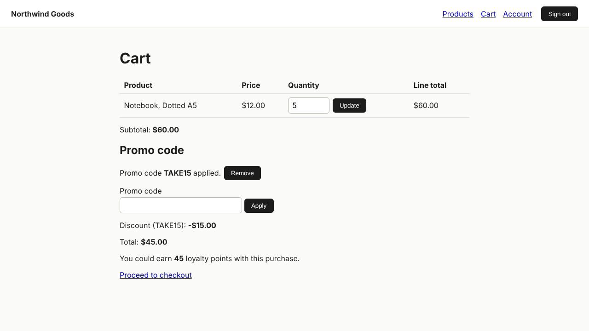

# S3 TAKE15 at exactly $60.00 applies; dropping the quantity below the minimum removes it

**Verdict: UNVERIFIED** — Not checked: A3, A4, A5. Replay diverged at observe {"name":"uiTotal","target":{"source":"page","by":"text","value":"Total: $33","count":false,"pattern":"Total:\\s*\\$([0-9.,]+)"},"rationale":"Record the displayed total after quantity change."}: Error: Expected exactly one element for {"source":"page","by":"text","value":"Total: $33","count":false,"pattern":"Total:\\s*\\$([0-9.,]+)"}, found 0.

- Steps chosen by: recording (no model)
- Environment: http://localhost:3000, commit 608909953f5ee06a34141dcbeea03fffc4bae337
- Started 2026-11-18T19:03:52.639Z, took 10.1 s, 22 tool calls
- Basis: risk; requirements R6, R7, R16, R4

## Objective

Sign in as the customer. Add Notebook, Dotted A5 ($12.00) to the cart with quantity 5 so the subtotal is exactly $60.00. On the cart page apply TAKE15. Call GET /api/cart and record subtotalCents (atSubtotal), discountCents (atDiscount) and totalCents (atTotal). Then, on the cart page, change the notebook quantity to 4 (subtotal $48.00). After the cart page has updated, record the displayed Subtotal (uiSubtotal) and Total (uiTotal) in dollars, then call GET /api/cart and record subtotalCents (afterSubtotal), discountCents (afterDiscount) and totalCents (afterTotal).

## Assertions

Expected values were fixed in the plan; actual values were read and compared in code.

| Id | What | Expected (plan) | Expected (evaluated) | Actual | Result | Evidence |
|---|---|---|---|---|---|---|
| A1 | With 5 notebooks (subtotal exactly $60.00) and TAKE15 applied, discountCents from GET /api/cart (atDiscount) equals 1500: exactly $60.00 qualifies. | `1500` | 1500 | 1500 | match | [check-A1.png](check-A1.png) |
| A2 | With 5 notebooks and TAKE15 applied, totalCents from GET /api/cart (atTotal) equals atSubtotal minus 1500 (the code stays applied even though the discounted total is below $60.00, since the minimum is checked before discount). | `atSubtotal - 1500` | 4500 | 4500 | match | [check-A2.png](check-A2.png) |
| A3 | After changing the quantity to 4 (subtotal $48.00), discountCents from GET /api/cart (afterDiscount) is 0. | `0` |  |  | not checked |  |
| A4 | After changing the quantity to 4, totalCents from GET /api/cart (afterTotal) equals subtotalCents (afterSubtotal). | `afterSubtotal` |  |  | not checked |  |
| A5 | After changing the quantity to 4, the Total shown on the cart page (uiTotal, dollars) equals the displayed Subtotal (uiSubtotal). | `uiSubtotal` |  |  | not checked |  |

## Observations

- `atSubtotal` = 6000
- `atDiscount` = 1500
- `atTotal` = 4500
- `uiSubtotal` = 48

## Steps

| # | Tool | Input | Outcome | Stated reason |
|---|---|---|---|---|
| 1 | navigate | {"path":"/"} | URL: / | See the landing page to find sign-in. |
| 2 | navigate | {"path":"/login"} | URL: /login | Open the sign-in page to log in as the customer. |
| 3 | fill | {"element":{"by":"role","role":"textbox","value":"Email"},"text":"s3-shopper@fixtures.test"} | URL: /login | Enter the shopper email. |
| 4 | fill | {"element":{"by":"role","role":"textbox","value":"Password"},"text":"{{secret:shopper.password}}"} | URL: /login | Enter the shopper password. |
| 5 | click | {"element":{"by":"role","role":"button","value":"Sign in"}} | URL: /account | Submit the sign-in form. |
| 6 | navigate | {"path":"/cart"} | URL: /cart | Check the cart starts empty. |
| 7 | navigate | {"path":"/"} | URL: / | Go to products to add the notebook. |
| 8 | click | {"element":{"by":"role","role":"button","value":"Add Notebook, Dotted A5 to cart"}} | URL: /cart | Add the notebook to the cart. |
| 9 | fill | {"element":{"by":"role","role":"spinbutton","value":"Quantity for Notebook, Dotted A5"},"text":"5"} | URL: /cart | Set quantity to 5 for a $60.00 subtotal. |
| 10 | click | {"element":{"by":"role","role":"button","value":"Update quantity for Notebook, Dotted A5"}} | URL: /cart | Save the quantity of 5. |
| 11 | fill | {"element":{"by":"role","role":"textbox","value":"Promo code"},"text":"TAKE15"} | URL: /cart | Enter the TAKE15 promo code. |
| 12 | click | {"element":{"by":"role","role":"button","value":"Apply"}} | URL: /cart | Apply TAKE15 at a $60.00 subtotal. |
| 13 | api_request | {"method":"GET","path":"/api/cart"} | {"responseId":"R1","status":200,"body":{"lines":[{"productId":3,"name":"Notebook, Dotted A5","priceCents":1200,"quantity":5,"lineCents":6000}],"subtotalCents":6000,"promoCode":"TAKE15","discountCents":1500,"totalCents":4500}} | Read cart totals with 5 notebooks and TAKE15 applied. |
| 14 | observe | {"name":"atSubtotal","target":{"source":"api","responseId":"R1","field":"body","jsonPath":"subtotalCents","count":false}} | Recorded atSubtotal = 6000 | Record subtotalCents at the $60 subtotal with TAKE15. |
| 15 | observe | {"name":"atDiscount","target":{"source":"api","responseId":"R1","field":"body","jsonPath":"discountCents","count":false}} | Recorded atDiscount = 1500 | Record discountCents at the $60 subtotal with TAKE15. |
| 16 | observe | {"name":"atTotal","target":{"source":"api","responseId":"R1","field":"body","jsonPath":"totalCents","count":false}} | Recorded atTotal = 4500 | Record totalCents at the $60 subtotal with TAKE15. |
| 17 | check | {"assertionId":"A1","target":{"source":"api","responseId":"R1","field":"body","jsonPath":"discountCents","count":false}} | Recorded A1: expected 1500, actual 1500 -> match. This result is final. | Check discount at exactly $60. |
| 18 | check | {"assertionId":"A2","target":{"source":"api","responseId":"R1","field":"body","jsonPath":"totalCents","count":false}} | Recorded A2: expected 4500, actual 4500 -> match. This result is final. | Check total at exactly $60 with TAKE15. |
| 19 | fill | {"element":{"by":"role","role":"spinbutton","value":"Quantity for Notebook, Dotted A5"},"text":"4"} | URL: /cart | Drop quantity to 4 for a $48.00 subtotal. |
| 20 | click | {"element":{"by":"role","role":"button","value":"Update quantity for Notebook, Dotted A5"}} | URL: /cart | Save the quantity of 4. |
| 21 | observe | {"name":"uiSubtotal","target":{"source":"page","by":"text","value":"Subtotal:","count":false,"pattern":"Subtotal:\\s*\\$([0-9.,]+)"}} | Recorded uiSubtotal = 48 | Record the displayed subtotal after quantity change. |
| 22 | observe | {"name":"uiTotal","target":{"source":"page","by":"text","value":"Total: $33","count":false,"pattern":"Total:\\s*\\$([0-9.,]+)"}} | error: Error: Expected exactly one element for {"source":"page","by":"text","value":"Total: $33","count":false,"pattern":"Total:\\s*\\$([0-9.,]+)"}, found 0. | Record the displayed total after quantity change. |

## Evidence

- Playwright trace: `trace.zip` (open with `npx playwright show-trace`)
- A1: 
- A2: 
